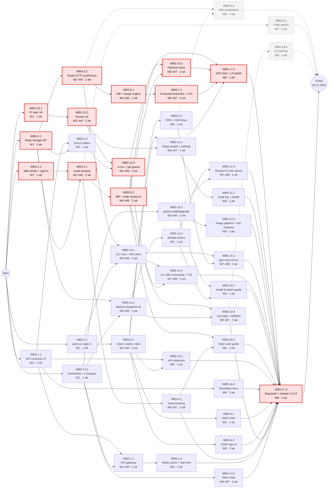
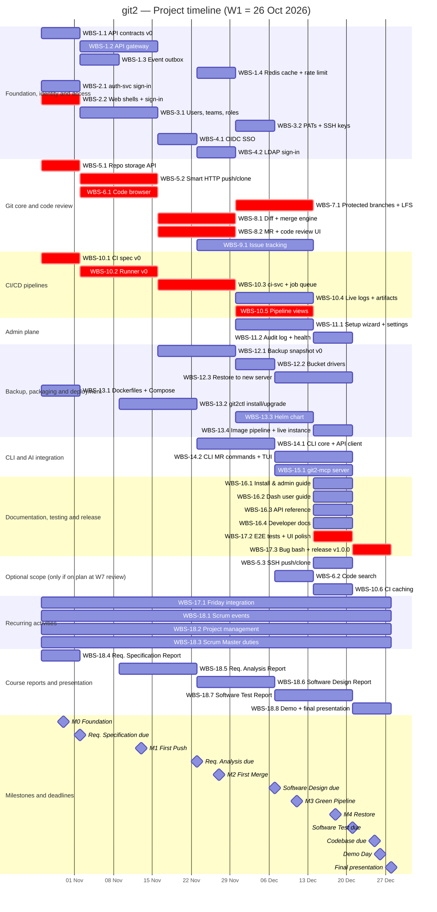

# Software Engineering — Project Plan

## Cover Page

| Field | Details |
|---|---|
| **Course** | BLG411E — Software Engineering |
| **Report name** | Project Plan |
| **Project title** | git2 — A Self-Hosted Git Platform |
| **Group name / number** | feastLabs |
| **Group members** | Osman Yahya Akıncı — 150230106, Abdullah Akcan — 150220051, Bilge Bostanbaşı — 150230081, Ceyda Akın — 150220096, Zarif Beste Süner — 150220085 |
| **Instructor** | Tolga Ovatman, Ayşe Tosun Kühn |
| **Submission date** | 2026-10-19 |
| **Document version** | 1.0 |

---

## 1. Introduction

### 1.1 Scope

**Project overview:**  
Many organizations — banks, public institutions, defense and healthcare companies, universities, small and mid-sized software companies — must keep their source code on their own servers, but self-hosted GitLab is heavy to install, run and back up. **git2** is an open-source, self-hosted Git platform that a company can install with one command (`git2ctl install`) on a single container host or a Kubernetes cluster. It is built as Go microservices and has two planes: **Dash**, where software developers work with repositories, merge requests, issues and CI/CD pipelines, and **Admin**, where IT and system administrators manage users, single sign-on, runners, settings and backups. One encrypted backup to any S3-compatible bucket restores the whole instance on a new server with one command. A Python CLI (GitHub Desktop-style) and an MCP server let developers and AI coding agents use git2 from the terminal. Intended users: software developers, team leads and code reviewers, IT/system administrators, and AI coding agents connecting through MCP.

**In scope:**
- Repository hosting: create, browse and delete repositories; push and clone over HTTPS; branches, tags, protected branches, file and commit browser, Git LFS
- Merge requests and code review: diffs, inline comments, approvals, merge strategies, pipeline status on merge requests
- Issue tracking: issues, labels, milestones, assignees, mentions and in-app notifications
- CI/CD pipelines: `.git2-ci.yml` definitions, containerized jobs on self-hosted Linux runners, live job logs, artifacts
- Identity and access: user accounts, organizations and teams, role-based permissions, personal access tokens, SSH keys, OIDC single sign-on and LDAP
- Admin plane: first-run setup wizard, instance settings, user/team and runner management, health dashboard, audit log
- Backup and restore: scheduled, encrypted full-instance snapshots (database, repositories, `git2.yaml`, secrets) to S3-compatible storage or local disk; one-command restore to a fresh server
- Containerization and deployment: one Docker image per service, Docker Compose, Helm chart, `git2ctl` install/upgrade, and a live reference instance
- git2 CLI (Python terminal app) and git2-mcp (local MCP server for AI agents)
- Documentation: installation/administration guide, user guide, API reference, developer documentation

**Optional scope:**
- SSH push and clone (WBS-5.3) — HTTPS push/clone is in the baseline
- Code search (WBS-6.2)
- CI caching between jobs (WBS-10.6)

These three items are listed in the charter but are the first to drop if the team falls behind. They are scheduled in W7–W8 and are started only if the team is on plan at the W7 sprint review.

**Out of scope:**
- Multi-tenant SaaS hosting, public sign-up and billing
- High-availability Git storage clustering and geo-replication
- Built-in container, package and artifact registries (Docker, npm, Maven, PyPI)
- Wikis, static site hosting (Pages), kanban boards and time tracking
- Built-in AI features inside git2 (LLM code review, code generation, chat); AI access is only through MCP
- Security scanning (SAST, DAST, dependency and secret scanning)
- Importers from GitHub, GitLab or Bitbucket beyond plain git mirroring
- Windows and macOS CI runners (Linux container runners only)
- Native mobile apps and a graphical desktop client

**Assumptions and constraints:**
- **Time:** 9 one-week sprints, W1 = 26.10.2026 to W9 = 27.12.2026. Fixed course deadlines: Requirement Specification 02.11, Requirement Analysis 23.11, Software Design 07.12, Software Test 21.12, Codebase 25.12, Demo 26.12, Presentation 28.12 (all 23:59). The charter (05.10) and this plan (19.10) are done before W1.
- **Team:** 5 members, each ~15 h/week on the project (0.375 FTE, where 1 man-week = 40 h); up to 20 h (0.5 FTE) in peak weeks, never more than 135 h in total. Total capacity = 5 × 15 h × 9 weeks = **675 h = 16.88 man-weeks**.
- **AI agent:** Claude (Claude Code) is used by every member as an AI development assistant. It is not counted as a team member or as FTE; its effect is counted as reduced human effort (Section 3). Every AI-generated change is reviewed by a human before merge.
- **Technology:** Go microservices with gRPC inside and REST/OpenAPI 3 outside; PostgreSQL (primary database, transactional outbox for events) and Redis (sessions, caching, rate limiting, job queues, pub/sub for live logs and notifications); React + TypeScript web apps; Python for the CLI and MCP server; Docker, Compose and Helm. Redis holds no durable state, so it is not part of the backup.
- **Budget:** no paid labor. Real costs (demo VM, bucket, domain, Claude Code seats) are about $370 for the project and are paid by the team.
- **Process:** Scrum with one-week sprints; Friday integration check, sprint review and planning; every PR needs tests and one human review.

### 1.2 Deliverables

| Deliverable ID | Deliverable name | Description / contents | Acceptance criterion |
|---|---|---|---|
| D-01 | git2 core services and API | Go services gateway, auth-svc, git-svc, dash-api and admin-api; OpenAPI 3 and gRPC contracts; PostgreSQL schemas; Redis integration | All services build and pass CI; the public REST API matches the OpenAPI spec (contract tests pass); a standard `git` client can push, clone and merge through git2 |
| D-02 | Dash web application | React app for developers: repositories and code browsing, merge requests and code review, issues, pipeline views | The developer flow sign-in → push → open MR → review → pipeline → merge passes the Playwright E2E suite |
| D-03 | Admin web application | React app for IT: setup wizard, users and teams, SSO/LDAP, runners, instance settings, audit log, health dashboard | The admin flow (first admin, create team, connect OIDC and LDAP, register runner, read audit log) passes the E2E suite |
| D-04 | CI/CD system | ci-svc and git2-runner: `.git2-ci.yml` spec, pipeline scheduling, Redis job queue, container execution, live logs, artifacts | A push triggers a multi-stage pipeline whose jobs run in containers on a registered runner; logs stream live; artifacts are downloadable |
| D-05 | Backup and restore system | backup-svc and `git2ctl restore`: encrypted snapshots to S3-compatible storage or local disk | A snapshot restored on a **new** VM brings back all repositories, users, settings and secrets; the restore test passes |
| D-06 | Deployment package and live instance | Docker images (amd64/arm64) in GitHub Container Registry, Docker Compose file, Helm chart, `git2ctl`, public reference instance | `git2ctl install` works on a clean Linux host with Docker; the Helm chart installs on a k3d/kind cluster; the live instance is reachable over HTTPS on demo day |
| D-07 | git2 CLI | Python terminal app (Typer + Textual) with a shared API client, distributed with pipx | `pipx install` works; clone, status, stage, commit, branch, push/pull and MR commands work against the live instance |
| D-08 | git2-mcp server | Local MCP server (FastMCP) exposing 10 git2 tools to AI agents, with read-only mode | Claude Code connected through git2-mcp lists repositories, reads a file, opens an MR and reads pipeline status; write tools are refused in read-only mode |
| D-09 | Documentation | Installation and administration guide, Dash user guide, API reference, developer docs (README + CLAUDE.md per repository), and the project documentation set (requirements, analysis, design and test reports, demo and presentation) | A member outside the Platform lane installs git2 using only the guide; the API reference is served at `/api/docs`; all project reports are submitted on time |

### 1.3 Functional Requirements / Tasks

| Task ID | Functional requirement / task | Description | Related deliverable ID(s) |
|---|---|---|---|
| T-01 | Service foundation and API gateway | Shared API contracts; one HTTPS entry point that routes to all services, checks sign-in and serves both UIs; event delivery between services (outbox); Redis cache and rate limiting | D-01 |
| T-02 | Authentication and sessions | Users sign in once for both Dash and Admin; sessions are kept in Redis; services accept tokens issued by auth-svc | D-01, D-02, D-03 |
| T-03 | User, team and access management | Admins manage users, organizations, teams and roles; users manage personal access tokens and SSH keys; permissions are enforced on every API call | D-01, D-03 |
| T-04 | Single sign-on | Users sign in through an OIDC provider or LDAP directory; LDAP groups map to git2 teams | D-01, D-03 |
| T-05 | Repository hosting and Git transport | Create and delete repositories; push and clone over HTTPS (and SSH, optional) with a standard `git` client | D-01 |
| T-06 | Code browsing and search | Browse files, branches and commits with syntax highlighting; search code (optional) | D-02 |
| T-07 | Branch protection and Git LFS | Protect branches with push and merge rules; store large files with Git LFS | D-01, D-02 |
| T-08 | Merge requests and code review | Open merge requests, view diffs, comment inline, approve, and merge with a chosen strategy | D-01, D-02 |
| T-09 | Issue tracking | Create and manage issues with labels, milestones and assignees; @mentions create notifications | D-01, D-02 |
| T-10 | CI/CD pipelines | Pipelines defined in `.git2-ci.yml` run on every push; jobs run in containers on self-hosted runners; logs stream live; artifacts are stored; status shows on merge requests | D-04, D-02 |
| T-11 | Admin plane | First-run setup wizard, runner registration, instance settings, audit log and health dashboard | D-03 |
| T-12 | Backup and restore | Scheduled encrypted full-instance snapshots to a bucket or disk; one-command restore on a fresh server | D-05 |
| T-13 | Packaging and deployment | Container images, Docker Compose, Helm chart, `git2ctl` install and upgrade, automated image builds, live reference instance | D-06 |
| T-14 | git2 CLI | Terminal client that works like GitHub Desktop for everyday Git work and merge requests | D-07 |
| T-15 | AI agent integration (MCP) | MCP server that turns AI agent tool calls into authenticated git2 REST API calls, with a read-only mode | D-08 |
| T-16 | Documentation | Installation/admin guide, user guide, API reference and developer documentation | D-09 |
| T-17 | Integration, testing and release | Weekly whole-system integration, end-to-end tests, bug bash and the v1.0.0 release | D-01, D-02, D-03, D-04, D-05, D-06, D-07, D-08 |
| T-18 | Project management and project documentation | Scrum events, project management, Scrum Master duties, the four course reports, demo and final presentation | D-09 |

### 1.4 Non-functional Issues

| Quality attribute | Requirement / concern | How it will be assessed |
|---|---|---|
| Security | All APIs except health checks require authentication; role-based permissions checked server-side on every call; passwords hashed with Argon2id; PATs are scoped and revocable; TLS for all external traffic; backups encrypted with `age`; secrets never in Git; admin actions written to the audit log; CI jobs run unprivileged with resource limits on a separate runner VM | Authorization tests for every endpoint (allowed and denied roles); GitHub secret scanning on all repositories; OWASP ASVS Level 1 checklist (authentication, session, access control sections) during the W9 bug bash; check that a backup file cannot be read without the key |
| Performance | On the demo VM (4 vCPU / 8 GB) with 20 users and 50 repositories: p95 response time < 300 ms for page APIs; clone of a 100 MB repository over HTTPS < 2× the time of plain `git http-backend`; a queued CI job starts on an idle runner in < 5 s; live log lines appear in the browser < 2 s after the job prints them | k6 load-test script run in W8 against the integration instance; timed clone benchmark; timestamps in runner and browser logs |
| Usability | `git2ctl install` finishes in < 10 minutes on a clean host; a new user can create a repository, push and open a merge request in < 10 minutes without help; Dash and Admin share one design system; keyboard navigation and WCAG 2.1 AA contrast | Install timed on a clean VM; hallway test with 3 people outside the team in W8; Lighthouse accessibility score ≥ 90 on main pages |
| Reliability | Services restart cleanly after a crash; events are delivered at least once (outbox); losing Redis loses no durable data (users sign in again, queued jobs re-created from PostgreSQL); a restore reproduces the instance exactly | Weekly restore test on a fresh VM from W5; fault test in W8 (kill Redis and one service during a pipeline, then check data and job recovery); outbox redelivery unit tests |
| Portability | Runs on amd64 and arm64; single host (Compose) and Kubernetes (Helm); any S3-compatible bucket or local disk | CI builds both architectures on tags; Helm install test on k3d/kind; bucket driver tests against Garage/SeaweedFS and local disk |
| Maintainability | Contract-first APIs; one CLAUDE.md per repository; lint and format checks; ≥ 60% unit-test coverage per Go service by W8 | CI gates (golangci-lint, ESLint, ruff, contract checks); coverage report in CI |

---

## 2. Project Plan — Work Breakdown Structure (WBS)

Size scale used for every activity (1 man-week = 40 h):

| Size | Effort range |
|---|---|
| **T** — Tiny | < 0.10 man-weeks (< 4 h) |
| **S** — Small | 0.10 – 0.20 man-weeks (4 – 8 h) |
| **M** — Medium | 0.20 – 0.40 man-weeks (8 – 16 h) |
| **L** — Large | 0.40 – 0.80 man-weeks (16 – 32 h) |
| **XL** — Extra-large | > 0.80 man-weeks (> 32 h) |

| WBS activity ID | Parent task ID | Activity / subtask | Description / completion condition | Size (T/S/M/L/XL) |
|---|---|---|---|---|
| WBS-1.1 | T-01 | API contracts v0 (OpenAPI 3 + gRPC proto) | First version of every public endpoint and service-to-service call is merged in `contracts/`; mock servers generated | M |
| WBS-1.2 | T-01 | API gateway: TLS, routing, sign-in check, serving both UIs | Both UIs and all APIs reachable through one HTTPS endpoint; unauthenticated API calls rejected | M |
| WBS-1.3 | T-01 | Event outbox and `repo.pushed` event | Events written in the same PostgreSQL transaction as the data and delivered at least once; covered by tests | S |
| WBS-1.4 | T-01 | Redis cache and rate-limiting middleware | Gateway limits requests per user/IP; hot API reads cached in Redis with expiry | T |
| WBS-2.1 | T-02 | auth-svc: sign-in, sessions in Redis, access tokens | Local accounts can sign in; session stored in Redis; tokens validated by the gateway | M |
| WBS-2.2 | T-02 | Dash and Admin web shells with shared sign-in page | Both apps build from one pnpm workspace with a shared UI kit; one sign-in works for both (M0 demo) | S |
| WBS-3.1 | T-03 | Users, teams and roles (admin-api + admin-web) | Admin can create, edit and disable users and teams and assign roles; permissions enforced by the API | M |
| WBS-3.2 | T-03 | Personal access tokens and SSH keys | Users create scoped PATs and add SSH keys; revoked tokens stop working immediately | S |
| WBS-4.1 | T-04 | OIDC single sign-on | Sign-in through an OIDC provider (Keycloak in tests) creates or links the user account | M |
| WBS-4.2 | T-04 | LDAP sign-in and group sync | Users sign in with LDAP credentials (OpenLDAP in tests); LDAP groups map to git2 teams | S |
| WBS-5.1 | T-05 | Repository storage and create/delete API | Repositories created and deleted through the API; bare repositories stored on disk | S |
| WBS-5.2 | T-05 | Smart HTTP push and clone | Standard `git` client clones and pushes over HTTPS with token auth; integration tests with real `git` pass (M1 demo) | M |
| WBS-5.3 | T-05 | SSH push and clone *(optional)* | `git clone ssh://…` and push work with keys from 3.2 | S |
| WBS-6.1 | T-06 | Repository and code browser | File tree, file view with Shiki highlighting, commit list and commit view work for any branch | M |
| WBS-6.2 | T-06 | Code search *(optional)* | Search across a repository's default branch returns matching files and lines | S |
| WBS-7.1 | T-07 | Protected branches and Git LFS | Pushes to protected branches are rejected unless rules allow; LFS objects upload and download | M |
| WBS-8.1 | T-08 | Diff and merge engine | Diff between branches and merge with merge-commit, squash and fast-forward strategies; conflicts reported | M |
| WBS-8.2 | T-08 | Merge request and inline code review UI | Users open an MR, see the diff, comment inline, approve and merge from the UI (M2 demo) | L |
| WBS-9.1 | T-09 | Issues, labels, milestones, mentions, notifications | Issues can be created, labeled, assigned and closed; @mentions create in-app notifications | M |
| WBS-10.1 | T-10 | `.git2-ci.yml` v0 specification | Spec for stages, jobs, images, scripts, artifacts and caches documented and validated by a JSON schema | S |
| WBS-10.2 | T-10 | Runner v0: jobs in containers via Docker Engine API | Runner registers, pulls a job, runs it in its own container and reports the exit status | M |
| WBS-10.3 | T-10 | ci-svc: pipeline model, Redis job queue, `repo.pushed` consumer | A push creates a pipeline; jobs are queued in Redis and picked up by runners in stage order | L |
| WBS-10.4 | T-10 | Live job logs (Redis pub/sub) and artifacts | Logs stream to the browser while a job runs; artifacts stored in object storage and downloadable | M |
| WBS-10.5 | T-10 | Pipeline views and pipeline status on merge requests | Pipeline list, pipeline graph and job log pages; MR shows the latest pipeline status (M3 demo) | M |
| WBS-10.6 | T-10 | CI caching *(optional)* | Cache paths declared in `.git2-ci.yml` are restored between jobs of the same branch | S |
| WBS-11.1 | T-11 | Setup wizard, runner and instance settings UI | First-run wizard creates the first admin; admins register runners and change instance settings | M |
| WBS-11.2 | T-11 | Audit log and health dashboard | Admin actions are recorded and searchable; dashboard shows service, PostgreSQL and Redis health | S |
| WBS-12.1 | T-12 | backup-svc v0: encrypted full-instance snapshot | Snapshot of database, repositories, `git2.yaml` and secrets in one `age`-encrypted archive with manifest and checksums | M |
| WBS-12.2 | T-12 | Bucket drivers (gocloud.dev/blob) | Snapshots written to and read from S3-compatible storage and local disk; scheduled nightly backups | S |
| WBS-12.3 | T-12 | One-command restore to a fresh server | `git2ctl restore` on a new VM brings back all repositories, users and settings; weekly restore test passes (M4 demo) | M |
| WBS-13.1 | T-13 | Dockerfiles and Docker Compose (with PostgreSQL and Redis) | `docker compose up` starts all services, PostgreSQL and Redis on one host (M0 demo) | S |
| WBS-13.2 | T-13 | `git2ctl` install and upgrade | `git2ctl install` brings up a working instance on a clean Linux host with Docker; `git2ctl upgrade` moves to a new version | M |
| WBS-13.3 | T-13 | Helm chart | Chart installs one Deployment per service on a k3d/kind cluster; services scale independently | M |
| WBS-13.4 | T-13 | Image pipeline (GitHub Actions → GHCR) and live reference instance | GitHub Actions publishes amd64/arm64 images on tags; public instance runs the latest release over HTTPS | S |
| WBS-14.1 | T-14 | Shared Python API client and core CLI commands | Client generated from OpenAPI; `git2` clone, status, stage, commit, branch, push and pull work against a live instance | M |
| WBS-14.2 | T-14 | Merge-request commands and Textual terminal UI | Open, list and review MRs from the CLI; GitHub Desktop-style TUI; package installs with pipx | S |
| WBS-15.1 | T-15 | git2-mcp server (FastMCP, 10 tools, read-only mode) | An MCP client (Claude Code) lists repositories, reads files, opens an MR and checks a pipeline through git2-mcp; write tools disabled in read-only mode | M |
| WBS-16.1 | T-16 | Installation and administration guide | Guide covers install (Compose, Helm), upgrade, SSO/LDAP, runners, backup and restore; a team member outside the lane installs git2 using only the guide | S |
| WBS-16.2 | T-16 | Dash user guide | Guide covers repositories, merge requests, issues and pipelines with screenshots | T |
| WBS-16.3 | T-16 | API reference | HTML reference generated from the OpenAPI spec and served by the gateway at `/api/docs` | T |
| WBS-16.4 | T-16 | Developer documentation (README and CLAUDE.md per repository) | Each repository has up-to-date build/test commands, architecture notes and AI-agent rules | S |
| WBS-17.1 | T-17 | Weekly integration check (every Friday) | Whole stack started from `main` with Compose; milestone smoke test recorded green/red | XL |
| WBS-17.2 | T-17 | End-to-end test suite (Playwright) and UI polish | E2E tests cover sign-in → push → MR → pipeline → merge and the Admin flows; all pass in CI | S |
| WBS-17.3 | T-17 | Bug bash and release v1.0.0 | All S1/S2 bugs fixed; `v1.0.0` tagged and deployed to the live instance (codebase deadline 25.12) | L |
| WBS-18.1 | T-18 | Scrum events (daily updates, sprint planning and review) | Held every week; board, burndown and next sprint tasks updated every Friday | XL |
| WBS-18.2 | T-18 | Project management (roadmap, status reports, change control) | Weekly status note and updated plan each Sunday | M |
| WBS-18.3 | T-18 | Scrum Master duties (process, risk review) | Risk register reviewed every Friday | M |
| WBS-18.4 | T-18 | Requirement Specification Report | Submitted by 02.11.2026 23:59; every lane owner has written their section | L |
| WBS-18.5 | T-18 | Requirement Analysis Report | Submitted by 23.11.2026 23:59; every lane owner has written their section | L |
| WBS-18.6 | T-18 | Software Design Report | Submitted by 07.12.2026 23:59; every lane owner has written their section | L |
| WBS-18.7 | T-18 | Software Test Report | Submitted by 21.12.2026 23:59; every lane owner has written their section | L |
| WBS-18.8 | T-18 | Demo day and final presentation | Live end-to-end demo on 26.12.2026; presentation delivered on 28.12.2026 | L |

**WBS decomposition notes:**
- **Decomposition by lane and milestone.** Each functional task (T-xx) was split into activities that one owner can finish within one or two one-week sprints and that end in something demonstrable (an API that passes tests, a UI flow, a working command). No development activity is longer than 3 weeks or larger than about 20 h, so progress is visible every Friday.
- **Owners follow the charter's lanes:** Pipelines and AI integration (Osman), Git core and CLI (Abdullah), Dash (Bilge), Platform and Backup (Ceyda), Admin and Identity (Zarif). Activities that touch everyone — contracts, developer docs, integration, bug bash, reports — are assigned to all members.
- **Contracts first.** WBS-1.1 (API contracts v0) is done by all owners in W1. After that, UI and service work in parallel against mock servers generated from the contracts, so a UI activity depends on its backend only where it truly needs the real behavior (for example, WBS-10.5 needs WBS-10.3).
- **Key dependencies:** Git transport (5.2) → merge engine (8.1) → branch protection/LFS (7.1); CI spec (10.1) → runner (10.2) → ci-svc (10.3) → logs (10.4) and pipeline views (10.5); backup snapshot (12.1) → bucket drivers (12.2) → restore (12.3); everything → E2E tests (17.2) → bug bash and release (17.3).
- **Recurring and fixed-date activities** (WBS-17.1, 18.1–18.8) are planned as level-of-effort work: their effort is counted in the estimates and in each member's availability, but their dates are fixed by the sprint calendar and course deadlines rather than by dependencies.
- **Optional activities** (WBS-5.3, 6.2, 10.6) are sized and scheduled but not counted in the baseline.

> **Course guideline note:** User stories for these subtasks will be written in the separate requirements document; this project plan defines and sizes the subtasks.

---

## 3. Estimates

| WBS activity ID | Size | Estimated effort (man-weeks) | Basis / assumptions |
|---|---|--:|---|
| WBS-1.1 | M | 0.40 | PERT 10/15/25 h → 15.8 h; AI leverage: Medium (team total, all 5 members) |
| WBS-1.2 | M | 0.29 | PERT 8/11/17 h → 11.5 h; AI leverage: Medium |
| WBS-1.3 | S | 0.11 | PERT 3/4/7 h → 4.3 h; AI leverage: Medium |
| WBS-1.4 | T | 0.08 | PERT 2/3/5 h → 3.2 h; AI leverage: Medium |
| WBS-2.1 | M | 0.20 | PERT 5/8/12 h → 8.2 h; AI leverage: Low |
| WBS-2.2 | S | 0.16 | PERT 4/6/10 h → 6.3 h; AI leverage: High |
| WBS-3.1 | M | 0.37 | PERT 10/14/22 h → 14.7 h; AI leverage: Medium |
| WBS-3.2 | S | 0.13 | PERT 3/5/8 h → 5.2 h; AI leverage: Low |
| WBS-4.1 | M | 0.23 | PERT 6/9/14 h → 9.3 h; AI leverage: Low |
| WBS-4.2 | S | 0.16 | PERT 4/6/10 h → 6.3 h; AI leverage: Low |
| WBS-5.1 | S | 0.16 | PERT 4/6/10 h → 6.3 h; AI leverage: Medium |
| WBS-5.2 | M | 0.39 | PERT 10/15/24 h → 15.7 h; AI leverage: Low |
| WBS-5.3 | S | 0.19 | PERT 5/7/12 h → 7.5 h; AI leverage: Low — **optional, not in baseline total** |
| WBS-6.1 | M | 0.37 | PERT 10/14/22 h → 14.7 h; AI leverage: High |
| WBS-6.2 | S | 0.13 | PERT 3/5/9 h → 5.3 h; AI leverage: High — **optional, not in baseline total** |
| WBS-7.1 | M | 0.29 | PERT 8/11/18 h → 11.7 h; AI leverage: Low |
| WBS-8.1 | M | 0.36 | PERT 9/14/22 h → 14.5 h; AI leverage: Low |
| WBS-8.2 | L | 0.47 | PERT 13/18/28 h → 18.8 h; AI leverage: High |
| WBS-9.1 | M | 0.34 | PERT 9/13/20 h → 13.5 h; AI leverage: High |
| WBS-10.1 | S | 0.13 | PERT 3/5/8 h → 5.2 h; AI leverage: Medium |
| WBS-10.2 | M | 0.34 | PERT 9/13/20 h → 13.5 h; AI leverage: Medium |
| WBS-10.3 | L | 0.44 | PERT 12/17/26 h → 17.7 h; AI leverage: Medium |
| WBS-10.4 | M | 0.26 | PERT 7/10/16 h → 10.5 h; AI leverage: Medium |
| WBS-10.5 | M | 0.21 | PERT 6/8/13 h → 8.5 h; AI leverage: High |
| WBS-10.6 | S | 0.13 | PERT 3/5/8 h → 5.2 h; AI leverage: Medium — **optional, not in baseline total** |
| WBS-11.1 | M | 0.23 | PERT 6/9/14 h → 9.3 h; AI leverage: High |
| WBS-11.2 | S | 0.18 | PERT 5/7/11 h → 7.3 h; AI leverage: High |
| WBS-12.1 | M | 0.34 | PERT 9/13/21 h → 13.7 h; AI leverage: Medium |
| WBS-12.2 | S | 0.13 | PERT 3/5/9 h → 5.3 h; AI leverage: Medium |
| WBS-12.3 | M | 0.29 | PERT 7/11/18 h → 11.5 h; AI leverage: Low |
| WBS-13.1 | S | 0.13 | PERT 3/5/8 h → 5.2 h; AI leverage: High |
| WBS-13.2 | M | 0.24 | PERT 6/9/15 h → 9.5 h; AI leverage: Medium |
| WBS-13.3 | M | 0.24 | PERT 6/9/15 h → 9.5 h; AI leverage: High |
| WBS-13.4 | S | 0.18 | PERT 4/7/12 h → 7.3 h; AI leverage: Medium |
| WBS-14.1 | M | 0.23 | PERT 6/9/14 h → 9.3 h; AI leverage: High |
| WBS-14.2 | S | 0.16 | PERT 4/6/10 h → 6.3 h; AI leverage: High |
| WBS-15.1 | M | 0.26 | PERT 7/10/15 h → 10.3 h; AI leverage: High |
| WBS-16.1 | S | 0.11 | PERT 3/4/6 h → 4.2 h; AI leverage: High |
| WBS-16.2 | T | 0.08 | PERT 2/3/5 h → 3.2 h; AI leverage: High |
| WBS-16.3 | T | 0.05 | PERT 1/2/3 h → 2.0 h; AI leverage: High |
| WBS-16.4 | S | 0.13 | PERT 3/5/8 h → 5.2 h; AI leverage: High (team total, all 5 members) |
| WBS-17.1 | XL | 1.12 | Fixed: 1 h per member per week × 9 weeks; no AI leverage |
| WBS-17.2 | S | 0.18 | PERT 4/7/11 h → 7.2 h; AI leverage: High |
| WBS-17.3 | L | 0.44 | PERT 14/17/24 h → 17.7 h; AI leverage: Medium (team total, all 5 members) |
| WBS-18.1 | XL | 2.25 | Fixed: 2 h per member per week × 9 weeks; no AI leverage |
| WBS-18.2 | M | 0.23 | Fixed: 1 h per week × 9 weeks; no AI leverage |
| WBS-18.3 | M | 0.23 | Fixed: 1 h per week × 9 weeks; no AI leverage |
| WBS-18.4 | L | 0.57 | Fixed: 4 h per member + 3 h for the editor; written by the team (no AI leverage counted) |
| WBS-18.5 | L | 0.57 | Fixed: 4 h per member + 3 h for the editor; written by the team (no AI leverage counted) |
| WBS-18.6 | L | 0.57 | Fixed: 4 h per member + 3 h for the editor; written by the team (no AI leverage counted) |
| WBS-18.7 | L | 0.57 | Fixed: 4 h per member + 3 h for the editor; written by the team (no AI leverage counted) |
| WBS-18.8 | L | 0.70 | Fixed: 5 h per member + 3 h for the editor; written by the team (no AI leverage counted) |
| **Total (baseline)** | — | **16.31** | **652.4 h** of 675 h capacity (16.88 man-weeks) |
| Optional scope (WBS-5.3, 6.2, 10.6) | — | 0.45 | 18.0 h, scheduled only if the team is on plan at the W7 review |
| Reserve | — | 0.57 | 22.6 h of capacity not planned |

**Estimation method:**
1. **Size first.** For each WBS activity the owner picked a T/S/M/L/XL size by comparing it with the others in the same lane.
2. **Three-point (PERT) estimate in hours.** The owner then gave an optimistic (O), most likely (M) and pessimistic (P) estimate, **assuming Claude Code is used**. Expected effort is **E = (O + 4M + P) / 6**. The size class was checked against E using the size table in Section 2, and corrected where they did not match.
3. **Conversion to man-weeks:** effort (man-weeks) = E / 40.
4. **Fixed activities** (Scrum events, integration checks, reports, demo) are estimated from their recurring cost per member, not with PERT.
5. **Re-estimation.** At the end of W1 we compare planned and actual hours (logged on the GitHub Projects board) and scale the remaining estimates by that ratio; this is repeated at every milestone.

**How the AI agent is taken into account.** Claude Code is not a team member and is not given FTE: it does not own activities, it works only when a member drives it, and its output must be reviewed. Its contribution is counted as **lower human effort**. Each activity has an AI-leverage class, and the estimate already includes the time to prompt Claude, review and fix its output:

| AI leverage | Effort factor vs. unassisted | Applied to | Activities | Planned effort (h) | Unassisted equivalent (h) |
|---|:-:|---|--:|--:|--:|
| High | 0.60 | UI pages, CRUD APIs, Dockerfiles/Helm templates, CLI, docs, tests | 17 | 140.8 | 234.7 |
| Medium | 0.75 | Service logic: gateway, ci-svc, runner, backup, outbox, contracts | 15 | 156.2 | 208.3 |
| Low | 0.90 | Protocol and security-critical code: Smart HTTP, SSH, merge engine, auth, SSO, restore | 8 | 82.4 | 91.6 |
| None | 1.00 | Meetings, integration checks, course reports | 9 | 273.0 | 273.0 |
| **Total** | | | **49** | **652.4** | **807.5** |

Without the AI agent, the same baseline would need about **807.5 h (20.19 man-weeks)**, which is more than the team's 675 h capacity. With Claude Code the plan needs **652.4 h (16.31 man-weeks)**, leaving **22.6 h (0.57 man-weeks)** of reserve. The AI agent therefore saves about **155.1 h (3.88 man-weeks)** and is what makes the scope fit; this dependence is recorded as a risk (R-06 and R-11 in Section 6). The factors are planning assumptions and will be checked against actual hours from W1.

**Effort versus duration.** Duration = effort ÷ allocation. For example, WBS-5.2 (Smart HTTP push/clone) needs 0.39 man-weeks; Abdullah works on it at 0.20 FTE (≈ 8 h/week) next to his other work, so it takes **2 weeks**. Because every member is only 0.375 FTE (15 h/week) on average, a 1-man-week activity done by one person would take almost 3 weeks; this is why activities were kept small and why lanes run in parallel. The AI agent shortens durations only through lower effort — it does not add parallel capacity — so all durations in Section 5 are computed from human FTE only.

---

## 4. Resources

### 4.1 Team Structure and Member Roles

The team uses a controlled decentralized structure: the Project Manager sets the roadmap and runs integration, the Scrum Master runs the process, and each lane owner decides how to build inside their lane. Every lane has a backup reviewer who reviews all of its pull requests (Osman ↔ Ceyda, Abdullah ↔ Bilge, Zarif → Bilge for admin-web and Abdullah for auth-svc/admin-api).

| Member | Student ID | Role(s) | Main responsibilities |
|---|---|---|---|
| Osman Yahya Akıncı | 150230106 | Product Owner, Project Manager, Pipelines Owner | Roadmap and scope decisions, weekly status, Friday integration; ci-svc, git2-runner, image pipeline and live instance, git2-mcp; editor of the demo and final presentation |
| Abdullah Akcan | 150220051 | Git Core Owner | git-svc (repository storage, HTTPS/SSH transport, diff and merge, branch protection, LFS), event outbox, git2 CLI; editor of the Software Design Report |
| Bilge Bostanbaşı | 150230081 | Dash Owner | dash-web and dash-api (code browsing, merge requests and review, issues, pipeline views), shared UI kit, E2E tests, user guide; editor of the Requirement Specification Report |
| Ceyda Akın | 150220096 | Platform & Backup Owner | gateway, Redis cache and rate limiting, Docker/Compose/Helm, `git2ctl`, backup-svc and restore, installation/admin guide; editor of the Software Test Report; tags releases |
| Zarif Beste Süner | 150220085 | Scrum Master, Admin & Identity Owner | Sprint process and risk review; auth-svc, admin-api and admin-web (users, teams, SSO/LDAP, tokens, settings, audit log), API reference; editor of the Requirement Analysis Report |
| Claude (AI agent) | — | AI Development Assistant | Used by every member through Claude Code to draft code, tests and documentation, guided by a CLAUDE.md file in each repository; never merges on its own; not counted as FTE |

### 4.2 Member-to-Activity Assignment

FTE is the share of a 40-hour week that the member spends on the activity while it runs: FTE = (hours ÷ 40) ÷ duration in weeks.

| WBS activity ID | Assigned member | Responsibility | Allocation to activity (FTE) |
|---|---|---|--:|
| WBS-1.1 | All five members (each) | Each owner writes the contracts of their own services | 0.08 each |
| WBS-1.2 | Ceyda Akın | Owner: design, implementation, tests | 0.14 |
| WBS-1.3 | Abdullah Akcan | Owner: design, implementation, tests | 0.11 |
| WBS-1.4 | Ceyda Akın | Owner: design, implementation, tests | 0.08 |
| WBS-2.1 | Zarif Beste Süner | Owner: design, implementation, tests | 0.20 |
| WBS-2.2 | Bilge Bostanbaşı | Owner: design, implementation, tests | 0.16 |
| WBS-2.2 | Claude (AI agent) | Drafts code, tests or text from the owner's instructions; every change reviewed by the owner and the backup reviewer | — (not counted as FTE) |
| WBS-3.1 | Zarif Beste Süner | Owner: design, implementation, tests | 0.18 |
| WBS-3.2 | Zarif Beste Süner | Owner: design, implementation, tests | 0.13 |
| WBS-4.1 | Zarif Beste Süner | Owner: design, implementation, tests | 0.23 |
| WBS-4.2 | Zarif Beste Süner | Owner: design, implementation, tests | 0.16 |
| WBS-5.1 | Abdullah Akcan | Owner: design, implementation, tests | 0.16 |
| WBS-5.2 | Abdullah Akcan | Owner: design, implementation, tests | 0.20 |
| WBS-5.3 | Abdullah Akcan | Owner: design, implementation, tests (optional) | 0.19 |
| WBS-6.1 | Bilge Bostanbaşı | Owner: design, implementation, tests | 0.18 |
| WBS-6.1 | Claude (AI agent) | Drafts code, tests or text from the owner's instructions; every change reviewed by the owner and the backup reviewer | — (not counted as FTE) |
| WBS-6.2 | Bilge Bostanbaşı | Owner: design, implementation, tests (optional) | 0.13 |
| WBS-7.1 | Abdullah Akcan | Owner: design, implementation, tests | 0.15 |
| WBS-8.1 | Abdullah Akcan | Owner: design, implementation, tests | 0.18 |
| WBS-8.2 | Bilge Bostanbaşı | Owner: design, implementation, tests | 0.24 |
| WBS-8.2 | Claude (AI agent) | Drafts code, tests or text from the owner's instructions; every change reviewed by the owner and the backup reviewer | — (not counted as FTE) |
| WBS-9.1 | Bilge Bostanbaşı | Owner: design, implementation, tests | 0.11 |
| WBS-9.1 | Claude (AI agent) | Drafts code, tests or text from the owner's instructions; every change reviewed by the owner and the backup reviewer | — (not counted as FTE) |
| WBS-10.1 | Osman Yahya Akıncı | Owner: design, implementation, tests | 0.13 |
| WBS-10.2 | Osman Yahya Akıncı | Owner: design, implementation, tests | 0.17 |
| WBS-10.3 | Osman Yahya Akıncı | Owner: design, implementation, tests | 0.22 |
| WBS-10.4 | Osman Yahya Akıncı | Owner: design, implementation, tests | 0.13 |
| WBS-10.5 | Bilge Bostanbaşı | Owner: design, implementation, tests | 0.11 |
| WBS-10.5 | Claude (AI agent) | Drafts code, tests or text from the owner's instructions; every change reviewed by the owner and the backup reviewer | — (not counted as FTE) |
| WBS-10.6 | Osman Yahya Akıncı | Owner: design, implementation, tests (optional) | 0.13 |
| WBS-11.1 | Zarif Beste Süner | Owner: design, implementation, tests | 0.12 |
| WBS-11.1 | Claude (AI agent) | Drafts code, tests or text from the owner's instructions; every change reviewed by the owner and the backup reviewer | — (not counted as FTE) |
| WBS-11.2 | Zarif Beste Süner | Owner: design, implementation, tests | 0.18 |
| WBS-11.2 | Claude (AI agent) | Drafts code, tests or text from the owner's instructions; every change reviewed by the owner and the backup reviewer | — (not counted as FTE) |
| WBS-12.1 | Ceyda Akın | Owner: design, implementation, tests | 0.17 |
| WBS-12.2 | Ceyda Akın | Owner: design, implementation, tests | 0.13 |
| WBS-12.3 | Ceyda Akın | Owner: design, implementation, tests | 0.14 |
| WBS-13.1 | Ceyda Akın | Owner: design, implementation, tests | 0.13 |
| WBS-13.1 | Claude (AI agent) | Drafts code, tests or text from the owner's instructions; every change reviewed by the owner and the backup reviewer | — (not counted as FTE) |
| WBS-13.2 | Ceyda Akın | Owner: design, implementation, tests | 0.12 |
| WBS-13.3 | Ceyda Akın | Owner: design, implementation, tests | 0.12 |
| WBS-13.3 | Claude (AI agent) | Drafts code, tests or text from the owner's instructions; every change reviewed by the owner and the backup reviewer | — (not counted as FTE) |
| WBS-13.4 | Osman Yahya Akıncı | Owner: design, implementation, tests | 0.18 |
| WBS-14.1 | Abdullah Akcan | Owner: design, implementation, tests | 0.12 |
| WBS-14.1 | Claude (AI agent) | Drafts code, tests or text from the owner's instructions; every change reviewed by the owner and the backup reviewer | — (not counted as FTE) |
| WBS-14.2 | Abdullah Akcan | Owner: design, implementation, tests | 0.08 |
| WBS-14.2 | Claude (AI agent) | Drafts code, tests or text from the owner's instructions; every change reviewed by the owner and the backup reviewer | — (not counted as FTE) |
| WBS-15.1 | Osman Yahya Akıncı | Owner: design, implementation, tests | 0.13 |
| WBS-15.1 | Claude (AI agent) | Drafts code, tests or text from the owner's instructions; every change reviewed by the owner and the backup reviewer | — (not counted as FTE) |
| WBS-16.1 | Ceyda Akın | Owner: design, implementation, tests | 0.11 |
| WBS-16.1 | Claude (AI agent) | Drafts code, tests or text from the owner's instructions; every change reviewed by the owner and the backup reviewer | — (not counted as FTE) |
| WBS-16.2 | Bilge Bostanbaşı | Owner: design, implementation, tests | 0.08 |
| WBS-16.2 | Claude (AI agent) | Drafts code, tests or text from the owner's instructions; every change reviewed by the owner and the backup reviewer | — (not counted as FTE) |
| WBS-16.3 | Zarif Beste Süner | Owner: design, implementation, tests | 0.05 |
| WBS-16.3 | Claude (AI agent) | Drafts code, tests or text from the owner's instructions; every change reviewed by the owner and the backup reviewer | — (not counted as FTE) |
| WBS-16.4 | All five members (each) | Each owner updates the docs of their own repository | 0.03 each |
| WBS-16.4 | Claude (AI agent) | Drafts code, tests or text from the owner's instructions; every change reviewed by the owner and the backup reviewer | — (not counted as FTE) |
| WBS-17.1 | All five members (each) | Each owner brings their lane to the Friday run; Osman leads | 0.03 each |
| WBS-17.2 | Bilge Bostanbaşı | Owner: design, implementation, tests | 0.18 |
| WBS-17.2 | Claude (AI agent) | Drafts code, tests or text from the owner's instructions; every change reviewed by the owner and the backup reviewer | — (not counted as FTE) |
| WBS-17.3 | All five members (each) | Each member tests other lanes and fixes their own bugs; Ceyda tags and deploys the release | 0.09 each |
| WBS-18.1 | All five members (each) | Daily update; sprint planning and review | 0.05 each |
| WBS-18.2 | Osman Yahya Akıncı | Owner: design, implementation, tests | 0.03 |
| WBS-18.3 | Zarif Beste Süner | Owner: design, implementation, tests | 0.03 |
| WBS-18.4 | Bilge Bostanbaşı | Editor: collects sections, writes shared parts, final formatting and submission | 0.17 |
| WBS-18.4 | Other four members (each) | Write the sections for their own lane | 0.10 each |
| WBS-18.5 | Zarif Beste Süner | Editor: collects sections, writes shared parts, final formatting and submission | 0.09 |
| WBS-18.5 | Other four members (each) | Write the sections for their own lane | 0.05 each |
| WBS-18.6 | Abdullah Akcan | Editor: collects sections, writes shared parts, final formatting and submission | 0.09 |
| WBS-18.6 | Other four members (each) | Write the sections for their own lane | 0.05 each |
| WBS-18.7 | Ceyda Akın | Editor: collects sections, writes shared parts, final formatting and submission | 0.09 |
| WBS-18.7 | Other four members (each) | Write the sections for their own lane | 0.05 each |
| WBS-18.8 | Osman Yahya Akıncı | Editor: collects sections, writes shared parts, final formatting and submission | 0.20 |
| WBS-18.8 | Other four members (each) | Write the sections for their own lane | 0.12 each |

**Availability or allocation constraints:**
- Each member gives ~15 h/week (0.375 FTE) on average and at most 20 h (0.50 FTE) in a peak week, with a hard limit of 135 h over the 9 weeks. Planned hours per member per week, including recurring work and reports:

| Member | W1 | W2 | W3 | W4 | W5 | W6 | W7 | W8 | W9 | Total (h) | Peak (FTE) |
|---|--:|--:|--:|--:|--:|--:|--:|--:|--:|--:|--:|
| Osman Yahya Akıncı | 16.4 | 10.8 | 12.8 | 14.8 | 14.8 | 11.2 | 16.4 | 19.5 | 15.5 | **132.2** | 0.49 |
| Abdullah Akcan | 16.5 | 15.1 | 12.8 | 12.2 | 18.4 | 17.0 | 14.0 | 9.2 | 11.5 | **126.8** | 0.46 |
| Bilge Bostanbaşı | 19.5 | 10.3 | 12.3 | 14.4 | 18.9 | 13.8 | 13.8 | 16.4 | 11.5 | **130.9** | 0.49 |
| Ceyda Akın | 15.4 | 8.8 | 15.5 | 16.6 | 15.1 | 15.1 | 17.0 | 17.5 | 11.5 | **132.3** | 0.44 |
| Zarif Beste Süner | 19.4 | 11.3 | 14.8 | 16.8 | 12.3 | 15.9 | 10.7 | 16.3 | 12.5 | **130.0** | 0.48 |
| **Team** | **87.0** | **56.4** | **68.3** | **74.9** | **79.5** | **72.9** | **71.8** | **79.0** | **62.7** | **652.4** | — |

- **Peak weeks** are W1 (project set-up, contracts and the Requirement Specification Report), W5 (M2 demo and Software Design Report) and W7–W8 (M3/M4 demos and Software Test Report). No member is above 0.50 FTE in any week.
- **Other courses and exams:** members have other courses; the weeks before midterms and finals may reduce availability. The ~22.6 h reserve and the optional scope absorb short absences; longer ones are handled by the backup reviewer (risks R-08 and R-14).
- **W9 holiday week (21–27 December):** planned load is lighter (≈ 11–16 h) because of the holiday; the codebase deadline (25.12) and demo (26.12) fall in this week.
- **Optional scope:** WBS-5.3 (Abdullah, 7.5 h), 6.2 (Bilge, 5.3 h) and 10.6 (Osman, 5.2 h) start only if the owner is on plan at the W7 review. Bilge and Osman would then be about 1–2 h over 135 h, so their optional items may be handed to Abdullah or Zarif, who have the most room.
- **AI agent:** Claude Code is available to every member at all times (one seat each); it is not a scheduling constraint.

---

## 5. Schedule

Sprints run Monday to Sunday. Week *n* starts on 26.10.2026 + 7(*n* − 1) days: W1 26.10, W2 02.11, W3 09.11, W4 16.11, W5 23.11, W6 30.11, W7 07.12, W8 14.12, W9 21.12. Milestone demos are on Fridays: M0 Foundation (30.10), M1 First Push (13.11), M2 First Merge (27.11), M3 Green Pipeline (11.12), M4 Restore (18.12), Demo Day (26.12).

### 5.1 PERT Chart — Activity Sequence

Each box shows the WBS ID, activity, planned weeks and duration. Red boxes are on the critical path; dashed grey boxes are optional.

**PERT notes (activity durations and dependencies):**
- **Durations** come from effort and allocation (Section 3): each activity's duration is its effort divided by the FTE its owner can give it next to their other work, rounded up to whole one-week sprints.
- **Dependencies** are finish-to-start: an activity starts in the sprint after all its predecessors finish. Only real technical dependencies are drawn. Work that only needs an API shape depends on the contracts and uses generated mocks, which keeps the five lanes parallel.
- **Start nodes** (no predecessors) are the W1 foundation activities: 2.1, 2.2, 5.1, 10.1, 13.1 and the contracts (1.1), which are written in the same week.
- **Parallel streams:** Git core and code review, CI/CD, Admin and identity, Backup and deployment, and the CLI/MCP clients run in parallel and meet at the E2E test suite (17.2) and the release (17.3).
- **Not drawn:** recurring and fixed-date activities (17.1, 18.1–18.8). They do not depend on development activities; their effort is in the availability table in Section 4.2.

### 5.2 Critical Path and Total Project Duration

The forward and backward pass over the network gives these earliest and latest start weeks and total float for each baseline development activity:

| WBS activity ID | Activity | Planned weeks | Duration (wk) | Earliest start | Latest start | Total float (wk) |
|---|---|---|--:|:-:|:-:|--:|
| WBS-1.1 | API contracts v0 | W1 | 1 | W1 | W2 | 1 |
| WBS-1.2 | API gateway | W2–W3 | 2 | W2 | W6 | 4 |
| WBS-1.3 | Event outbox | W2 | 1 | W2 | W3 | 1 |
| WBS-1.4 | Redis cache + rate limit | W5 | 1 | W4 | W8 | 4 |
| WBS-2.1 | auth-svc sign-in | W1 | 1 | W1 | W3 | 2 |
| WBS-2.2 | Web shells + sign-in | W1 | 1 | W1 | W1 | **0** |
| WBS-3.1 | Users, teams, roles | W2–W3 | 2 | W2 | W4 | 2 |
| WBS-3.2 | PATs + SSH keys | W6 | 1 | W4 | W6 | 2 |
| WBS-4.1 | OIDC SSO | W4 | 1 | W4 | W8 | 4 |
| WBS-4.2 | LDAP sign-in | W5 | 1 | W4 | W8 | 4 |
| WBS-5.1 | Repo storage API | W1 | 1 | W1 | W1 | **0** |
| WBS-5.2 | Smart HTTP push/clone | W2–W3 | 2 | W2 | W2 | **0** |
| WBS-6.1 | Code browser | W2–W3 | 2 | W2 | W2 | **0** |
| WBS-7.1 | Protected branches + LFS | W6–W7 | 2 | W6 | W6 | **0** |
| WBS-8.1 | Diff + merge engine | W4–W5 | 2 | W4 | W4 | **0** |
| WBS-8.2 | MR + code review UI | W4–W5 | 2 | W4 | W4 | **0** |
| WBS-9.1 | Issue tracking | W5–W7 | 3 | W4 | W5 | 1 |
| WBS-10.1 | CI spec v0 | W1 | 1 | W1 | W1 | **0** |
| WBS-10.2 | Runner v0 | W2–W3 | 2 | W2 | W2 | **0** |
| WBS-10.3 | ci-svc + job queue | W4–W5 | 2 | W4 | W4 | **0** |
| WBS-10.4 | Live logs + artifacts | W6–W7 | 2 | W6 | W7 | 1 |
| WBS-10.5 | Pipeline views | W6–W7 | 2 | W6 | W6 | **0** |
| WBS-11.1 | Setup wizard + settings | W6–W7 | 2 | W4 | W6 | 2 |
| WBS-11.2 | Audit log + health | W8 | 1 | W6 | W8 | 2 |
| WBS-12.1 | Backup snapshot v0 | W4–W5 | 2 | W2 | W4 | 2 |
| WBS-12.2 | Bucket drivers | W6 | 1 | W4 | W6 | 2 |
| WBS-12.3 | Restore to new server | W7–W8 | 2 | W5 | W7 | 2 |
| WBS-13.1 | Dockerfiles + Compose | W1 | 1 | W1 | W3 | 2 |
| WBS-13.2 | git2ctl install/upgrade | W3–W4 | 2 | W2 | W5 | 3 |
| WBS-13.3 | Helm chart | W6–W7 | 2 | W2 | W7 | 5 |
| WBS-13.4 | Image pipeline + live instance | W8 | 1 | W4 | W8 | 4 |
| WBS-14.1 | CLI core + API client | W5–W6 | 2 | W4 | W5 | 1 |
| WBS-14.2 | CLI MR commands + TUI | W7–W8 | 2 | W6 | W7 | 1 |
| WBS-15.1 | git2-mcp server | W7–W8 | 2 | W6 | W7 | 1 |
| WBS-16.1 | Install & admin guide | W8 | 1 | W5 | W8 | 3 |
| WBS-16.2 | Dash user guide | W8 | 1 | W7 | W8 | 1 |
| WBS-16.3 | API reference | W8 | 1 | W4 | W8 | 4 |
| WBS-16.4 | Developer docs | W8 | 1 | W2 | W8 | 6 |
| WBS-17.2 | E2E tests + UI polish | W8 | 1 | W8 | W8 | **0** |
| WBS-17.3 | Bug bash + release v1.0.0 | W9 | 1 | W9 | W9 | **0** |

**Critical path (in activity order):**  
`WBS-5.1 → WBS-5.2 → WBS-8.1 → WBS-7.1 → WBS-17.2 → WBS-17.3`

Two other chains have the same length (9 weeks) and are also critical:

- `WBS-10.1 → WBS-10.2 → WBS-10.3 → WBS-10.5 → WBS-17.2 → WBS-17.3` (CI/CD)
- `WBS-2.2 / WBS-5.1 → WBS-6.1 → WBS-8.2 → WBS-10.5 → WBS-17.2 → WBS-17.3` (Dash)

| Critical-path activity ID | Duration (weeks) | Reason it is critical |
|---|---|---|
| WBS-5.1 | 1 | Starts the project in W1; repository storage is needed by Git transport (5.2) and the code browser (6.1); zero float |
| WBS-5.2 | 2 | Smart HTTP push/clone is needed by the merge engine (8.1) and the CLI; the M1 demo depends on it; zero float |
| WBS-8.1 | 2 | Diff and merge engine is needed by branch protection (7.1); the M2 demo depends on it; zero float |
| WBS-7.1 | 2 | Protected branches and LFS must be finished before the E2E suite can test merge rules (17.2); ends in W7 with no slack |
| WBS-17.2 | 1 | E2E tests in W8 need 7.1, 8.2, 10.5 and 11.1 to be finished; the bug bash cannot start without them |
| WBS-17.3 | 1 | Bug bash and v1.0.0 release must finish by the codebase deadline (25.12.2026); last activity of the project |

*Also critical (zero float):* WBS-10.1 (1 wk), 10.2 (2 wk), 10.3 (2 wk), 10.5 (2 wk), 2.2 (1 wk), 6.1 (2 wk), 8.2 (2 wk).

**Total project schedule:** **9 weeks**, from **2026-10-26** to **2026-12-27** (codebase due 2026-12-25, demo 2026-12-26), followed by the final presentation on **2026-12-28**.

**Critical-path explanation:**  
We ran a forward pass (earliest start = latest finish of all predecessors) and a backward pass from the end of W9 (latest start = earliest latest-start of all successors minus duration) over the network in Section 5.1. Activities with zero total float form the critical path. The longest chain — Git transport → merge engine → branch protection → E2E tests → release — takes 1 + 2 + 2 + 2 + 1 + 1 = **9 weeks**, exactly the time to the codebase deadline. The CI/CD and Dash chains also take 9 weeks, so the project has **no schedule slack on three chains**. A one-week slip on any red activity moves the release past 25.12. The non-critical chains have 1–6 weeks of float: Admin and identity, backup and restore, deployment, CLI and MCP. These lanes can absorb delays, and their owners can help on the critical chains. Critical activities get first claim on the 22.6 h reserve; their owners report on them in every daily update, and the optional scope is dropped first if any of them slips.

### 5.3 Gantt Chart — Project Timeline

**Schedule consistency check:**
- **Dependencies:** every predecessor in the WBS finishes in an earlier week than its successor starts; checked for all activities. Every planned start lies between its earliest and latest start (Section 5.2), so the Gantt dates are consistent with the PERT network.
- **Durations and dates:** Gantt bars use the same planned weeks as the WBS, assignment and PERT tables (week *n* = 26.10.2026 + 7(*n* − 1) days).
- **Effort:** the sum of the activity estimates (Section 3) is **652.4 h = 16.31 man-weeks**. This equals the sum of the weekly planned hours in the availability table (Section 4.2).
- **Availability:** no member is planned above 20 h (0.50 FTE) in any week or above 135 h in total. Team capacity is 675 h, so **22.6 h** remain as reserve.
- **Deadlines:** each report activity ends in the week before its Monday deadline; the release (17.3) ends with the codebase deadline (25.12); the demo and presentation (18.8) follow.
- **AI agent:** estimates include AI leverage, and durations use human FTE only (Section 3), so the AI agent is not double-counted.

---

## 6. Risks

### 6.1 Risk Impact / Probability Chart

Scales: **Probability** 1 = very unlikely (< 10%), 2 = unlikely (10–30%), 3 = possible (30–50%), 4 = likely (50–70%), 5 = very likely (> 70%). **Impact** 1 = negligible, 2 = minor delay to a non-critical activity, 3 = a feature is reduced or a milestone demo is partial, 4 = a milestone or the release slips, 5 = a charter objective fails (e.g., restore does not work).

**Risk register** (ascending order of probability, then impact):

| Risk ID | Risk description | Probability (1–5) | Impact (1–5) | Risk score (P × I) | Affected WBS activity ID(s) |
|---|---|---|---|---|---|
| R-01 | arm64 image builds are slow or fail in GitHub Actions | 2 | 2 | 4 | WBS-13.4 |
| R-02 | No OIDC/LDAP test environment to develop and test SSO against | 2 | 3 | 6 | WBS-4.1, WBS-4.2 |
| R-03 | Durable data is accidentally kept only in Redis (sessions, job state), so it is lost on restart or missing after a restore | 2 | 3 | 6 | WBS-2.1, WBS-10.3, WBS-10.4, WBS-12.3 |
| R-04 | Secrets or tokens are committed to the public repositories | 2 | 4 | 8 | WBS-13.1, WBS-13.4, WBS-2.1 |
| R-05 | CI runner executes untrusted jobs with Docker access and the demo server is compromised | 2 | 4 | 8 | WBS-10.2, WBS-13.4 |
| R-06 | Claude Code is unavailable or less helpful than assumed, so the AI-leverage factors are too optimistic | 2 | 4 | 8 | All High/Medium AI-leverage activities (e.g., WBS-6.1, 8.2, 9.1, 10.3, 11.1, 14.1) |
| R-07 | Live reference instance is down or unreachable on demo day | 2 | 4 | 8 | WBS-13.4, WBS-18.8 |
| R-08 | Only one owner per lane (bus factor 1): a lane stops if its owner is blocked | 2 | 4 | 8 | All lane activities, esp. critical path WBS-5.2, 8.1, 7.1, 10.3 |
| R-09 | Full restore to a new server fails (missing secret, database and repositories out of sync) | 2 | 5 | 10 | WBS-12.1, WBS-12.2, WBS-12.3 |
| R-10 | Learning curve: Go, gRPC, Helm and Git internals are new to some members | 3 | 3 | 9 | WBS-1.2, WBS-5.2, WBS-10.2, WBS-13.3 |
| R-11 | AI-generated code hides bugs or security flaws, or code that nobody on the team understands | 3 | 3 | 9 | All High AI-leverage activities; WBS-17.2, WBS-17.3 |
| R-12 | Services do not integrate: contracts drift between lanes and `main` breaks | 3 | 4 | 12 | WBS-1.1, WBS-17.1, WBS-17.2 |
| R-13 | Git protocol work (Smart HTTP, merge, LFS, SSH) is harder than estimated | 3 | 4 | 12 | WBS-5.2, WBS-8.1, WBS-7.1, WBS-5.3 |
| R-14 | A member is unavailable for a week or more (illness, exams, other courses) | 3 | 4 | 12 | Any; worst on critical path WBS-5.2, 8.1, 7.1, 10.3, 10.5, 8.2 |
| R-15 | Report deadlines collide with milestone work (W1, W5, W7–W8) | 4 | 3 | 12 | WBS-18.4–18.7; WBS-8.2, 10.5, 12.3 |
| R-16 | Scope is larger than the 675 h capacity (estimates too low; three critical chains have zero float) | 4 | 4 | 16 | All development activities; WBS-17.3 |

| Impact ↓ / Probability → | 1 (Very low) | 2 (Low) | 3 (Medium) | 4 (High) | 5 (Very high) |
|---|---|---|---|---|---|
| **1 — Very low** | — | — | — | — | — |
| **2 — Low** | — | R-01 | — | — | — |
| **3 — Medium** | — | R-02, R-03 | R-10, R-11 | R-15 | — |
| **4 — High** | — | R-04, R-05, R-06, R-07, R-08 | R-12, R-13, R-14 | R-16 | — |
| **5 — Very high** | — | R-09 | — | — | — |

**Cut-off:** risks with a score ≥ 9 (R-09 to R-16) are actively managed and reviewed every Friday by the Scrum Master. Risks below are watched. Every risk has a mitigation plan below.

### 6.2 Risk Mitigation / Aversion Plan

| Risk ID | Related WBS activity ID(s) | Mitigation / avoidance strategy | Responsible member | Contingency if risk occurs |
|---|---|---|---|---|
| R-01 | WBS-13.4 | Build arm64 images only on release tags, not on every PR; use docker buildx with QEMU cache | Osman | Release amd64 images only; publish arm64 after the demo |
| R-02 | WBS-4.1, WBS-4.2 | Keycloak (OIDC) and OpenLDAP containers with seeded test users in the dev Compose file from W3 | Zarif | Test OIDC against a free public test provider; demo LDAP with the containerized directory only |
| R-03 | WBS-2.1, WBS-10.3, WBS-10.4, WBS-12.3 | Rule in CLAUDE.md and code review: Redis holds only sessions, cache, queue entries and pub/sub; job and pipeline state is always written to PostgreSQL first; fault test kills Redis in W8 | Osman | Move the affected state into PostgreSQL; on restore, re-queue unfinished jobs from PostgreSQL |
| R-04 | WBS-13.1, WBS-13.4, WBS-2.1 | GitHub secret scanning and push protection on all repositories; `.env` and keys in `.gitignore`; test credentials only in dev Compose | Ceyda | Revoke and rotate the secret at once; rewrite history if needed; record the incident in the audit notes |
| R-05 | WBS-10.2, WBS-13.4 | Runner on a separate VM from git2; job containers without privileged mode, with CPU/memory limits; only the team's own repositories on the demo instance | Osman | Disable the public runner; run demo pipelines on a local runner; rebuild the VM from the image |
| R-06 | High/Medium AI-leverage activities | Compare planned vs. actual hours from W1 to check the AI factors; keep CLAUDE.md files current so Claude has the right context; one Claude Code seat per member | Zarif | Re-estimate with factors from W1–W2 data; drop optional scope; reduce depth of non-critical features through a change request |
| R-07 | WBS-13.4, WBS-18.8 | Live instance deployed in W8 from a release tag; demo rehearsal on 24.12; uptime check | Osman | Run the demo on a local Compose instance prepared from the same release; show restore on a local VM |
| R-08 | All lane activities | Backup reviewer per lane reviews every PR; CLAUDE.md and README document each lane; no activity longer than 3 weeks | Osman | Backup reviewer becomes temporary owner; work is re-planned at the next sprint planning |
| R-09 | WBS-12.1, WBS-12.2, WBS-12.3 | One snapshot holds database dump, repositories, `git2.yaml` and secrets with a manifest and checksums; repositories are snapshotted inside the same consistency window as the database; restore tested on a fresh VM every week from W5 | Ceyda | Ceyda and Osman (backup reviewer) work full-time on restore; Helm chart (13.3) moves into reserve time |
| R-10 | WBS-1.2, WBS-5.2, WBS-10.2, WBS-13.3 | Pairing sessions in W1–W2; short "how we use X" notes in each CLAUDE.md; Claude Code used to explain unfamiliar code and libraries | Zarif | Pair the member with their backup reviewer; swap the task with a member who knows the technology |
| R-11 | High AI-leverage activities; WBS-17.2, WBS-17.3 | Tests required in every PR; mandatory human review; the author must explain AI-written code in review; reviewers label AI problems `ai-issue` to track them | Each lane owner | Revert the change and rewrite the part manually with the reviewer; tighten the CLAUDE.md rules for that lane |
| R-12 | WBS-1.1, WBS-17.1, WBS-17.2 | Contracts first (W1); contract changes only by PR approved by all affected owners; services tested against mocks generated from contracts; Friday integration from `main` | Osman | Freeze features in the affected lanes until `main` is green again; owners fix forward the same weekend |
| R-13 | WBS-5.2, WBS-8.1, WBS-7.1, WBS-5.3 | Use `git` CLI plumbing (`upload-pack`, `receive-pack`, `merge-tree`) instead of re-implementing the protocol; spike Smart HTTP in W1; integration tests with a real `git` client from W2 | Abdullah | SSH (5.3) stays optional; LFS reduced to upload/download without locking; Bilge or Zarif take over Git-adjacent UI and API work from Abdullah |
| R-14 | Any; critical path first | Daily async updates; work pushed daily; backup reviewer knows every lane; reserve of 22.6 h | Zarif | Backup reviewer takes over critical-path activities first; non-critical work of the absent member moves to later sprints or is dropped |
| R-15 | WBS-18.4–18.7; WBS-8.2, 10.5, 12.3 | Each report spread over two sprints; one editor per report; owners write their sections during the sprint; draft reviewed in the Friday review one week before the deadline | Zarif | Editor and Scrum Master finish formatting; each owner gives 2 extra hours; non-critical development moves into reserve time |
| R-16 | All development activities; WBS-17.3 | MoSCoW priorities; milestones deliver working slices (push, merge, pipeline, restore); optional scope defined in advance; planned vs. actual hours tracked from W1; critical-path work gets first claim on reserve | Osman | Drop optional scope (5.3, 6.2, 10.6) first; then reduce depth of non-critical features (e.g., one merge strategy, minimal health dashboard) through a change request approved by the Product Owner and Scrum Master |
