# Software Engineering — Requirements Specification

## Cover Page

| Field | Details |
|---|---|
| **Course** | BLG 411E Software Engineering |
| **Report name** | Requirements Specification |
| **Project title** | git2 — A Self-Hosted Git Platform |
| **Group name / number** | feastLabs |
| **Group members** | Osman Yahya Akıncı — 150230106, Abdullah Akcan — 150220051, Bilge Bostanbaşı — 150230081, Ceyda Akın — 150220096, Zarif Beste Süner — 150220085 |
| **Instructor** | Tolga Ovatman, Ayşe Tosun Kühn |
| **Submission date** | 2026-11-02 |
| **Document version** | 1.0 |

---

## 1. Introduction

**git2** is an open-source, self-hosted Git platform that an organization installs on its own servers with one command. It is meant for organizations that must keep their source code on their own infrastructure, such as banks, public institutions, defense and healthcare companies, universities, and small and mid-sized software companies that want a lighter alternative to self-hosted GitLab. git2 is built as Go microservices behind one HTTPS gateway and has two planes. In **Dash**, software developers work with repositories, merge requests, issues and CI/CD pipelines. In **Admin**, IT and system administrators manage users, single sign-on, runners, settings and backups. One encrypted full-instance backup to an S3-compatible bucket restores the whole instance on a new server with one command. A Python CLI that works like GitHub Desktop and a local MCP server let developers and AI coding agents use git2 outside the browser.

This document is the Requirements Specification of git2 (Project Plan activity WBS-18.4). It turns the scope agreed in the Project Charter (05.10.2026) and the Project Plan v1.0 (19.10.2026) into requirements that can be checked:

- Every functional requirement is linked to the Project Plan task (`T-##`) and deliverable (`D-##`) it belongs to and has an acceptance condition.
- Every non-functional requirement says how it will be measured, using only the thresholds agreed in Project Plan §1.4.
- Every Project Plan WBS activity (`WBS-#.#`) has a user story, or an explanation of why it is internal.
- Every development task T-01–T-17 is covered by at least one use case.

The Requirement Analysis Report (23.11.2026) will refine these requirements. The Software Design Report (07.12.2026) will design against them, and the Software Test Report (21.12.2026) will verify the acceptance conditions stated here. Changes after submission go through the change control of WBS-18.2. Where the Charter and the Plan leave a detail open, this document takes it from the team's merged API contracts and database migrations, such as the auth-svc API, the `ci.v1` contract and the git-svc and ci-svc schemas. If no merged source exists, the detail is stated as an assumption in the notes under the relevant table.

**Structure of this document:**

- **Section 2.1** lists functional requirements FR-01–FR-100, grouped by Project Plan task T-01–T-17, each with a priority and an acceptance condition.
- **Section 2.2** lists non-functional requirements NFR-01–NFR-35: security, performance, usability, reliability, portability, maintainability and design constraints.
- **Section 3.1** describes the nine user types and external actors (UT-01–UT-09) and how their permissions differ.
- **Section 3.2** presents five personas (P-01–P-05), thirteen user scenarios (SC-01–SC-13), and a user story for every WBS activity of the Project Plan (US-01–US-42).
- **Section 3.3** contains one use case diagram for the whole system and twelve diagrams for the main functionalities.
- **Section 3.4** contains the use case coverage matrix and 31 detailed use cases (UC-01–UC-31) with main, alternative and exception flows.

**Priorities (MoSCoW):**

- **Must**: part of the Project Plan baseline. The deliverable named in the requirement fails its acceptance criterion without it.
- **Should**: needed for a complete feature but not named in a WBS completion condition. It may be reduced through a change request approved by the Product Owner and Scrum Master (risk R-16) without failing a deliverable.
- **Could**: the Project Plan's optional scope: SSH transport (WBS-5.3), code search (WBS-6.2) and CI caching (WBS-10.6). These are started only if the team is on plan at the W7 sprint review.
- **Won't (this project)**: the Charter's out-of-scope list:
  - multi-tenant SaaS hosting, public sign-up and billing
  - high-availability Git storage and geo-replication
  - built-in container, package and artifact registries
  - wikis, Pages, kanban boards and time tracking
  - built-in AI features inside git2
  - security scanning
  - importers beyond plain git mirroring
  - Windows and macOS CI runners
  - native mobile apps and a graphical desktop client

**Terms used:**

- **Instance**: one installation of git2.
- **Merge request (MR)**: a request to merge a source branch into a target branch after review.
- **Pipeline**: one run of a repository's `.git2-ci.yml` for one commit. A pipeline is made of **stages**, and each stage contains one or more **jobs**.
- **Runner**: a git2-runner process that executes jobs in containers.
- **PAT**: a personal access token.
- **Snapshot**: one encrypted full-instance backup archive.
- **Operator**: a person with shell access to the host or cluster.

---

## 2. System Requirements

### 2.1 Functional Requirements

The requirements are grouped by Project Plan task. Each one is linked to the task(s) and deliverable(s) it serves.

| Requirement ID | Related task ID(s) | Related deliverable ID(s) | Functional requirement (natural language) | Priority | Verification / acceptance condition |
|---|---|---|---|---|---|
| FR-01 | T-01 | D-01 | The system shall expose every function used by the web apps, the git2 CLI and git2-mcp through a REST API under `/api`, described by one OpenAPI 3 specification kept in `contracts/`. | Must | Contract tests in CI compare every endpoint's requests and responses with the OpenAPI spec (D-01 acceptance). Mock servers are generated from the spec (WBS-1.1). |
| FR-02 | T-01 | D-01 | The system shall provide one HTTPS entry point (the gateway). It terminates TLS, routes each `/api` request to the service that owns it, sends Git over HTTPS (`/<owner>/<repo>.git/*`) to the Git service, and serves the Dash and Admin web applications as static files. It is the only port the instance publishes; the services behind it are reachable only from the instance's internal network. | Must | Both UIs, all APIs and Git over HTTPS are reachable through one HTTPS endpoint on the integration instance, and no other git2 port is open on the host (WBS-1.2, M0 demo). |
| FR-03 | T-01, T-02 | D-01 | The gateway shall reject, with HTTP 401 and before the request reaches a service, any API request that has no valid access token or PAT. Only these endpoints are exempt: sign-in, session refresh and sign-out, first-run setup (while no administrator exists) and health checks. Whether the API reference (FR-91) is public is decided with WBS-16.3; until then it needs a token like any other API path. A path is matched only in its clean form: a path with dot segments or encoded separators is refused, so a request cannot reach a protected endpoint through an exempt prefix. | Must | An automated test calls every endpoint four ways: without a token, and with an expired, a revoked and a tampered token. It expects 401 each time. It also calls protected endpoints through dot-segment and percent-encoded variants of exempt paths (for example `/api/auth/../repos`) and expects them refused. The exempt list is checked against the OpenAPI spec. |
| FR-04 | T-01 | D-01 | When a push changes one or more refs of a repository, the system shall write one `repo.pushed` event that lists every changed ref, and deliver it to the subscribing services at least once. A consumer shall recognise a repeated delivery by its event ID and process it only once. Events about data kept in PostgreSQL, such as a repository's creation and deletion, are written in the same transaction as that data. A push changes refs on disk, so its event is written right after Git updates the refs: an event is never written for a push that did not happen, and a push whose event could not be written is logged. | Must | Outbox and integration tests show four things. A push that changes refs writes exactly one event with all of its ref updates. A push that is rejected, or changes no ref, writes none. The relay redelivers after a crash between sending and acknowledging. A duplicated event causes no second effect (WBS-1.3). |
| FR-05 | T-01 | D-01 | The gateway shall limit requests in a time window per signed-in user, or per client IP address for unauthenticated requests. Requests above the limit get HTTP 429 with a `Retry-After` header. The client IP address is the one the gateway reports (FR-99); an address header sent by the client is ignored. Failed Git sign-ins (FR-27) are limited separately, per client IP and per username; only failures count, so correct sign-ins are never held. | Must | A test sends requests above the configured limit and expects 429 with `Retry-After`. Requests from another user or IP are not affected (WBS-1.4). Two clients behind the gateway get separate limits, and a client that sends its own `X-Real-IP` is still limited by its real address. Repeated wrong Git passwords get 429 from one IP and for one username spread over many IPs, while correct sign-ins from that IP still work. |
| FR-06 | T-01 | D-01 | The system shall cache frequently read API data in Redis with an expiry time. A repeated read within the expiry is served without a PostgreSQL query. | Must | A test shows that a second identical read is served from the cache and that the entry disappears after its expiry (WBS-1.4). |
| FR-07 | T-01, T-11 | D-01 | Each service shall offer a health-check endpoint that needs no authentication. It reports whether the service is running and whether its PostgreSQL and Redis connections work. | Must | The health endpoints answer without a token. Stopping PostgreSQL or Redis turns the matching field to unhealthy at the next check. FR-69 and `git2ctl` use these endpoints. |
| FR-99 | T-01 | D-01 | The gateway shall pass to the services only the identity and client information it set itself. It removes every `X-Git2-*`, `X-Real-IP` and `X-Forwarded-*` header the client sent, and sets the client's IP address and a request ID. On Git routes it adds the signed-in user's ID. On `/api` the caller's `Authorization` header reaches the service unchanged, and the service verifies the token again. Services trust these headers only on connections from the gateway's network. | Must | Smoke test on the Compose instance: a request with a forged `X-Git2-User-Id` and `X-Real-IP` reaches no service with those values, and the service logs the client's real address, not the gateway's (WBS-1.2). |
| FR-08 | T-02 | D-01, D-02, D-03 | The system shall provide one shared sign-in page for Dash and Admin, where a user with a local account signs in with email address and password. After one sign-in, the user can open both web applications without signing in again. Admin opens only for administrators. | Must | M0 demo and E2E test: sign in once, then open Dash and Admin in the same browser. A non-administrator is refused in Admin (WBS-2.2). |
| FR-09 | T-02 | D-01 | On a successful sign-in, the system shall create a session in Redis and return a short-lived access token and a refresh token in the `X-Access-Token` and `X-Refresh-Token` response headers, never in the response body. | Must | An API test checks both headers and confirms that the JSON body contains no token. It then finds the session in Redis (WBS-2.1). |
| FR-10 | T-02 | D-01 | The system shall let a client exchange a valid refresh token for a new access and refresh token pair. The used refresh token stops working. If an already-used refresh token is presented again, the system ends the whole session. | Must | Unit tests against miniredis. Rotation returns a new pair and the old token is refused. Replaying the old token revokes the session, so the newest token is refused too. |
| FR-11 | T-02 | D-01, D-02, D-03 | The system shall let a signed-in user sign out. Sign-out revokes the current access token and the refresh session at once. | Must | After sign-out, `GET /api/auth/me` with the old access token returns 401, and a refresh with the old refresh token fails. |
| FR-12 | T-02 | D-01 | Every service shall accept access tokens issued by auth-svc and identify the calling user from them. It shall refuse with HTTP 401 a token that is expired, revoked, signed with another key or algorithm, or has no expiry. During a Redis fault, the revocation check on access tokens fails open (see the note "Redis faults and tokens"). | Must | JWT unit tests with expired, revoked, re-signed, `alg: none` and expiry-less tokens. Protected routes use the shared `RequireAuth` middleware. |
| FR-13 | T-02 | D-01 | When a sign-in fails, the system shall return the same "invalid credentials" error for an unknown email address and for a wrong password. It shall refuse a disabled account with a distinct "account is disabled" error and limit sign-in attempts per client IP address. | Must | API tests cover an unknown email, a wrong password and a disabled account. Repeated attempts from one IP get 429. |
| FR-14 | T-03 | D-01, D-03 | The system shall let an instance administrator create, edit, disable and re-enable user accounts. A disabled user cannot sign in or refresh a session, and the user's PATs stop working. | Must | Admin E2E flow. API tests for a disabled user: sign-in returns 403, refresh returns 401 and the PAT returns 401 (WBS-3.1). |
| FR-15 | T-03 | D-01, D-03 | The system shall let an instance administrator create organizations and teams, add and remove team members, and give a user or a team a role (Read, Write or Maintain) on an organization or a repository. | Must | The admin E2E flow creates an organization, a team and a role assignment, and API tests read them back (WBS-3.1). |
| FR-16 | T-03 | D-01 | The system shall check the caller's permission on the server for every API call and Git operation. It shall refuse an action that the caller's role does not allow with HTTP 403 or a Git error, whatever the web UI shows. A repository the caller cannot read answers "not found" (404) instead, so that its existence is not revealed (FR-97). | Must | Authorization test matrix: every endpoint is called with an allowed role and a denied role (Project Plan §1.4). |
| FR-17 | T-03 | D-01, D-03 | The system shall let a user create a PAT with a name and one or more scopes, at least a read-only scope and a read-write scope. The token value is shown once, when it is created, and stored only as a hash. | Must | An API test creates a token of each scope. Database inspection shows only hashes. A read-only token cannot perform a write (WBS-3.2). |
| FR-18 | T-03 | D-01, D-03 | The system shall let a user list and revoke their PATs. A revoked token is refused on the next request. | Must | Revoke a token and reuse it at once for an API call and a `git fetch`. Both are refused (WBS-3.2). |
| FR-19 | T-03 | D-01, D-03 | The system shall let a user add, list and remove SSH public keys on their account and show each key's fingerprint. | Must | API and UI tests add a valid key, reject a malformed or duplicate key, and remove a key (WBS-3.2). |
| FR-20 | T-03 | D-01, D-03 | The system shall not offer public self-registration. An account is created only by an instance administrator, by the first-run setup wizard, or on a user's first successful OIDC or LDAP sign-in. | Must | Inspection of the sign-in page and the OpenAPI spec: a release build exposes no unauthenticated account-creation endpoint. A call to create an account without an administrator token is refused. |
| FR-21 | T-04 | D-01, D-03 | The system shall let an instance administrator configure an OIDC identity provider by entering its issuer URL, client ID and client secret. The provider's discovery document is checked before the settings are saved. | Must | The admin E2E flow connects the Keycloak test provider. A wrong issuer URL is refused (WBS-4.1). |
| FR-22 | T-04 | D-01, D-02, D-03 | When an OIDC provider is configured, the sign-in page shall offer sign-in through it. After a successful OIDC sign-in, the system signs the user in. On the first sign-in it creates a git2 account, or links the identity to an existing account with the same verified email address. | Must | Integration test with Keycloak. The first sign-in creates the account and a second sign-in reuses it. An existing local account with the same email is linked (WBS-4.1). |
| FR-23 | T-04 | D-01, D-03 | The system shall let an instance administrator configure an LDAP directory and test the connection. The settings are the server URL, the bind account, and the user and group search bases. Users can then sign in with their LDAP username and password. | Must | Integration test with the OpenLDAP container: a seeded user signs in and a wrong password is refused (WBS-4.2). |
| FR-24 | T-04 | D-01, D-03 | The system shall map LDAP groups to git2 teams chosen by the administrator. At each LDAP sign-in, it adds the user to, or removes the user from, the mapped teams to match the user's current LDAP groups. | Must | Integration test: moving a seeded user between LDAP groups changes their git2 team membership at the next sign-in (WBS-4.2). |
| FR-25 | T-05 | D-01, D-02 | The system shall let a user create a repository owned by their own account, or by an organization where they have the Maintain role. The user gives a name, an optional description and an optional default branch name, which is `main` if left empty. A name has 1–100 characters from letters, digits, `.`, `_` and `-`, does not start with `.` or `-`, and does not end with `.git`. Repository names are unique per owner, ignoring letter case. | Must | API and UI tests create repositories. Creating `Api` next to `api` under the same owner is refused, and so are names that break the rules, such as `.hidden`, `app.git` or a name of 101 characters (WBS-5.1). |
| FR-26 | T-05 | D-01, D-02 | The system shall let a user with the Maintain role delete a repository after typing its name to confirm. A deleted repository is no longer listed or reachable over Git, and its name can be reused at once. | Must | A test deletes a repository, checks that a clone fails, and creates a new repository with the same name (WBS-5.1). |
| FR-27 | T-05, T-03 | D-01 | The system shall let a standard `git` client clone, fetch and push a repository over HTTPS (the Git Smart HTTP protocol). The client authenticates with the username and a PAT. | Must | Integration tests run the real `git` CLI for clone, fetch, and push of new commits, branches and tags (WBS-5.2, M1 demo). |
| FR-28 | T-05 | D-01 | The system shall allow clone and fetch only to users with at least the Read role on the repository, and push only to users with at least the Write role. A refusal is shown in the `git` client's error output. | Must | Integration tests with users of each role. The FR-16 matrix includes Git operations. |
| FR-29 | T-05 | D-01 | The system shall let a standard `git` client clone, fetch and push over SSH with a key registered on the user's account (FR-19). The permission checks are the same as for HTTPS. | Could (optional, WBS-5.3) | `git clone ssh://…` and push succeed with a registered key and fail with an unknown key (WBS-5.3). |
| FR-30 | T-06 | D-02 | The system shall show the file tree of any branch or tag of a repository, directories first, with a breadcrumb back to the root. It shows the content of a selected text file with syntax highlighting and line numbers. Selecting a line number gives a URL that links to that line. A binary file, a file over 1 MiB or a Git LFS file is shown with its size and a download link instead of its content. | Must | An E2E test opens files in several languages on two branches, follows a line link, and opens a binary, a 2 MiB and an LFS file (WBS-6.1). |
| FR-97 | T-06 | D-02 | The system shall show a signed-in user the repositories of one owner that they can read, sorted by name, with name, owner and description. The owner is the user themselves unless they choose another user or organization. The next page of 50 is loaded when the user scrolls to the end. A repository the user cannot read is not listed, and its URL shows "not found". | Must | UI and API test with a user who owns 60 repositories, and a second user with a repository the first cannot read: the first user's list loads two pages in name order, the second user's list does not show that repository, and its URL answers 404 (WBS-6.1). |
| FR-98 | T-06 | D-02 | When a repository has no commits yet, the system shall show its HTTPS clone URL with a copy button and the commands for a first push, instead of a file tree. | Should | UI test with a new, empty repository. After the shown commands are run, the page shows the file tree (WBS-6.1). |
| FR-31 | T-06 | D-02 | The system shall show the commit history of a selected branch, directory or file, newest first, with each commit's title, author, date and short SHA. The history of a directory or file contains only the commits that changed it. For a selected commit, it shows the full message, author, date and parent commits, and the diff of each changed file with added and removed lines. When a commit changes more than 300 files, the page says that the list is truncated. | Must | An E2E test compares the commit list and one commit's diff with the `git log` and `git show` output of the same repository (WBS-6.1). |
| FR-32 | T-06 | D-02 | The system shall list a repository's branches and tags, each with its latest commit, and let the user switch the branch or tag being browsed. | Must | UI test with a repository that has several branches and tags (WBS-6.1). |
| FR-33 | T-06 | D-02 | The system shall search the default branch of a repository for a text query. It returns the matching files with their matching lines, each linked to the file view. | Could (optional, WBS-6.2) | A search for a known string returns exactly the files that `git grep` finds on the default branch (WBS-6.2). |
| FR-34 | T-07 | D-01, D-02 | The system shall let a user with the Maintain role mark a branch as protected and set its rules. The rules state who may push to it directly, who may merge merge requests into it, and how many approvals a merge request needs first. | Must | UI and API tests save the rules and read them back (WBS-7.1). |
| FR-35 | T-07 | D-01 | The system shall reject a push to a protected branch from any user its rules do not allow. It shall reject force-pushes to a protected branch and its deletion from every user. The `git` client shows the reason. | Must | Integration tests with the real `git` CLI: a direct push, a force-push and a branch deletion are rejected with a message, and the refs stay unchanged (WBS-7.1). |
| FR-36 | T-07, T-08 | D-01, D-02 | The system shall merge a merge request into a protected branch only when the branch's merge rules allow the merging user and the required number of approvals is reached. | Must | A merge without enough approvals is refused. After approval, the same merge succeeds (WBS-7.1, WBS-8.1). |
| FR-37 | T-07 | D-01 | The system shall implement the Git LFS protocol over HTTPS, so that a `git` client with `git-lfs` uploads and downloads large files with the same credentials and Read/Write permissions as Git. LFS file locking is not required. | Must | An integration test pushes and clones a repository with LFS-tracked files. A user with only the Read role cannot upload (WBS-7.1). |
| FR-38 | T-08 | D-01, D-02 | The system shall let a user with the Write role open a merge request from a source branch to a target branch of the same repository, with a title and a description. Before it is created, the user sees the commits and changes between the two branches. The new merge request gets a number (`!n`) within the repository. The author can close it without merging and reopen it. | Must | An E2E test opens, closes and reopens a merge request (WBS-8.2). |
| FR-39 | T-08 | D-01, D-02 | The system shall show a merge request's commits and the diff between its source and target branches. Both update when new commits are pushed to the source branch. | Must | An E2E test pushes to the source branch and checks that the diff changes (WBS-8.1, WBS-8.2). |
| FR-40 | T-08 | D-01, D-02 | The system shall let a user with the Read role comment on a specific line of a merge request's diff, comment on the merge request as a whole, and reply to a comment. When a later push changes the commented line, the comment is marked as outdated but stays readable. | Must | An E2E test adds an inline comment, a general comment and a reply, then reloads the page and finds all three. A push that changes the commented line marks the inline comment as outdated (WBS-8.2). |
| FR-41 | T-08 | D-01, D-02 | The system shall let a user with the Write role approve a merge request and withdraw the approval. It shows who has approved. | Must | E2E test (WBS-8.2, M2 demo). |
| FR-42 | T-08 | D-01, D-02 | The system shall merge a merge request with the strategy the merging user chooses: merge commit, squash or fast-forward. | Must | An integration test runs each strategy and checks the resulting history of the target branch with `git log` (WBS-8.1). |
| FR-43 | T-08 | D-01, D-02 | The system shall detect when a merge request cannot be merged, because changes conflict or a fast-forward is impossible. It shows the reason and the conflicting files and leaves the target branch unchanged. Whenever a merge is not allowed (conflicts, an impossible fast-forward, missing approvals or a branch rule, FR-36), the merge button in Dash is disabled and the reason is shown next to it. | Must | Integration test with a prepared conflict: the merge is refused, the conflicting files are listed and the target ref is unchanged (WBS-8.1). |
| FR-44 | T-08 | D-01, D-02 | The system shall list a repository's merge requests filtered by state: open, merged or closed. | Must | UI and API test with merge requests in all three states (WBS-8.2). |
| FR-45 | T-09 | D-01, D-02 | The system shall let a user with the Read role on a repository create an issue with a title and a description, and comment on issues. A new issue gets a number (`#n`) within the repository. The issue's author or a user with the Write role can close and reopen it. | Must | E2E test (WBS-9.1). |
| FR-46 | T-09 | D-01, D-02 | The system shall let a user with the Write role create labels and milestones in a repository, and set an issue's labels, milestone and one or more assignees. Every change of labels, milestone, assignees or state is shown in the issue's history with who made it and when. | Must | E2E test: each change appears in the issue's history (WBS-9.1). |
| FR-47 | T-09 | D-01, D-02 | The system shall list a repository's issues filtered by state, label, milestone and assignee. The chosen filters are kept in the page URL, so a filtered list can be bookmarked and shared. | Should | UI and API test with issues that cover each filter value. Opening the copied URL in a new session shows the same list. |
| FR-48 | T-09 | D-01, D-02 | When an issue, a merge request or a comment mentions an existing user as `@username`, the system shall create one in-app notification for that user, linking to where the mention was made. | Must | A test mentions an existing user and an unknown name. It finds one notification for the user and none for the unknown name (WBS-9.1). |
| FR-49 | T-09 | D-01, D-02 | The system shall show a signed-in user an unread-notification counter and a notification list. Both update without a page reload when a new notification arrives, and the user can mark notifications as read. | Must | E2E test with two browser sessions: a mention made in one session updates the counter in the other without a reload. |
| FR-50 | T-10 | D-04 | The system shall read the pipeline definition from the `.git2-ci.yml` file at the root of the pushed commit. The format describes stages, jobs, each job's container image and script, artifacts and caches. It is documented and published as a JSON schema. | Must | The spec document and the JSON schema exist. Schema tests accept the example files and reject known-bad files (WBS-10.1). |
| FR-51 | T-10, T-01 | D-04 | When a push updates a branch and the new commit contains `.git2-ci.yml`, the system shall create exactly one pipeline for that commit, even if the `repo.pushed` event is delivered more than once. | Must | An integration test pushes a commit and delivers its event twice, and finds one pipeline (WBS-10.3). |
| FR-52 | T-10 | D-04, D-02 | When `.git2-ci.yml` is invalid, the system shall create the pipeline with status failed and show the validation error instead of running jobs. | Must | Push a file that breaks the schema. The pipeline page shows the error (WBS-10.3). |
| FR-53 | T-10 | D-04 | The system shall run a pipeline stage by stage. The jobs of a stage are queued only after every job of the previous stage has succeeded, and jobs in the same stage may run in parallel. When a job fails, the jobs of later stages are skipped and the pipeline is marked failed. | Must | Integration test with a three-stage pipeline, run once all green and once with a failing job in stage 2 (WBS-10.3, M3 demo). |
| FR-54 | T-10, T-11 | D-04 | The system shall give each queued job to exactly one registered, unpaused runner whose labels include all of the job's tags. Queued jobs shall survive a restart of Redis or ci-svc. | Must | Integration test with two runners with different labels: each job runs once, on a matching runner. Killing Redis during the test loses no job (WBS-10.3, NFR-21). |
| FR-55 | T-10 | D-04 | A runner shall run each job in a new container started from the job's image through the Docker Engine API, without privileged mode and with CPU and memory limits. It reports the job's exit status and removes the container after the job. | Must | A runner integration test checks the container settings with `docker inspect` and checks that no job container is left afterwards (WBS-10.2). |
| FR-56 | T-10 | D-04, D-02 | The system shall show a running job's log in the browser as the job prints it, and keep the complete log for viewing after the job ends. | Must | Timestamp test (NFR-14). After the job, the stored log equals the job's output byte for byte (WBS-10.4). |
| FR-57 | T-10 | D-04, D-02 | The system shall store the files that a job declares as artifacts in object storage, and let users with the Read role download them from the job page. | Must | Run a pipeline with an artifact, download it and compare checksums (WBS-10.4). |
| FR-58 | T-10 | D-02 | The system shall show three views for each repository: a pipeline list, newest first (status, branch, commit and trigger), a pipeline graph of stages and jobs with their status and duration, and a job page with its log. | Must | E2E test (WBS-10.5, M3 demo). |
| FR-59 | T-10, T-08 | D-02 | The system shall show on each merge request the status of the latest pipeline of its source branch, with a link to that pipeline. If that pipeline has failed, the merge box shows this as a warning next to the merge button. | Must | E2E test: the status on the merge request changes from running to passed. A failing pipeline shows the warning (WBS-10.5). |
| FR-60 | T-10 | D-04, D-02 | The system shall let a user with the Write role cancel a pending or running pipeline, which stops its running jobs. The user can also retry a finished pipeline, which creates a new pipeline for the same commit. | Must | Integration and E2E tests. The `retry_pipeline` tool of git2-mcp uses the same API (FR-88). |
| FR-61 | T-10 | D-04 | The system shall mark a job as failed, with a visible reason, in four cases: its script fails, it exceeds its time limit, its image cannot be pulled, or its runner stops reporting while running it. | Should | One test per failure reason: `script_failure`, `timeout`, `image_pull_failure` and `runner_lost`. |
| FR-62 | T-10 | D-04, D-02, D-03 | The system shall let a user with the Maintain role define secret CI variables for a repository, and let an instance administrator define them for the whole instance. Secret values are write-only (never shown again), stored encrypted, and given to a job as environment variables only when a runner takes the job. | Should | An API test shows that a stored secret cannot be read back, and database inspection shows only ciphertext. A test job proves delivery by printing the variable's length. |
| FR-63 | T-10 | D-04 | Before a job runs, the system shall restore the cache paths declared in `.git2-ci.yml` from an earlier job on the same branch. It saves them after the job succeeds. | Could (optional, WBS-10.6) | The second run of a pipeline finds the cached directory (WBS-10.6). |
| FR-64 | T-11 | D-03 | When no administrator account exists, the system shall show a first-run setup wizard that creates the first administrator and stores the basic instance settings. Once an administrator exists, the wizard is no longer available. | Must | Admin E2E flow on a fresh instance. Afterwards the wizard address shows the sign-in page (WBS-11.1). |
| FR-65 | T-11 | D-03 | The system shall let an instance administrator view and change the instance settings in the Admin plane: the instance name and external URL, and the authentication, runner and backup settings. The backup settings changed here are the schedule and the retention (FR-73, FR-100); the backup destination, its credentials and the `age` public key are set by the operator in `git2.yaml` and shown read-only, without credentials. Each change is recorded in the audit log. | Must | A UI test changes a setting and finds its audit entry (WBS-11.1). |
| FR-66 | T-11, T-10 | D-03, D-04 | The system shall let an instance administrator create a one-time runner registration token with an expiry time. A runner registers only with an unused, unexpired token and then receives its own runner token. Both tokens are stored only as hashes. | Must | The admin E2E flow registers a runner. Reusing the token, and using an expired token, both fail (WBS-11.1). |
| FR-67 | T-11, T-10 | D-03, D-04 | The system shall list the registered runners with their name, labels, version and status (online, offline or paused). It shall let an instance administrator pause, resume and remove a runner. A paused or removed runner gets no new jobs. | Must | UI and API test: the queued jobs of a paused runner go to another matching runner (WBS-11.1). |
| FR-68 | T-11 | D-03 | The system shall record every administrative action in an audit log: who did it, what was done, when, and to which object. This covers user, team and role changes, SSO, LDAP and instance-setting changes, runner registration and removal, and backup runs. The log cannot be changed or deleted through the UI or API. Administrators can search it by actor, action and time range. | Must | A test performs each administrative action and finds its entry. No update or delete endpoint exists for audit entries (WBS-11.2). |
| FR-69 | T-11 | D-03 | The system shall show administrators a health dashboard with the current status of each git2 service, PostgreSQL and Redis, taken from the health checks (FR-07). | Must | Stop one service on the integration instance. The dashboard shows it as unhealthy (WBS-11.2). |
| FR-70 | T-12 | D-05 | The system shall create full-instance snapshots. A snapshot contains a dump of every service schema in PostgreSQL, all repositories including Git LFS objects, the `git2.yaml` configuration and the instance secrets. It is packed as one archive, encrypted with `age`, and includes a manifest with a checksum for every file. A checksum of the encrypted archive is stored next to it in the destination, so that a damaged upload is detected before decryption (FR-76). | Must | Inspect a decrypted snapshot: the manifest lists every component and the checksums match, and the archive checksum matches the uploaded file (WBS-12.1). |
| FR-71 | T-12 | D-05 | The system shall take the database and repository parts of a snapshot in one consistency window. Every repository and commit that the restored database refers to must exist in the restored repositories. | Must | Take a snapshot during concurrent pushes, restore it, and check that every repository row has a matching repository on disk (risk R-09 mitigation). |
| FR-72 | T-12 | D-05 | The system shall write snapshots to, and read them from, an S3-compatible bucket or a local disk directory that the operator sets in `git2.yaml` (FR-65). | Must | Driver tests against Garage or SeaweedFS and against local disk (WBS-12.2). |
| FR-73 | T-12 | D-05, D-03 | The system shall take snapshots automatically on the schedule set by the administrator (nightly by default), and let an administrator start a snapshot on demand. | Must | A scheduled run is observed on the integration instance, and an on-demand run is started from the Admin plane (WBS-12.2). |
| FR-74 | T-12 | D-05, D-03 | The system shall record each backup run with its start and end time, size and result, and show the runs in the Admin plane. A failed run is shown as failed, with its error. | Should | A test with an unreachable bucket shows a failed run with the error. |
| FR-100 | T-12 | D-05, D-03 | The system shall keep the newest snapshots up to a retention count set by the administrator (1 to 365) and delete older ones, and shall let an administrator delete a snapshot. When the count is lowered, the extra snapshots are deleted only after the next snapshot succeeds. Each deletion is recorded in the audit log. | Should | With a retention of 2, a third snapshot deletes the oldest. Lowering the retention keeps every snapshot until the next one succeeds. A deletion from the Admin plane has an audit entry (WBS-12.2). |
| FR-75 | T-12 | D-05, D-06 | The system shall restore a snapshot onto a fresh server with one command, `git2ctl restore`, given the snapshot location and the `age` private key. The restore brings back all repositories, users, teams, settings and secrets. | Must | Weekly restore test on a new VM from W5, M4 demo and D-05 acceptance (WBS-12.3). |
| FR-76 | T-12 | D-05, D-06 | Before changing anything on the target server, `git2ctl restore` shall check the archive against its checksum, then decrypt it and check every file against the manifest checksums. It stops with a clear error if the archive is damaged, the key is wrong, a file is missing or a checksum does not match. | Must | Restore tests with a damaged upload, a wrong key, a truncated archive and a modified file all stop before any data is written. |
| FR-77 | T-13 | D-06 | The system shall install on a clean Linux host with Docker with one command, `git2ctl install`. The command starts all git2 services, PostgreSQL and Redis with Docker Compose, keeps repository and database data on named volumes, and finishes when all health checks pass. | Must | Timed install on a clean VM (NFR-15) and D-06 acceptance (WBS-13.1, WBS-13.2). |
| FR-78 | T-13 | D-06 | `git2ctl upgrade` shall move an installation to a newer release. It applies the database migrations and keeps all repositories, users, settings and pipeline history. | Must | Install the previous release, add data, upgrade, then check the data and the health checks (WBS-13.2). |
| FR-79 | T-13 | D-06 | The system shall provide a Helm chart that installs git2 on Kubernetes with one Deployment per service, so that each service can be scaled independently. | Must | The chart installs on a k3d or kind cluster. Scaling one Deployment leaves the others unchanged (WBS-13.3). |
| FR-80 | T-13 | D-06 | For each release tag, the project shall build one container image per service, for amd64 and arm64, and publish them to GitHub Container Registry. | Must | A GitHub Actions run on a tag publishes both architectures, and `docker manifest inspect` lists both (WBS-13.4). |
| FR-81 | T-13 | D-06 | The project shall also publish an all-in-one image that runs every git2 service in one container, for small teams. | Should | Start the all-in-one image with PostgreSQL and Redis and run the M1 smoke test against it. |
| FR-82 | T-13, T-17 | D-06 | The project shall run a public live reference instance of git2 over HTTPS, running the latest release. | Must | The instance is reachable over HTTPS on demo day and runs the image tag of the latest release (WBS-13.4, D-06 acceptance). |
| FR-83 | T-14 | D-07 | The git2 CLI shall install with `pipx install` and sign in to a git2 instance with the instance URL and a PAT, which it stores in the user's local configuration. | Must | Install on a clean machine with pipx and sign in to the live instance (D-07 acceptance). |
| FR-84 | T-14 | D-07 | Against a git2 instance, the git2 CLI shall clone a repository, show status, stage and unstage files, commit, create and switch branches, and push and pull. | Must | CLI test suite against the live instance (WBS-14.1). |
| FR-85 | T-14 | D-07 | The git2 CLI shall open a merge request from the current branch and list merge requests. It shall show a merge request with its diff and pipeline status, and let the user comment on it and approve it. | Must | CLI test suite (WBS-14.2). |
| FR-86 | T-14 | D-07 | The git2 CLI shall provide a full-screen terminal UI, similar to GitHub Desktop, that shows the changed files and their diff. From the keyboard, the user can stage, commit, switch branches, push and pull. | Must | Textual UI tests and a manual walkthrough (WBS-14.2). |
| FR-87 | T-15 | D-08 | git2-mcp shall run on the user's machine as a local MCP server over stdio, started by the MCP client. It reads the instance URL, the PAT and the read-only switch from `GIT2_URL`, `GIT2_TOKEN` and `GIT2_READ_ONLY`. | Must | Start git2-mcp from Claude Code with the configuration in Charter §4 (WBS-15.1). |
| FR-88 | T-15 | D-08 | git2-mcp shall offer the tools `list_repositories`, `read_file`, `search_code`, `list_issues`, `create_issue`, `comment_on_issue`, `open_merge_request`, `review_merge_request`, `get_pipeline_status` and `retry_pipeline`. It performs each tool call as authenticated git2 REST API calls with the token's permissions. | Must | Through git2-mcp, Claude Code lists repositories, reads a file, opens a merge request and reads a pipeline status (D-08 acceptance). |
| FR-89 | T-15 | D-08 | When `GIT2_READ_ONLY` is true, git2-mcp shall not offer the write tools (`create_issue`, `comment_on_issue`, `open_merge_request`, `review_merge_request` and `retry_pipeline`). It refuses any call to them without calling the API. | Must | Read-only test: the write tools are missing from the tool list, a forced call is refused, and the API log shows no request (D-08 acceptance). |
| FR-90 | T-15 | D-08 | When the git2 API refuses a call (for example with 401, 403, 404 or 429), git2-mcp shall return the API's error message to the agent as a tool error and keep running. | Should | Tests with a revoked token and with a repository that does not exist. |
| FR-91 | T-16 | D-09, D-01 | The gateway shall serve an HTML API reference, generated from the OpenAPI specification, at `/api/docs`. | Must | Open `/api/docs` on the live instance. The reference lists every path of the spec (WBS-16.3). |
| FR-92 | T-16 | D-09 | Each release shall come with an installation and administration guide. It covers installation with Compose and Helm, upgrade, SSO and LDAP, runners, and backup and restore. | Must | A team member outside the Platform lane installs git2 using only the guide (WBS-16.1, D-09 acceptance). |
| FR-93 | T-16 | D-09 | Each release shall come with a Dash user guide with screenshots, covering repositories, merge requests, issues and pipelines. | Must | Review of the guide against the release UI (WBS-16.2). |
| FR-94 | T-16 | D-09 | Each git2 repository shall contain an up-to-date README and CLAUDE.md with build and test commands, architecture notes and rules for AI agents. | Must | Checklist review of every repository before the release (WBS-16.4). |
| FR-95 | T-17 | D-01, D-02, D-04 | The integrated system shall support the complete developer flow on one instance: sign in, push a branch, open a merge request, review and approve it, see its pipeline pass, and merge it. | Must | The Playwright E2E suite passes in CI and on the release candidate (WBS-17.2, D-02 acceptance). |
| FR-96 | T-17 | D-03, D-04, D-06 | The integrated system shall support the complete administrator flow on a freshly installed instance: create the first administrator, create a team, connect OIDC and LDAP, register a runner, and read the resulting audit log. | Must | The admin E2E suite passes on a fresh install (WBS-17.2, D-03 acceptance). |

**Functional requirement notes:**

- **Task coverage.** Every Project Plan task T-01–T-17 has at least one requirement above. T-18 (project management and project documentation) adds no system behavior, so it has no functional requirement. Its course reports and demo are covered by D-09 and by this document itself (WBS-18.4).
- **Roles.** This document assumes three repository and organization roles: **Read**, **Write** and **Maintain**. It also assumes an instance-wide **administrator** flag on accounts. The Charter and the Plan require role-based permissions but do not name roles, so these names and the permission table in Section 3.1 are this document's proposal, to be confirmed in the Requirement Analysis Report. A role given on an organization applies to all of its repositories.
- **Numbering.** FR-97 and FR-98 were added after the first numbering. They are listed under T-06, the task they belong to, and keep their numbers so that references to them stay stable.
- **Repository list (FR-97).** The first version lists the repositories of one owner at a time. A single list across all owners, newest first, is left to the Requirement Analysis Report, because it depends on how repository access and team grants are stored.
- **Ownership and scope of objects.** A repository is owned by a user or by an organization. A merge request is always between two branches of the same repository, because forks are not in the agreed scope.
- **Optional scope.** FR-29, FR-33 and FR-63 are the Project Plan's optional activities, WBS-5.3, WBS-6.2 and WBS-10.6. The `search_code` tool of git2-mcp (FR-88) depends on FR-33: if WBS-6.2 is dropped, `search_code` returns a "not available" tool error instead of results.
- **Reduction rule.** If the schedule slips, the Project Plan's risk R-16 contingency may reduce some features through a change request. For example, FR-42 could be reduced to one merge strategy, or FR-69 to a minimal health dashboard. Any such change is recorded as a new version of this document.
- **API conventions.**
  - Request bodies are JSON. Unknown fields, trailing data and bodies over 64 KiB are rejected with 400.
  - Errors are returned as `{"error": "…"}` with a matching HTTP status.
  - Tokens are returned only in response headers.
  - A database or Redis fault is answered with 5xx, never with 401 (NFR-22).
- **Sources beyond the Charter and the Plan.** Some details come from the team's merged artifacts:
  - FR-09–FR-13 describe the auth-svc API that already runs. The development build also has an unauthenticated `POST /api/auth/register` endpoint, used only to create test accounts during development. It is removed from release builds, as FR-20 requires, and is therefore not in the FR-03 exempt list.
  - FR-25's case-insensitive uniqueness comes from the git-svc schema (`migrations/002_git_repositories.sql`), and its name and default-branch rules from the `git.v1` contract (`contracts/git/`).
  - FR-54's label matching, FR-61's failure reasons and FR-62's CI secrets come from the `ci.v1` contract and the ci-svc schema (`migrations/003_ci_pipelines.sql`).
- **Values not fixed here.** This document sets no access-token or refresh-token lifetimes, rate-limit sizes, registration-token expiry, job time limits or the default backup retention. These are configuration values. Their defaults are set in the Software Design Report.
- **Redis faults and tokens.** This applies to JWT access tokens only. If Redis cannot be reached, the gateway and the services still accept an access token that is correctly signed and not expired: its revocation marker (FR-11, FR-12) and its user's disabled marker (FR-14) live in Redis, and those checks fail open, as auth-svc's do, so that a Redis fault does not sign everyone out (NFR-21, NFR-22). An access token revoked or disabled during the fault works until it expires, at most one access-token lifetime (`JWT_EXPIRY`, 15 minutes). PATs (FR-18) and the sign-in of a disabled account (FR-14) are checked in PostgreSQL and are not affected. FR-03's revoked-token test runs with Redis up. This is recorded as an exception under NFR-09.
- **Git LFS.** LFS file locking is left out on purpose, following risk R-13. LFS objects are part of the repository data, so they are included in snapshots (FR-70).
- **Push events (FR-04).** Git keeps a repository's refs on disk, not in PostgreSQL, so a push and its event cannot share a transaction. git-svc writes the event right after Git updates the refs. If git-svc stops or loses its database in between, the push stays without an event, and git-svc logs the loss. `repo.pushed` is the Project Plan's name; the `git.v1` contract calls the event `RepositoryPushed`. This follows git2-codeplane ADR 0012, which is still under review in git2-codeplane#5.
- **Git sign-in before PATs (FR-27).** PATs arrive with WBS-3.2 in W6. Until then, including at the M1 demo, Git clients sign in with the account's username and password, as proposed in the gateway contract v0.1 (git2-deploy#13).

### 2.2 Non-functional Requirements

The thresholds below are the ones agreed in Project Plan §1.4. Where the Plan gives no number, the requirement states the rule without a threshold.

| Requirement ID | Quality attribute | Non-functional requirement (natural language) | Applies to | Verification / measurement |
|---|---|---|---|---|
| NFR-01 | Security (access control) | Every API endpoint shall require authentication, except those listed in FR-03. Every endpoint shall check the caller's permissions on the server. | Whole system; FR-03, FR-16 | Authorization tests for every endpoint, with allowed and denied roles. |
| NFR-02 | Security (credentials) | User passwords shall be stored only as salted, deliberately slow one-way hashes. A password shall never be stored in plain text or reversible form, returned by the API or written to logs. | auth-svc; FR-08, FR-14 | Unit tests and inspection of the user table, which holds only hashes. A log review during the W9 bug bash. |
| NFR-03 | Security (tokens) | Access tokens shall be JWTs signed with HS256 only and shall always carry an expiry. PATs, runner tokens and runner registration tokens shall be stored only as hashes. No token shall appear in a response body. | auth-svc, ci-svc; FR-09, FR-12, FR-17, FR-66 | JWT unit tests with tampered, `alg: none` and expiry-less tokens. Database inspection. API tests on the response bodies. |
| NFR-04 | Security (transport) | All external traffic shall be encrypted with TLS: web UIs, API, Git over HTTPS and Git LFS. The gateway shall not serve the UIs or the API over plain HTTP. The only exception is an instance reachable from its own machine only (loopback), for development and trials; `git2ctl install` refuses plain HTTP for any other address. | Gateway, git2ctl; FR-02, FR-77 | A TLS check of the live instance. A plain-HTTP request is refused or redirected to HTTPS. `git2ctl install` with an `http://` URL for a non-loopback host is refused. |
| NFR-05 | Security (backups) | Snapshots shall be encrypted with `age` before they leave the server. A snapshot shall not be readable without the private key, and the private key shall never be stored in the snapshot or in the backup bucket. | backup-svc; FR-70, FR-75 | Try to open a snapshot without the key. Inspect the bucket contents (Project Plan §1.4). |
| NFR-06 | Security (CI secrets) | CI secret values shall be encrypted at rest (AES-256-GCM), with the key kept outside the database. | ci-svc; FR-62 | Database inspection shows only ciphertext. Configuration review confirms the key comes from the environment. |
| NFR-07 | Security (CI isolation) | CI jobs shall run unprivileged, with CPU and memory limits, in one container per job. On the live reference instance, runners shall run on a separate VM from the git2 server. | git2-runner; FR-55 | Container settings checked with `docker inspect`. Deployment review of the live instance (risk R-05 mitigation). |
| NFR-08 | Security (repository hygiene) | Secrets, keys and `.env` files shall never be committed to git2's own Git repositories. All of them shall have secret scanning and push protection turned on. | Project repositories | GitHub secret-scanning settings, with no open alerts at the v1.0.0 release. |
| NFR-09 | Security (verification standard) | The system shall pass the OWASP ASVS Level 1 checks for authentication (V2), session management (V3) and access control (V4). | Whole system | ASVS L1 checklist during the W9 bug bash. Every item passes or has a recorded exception. |
| NFR-10 | Privacy / data sovereignty | git2 shall keep all repositories, database data, logs and backups on infrastructure the customer controls. It shall open outbound connections only to destinations that the administrator or a pipeline configures: the identity provider, the backup bucket, and container registries for CI images. There shall be no telemetry sent to the vendor. | Whole system | Network egress capture on a clean install during a full developer flow shows no unexpected destinations. |
| NFR-11 | Performance (API) | The 95th-percentile response time of page APIs shall be below 300 ms on the demo VM (4 vCPU / 8 GB) with 20 users and 50 repositories. | dash-api, admin-api, auth-svc, gateway | k6 load test against the integration instance in W8. |
| NFR-12 | Performance (Git) | Cloning a 100 MB repository over HTTPS shall take less than 2× the time of plain `git http-backend` on the same VM. | git-svc; FR-27 | Timed clone benchmark in W8. |
| NFR-13 | Performance (CI start) | A queued CI job shall start on an idle runner in less than 5 s. | ci-svc, git2-runner; FR-54 | Queue and start timestamps in the runner and ci-svc logs. |
| NFR-14 | Performance (live logs) | A line printed by a job shall appear in the browser less than 2 s after the job prints it. | ci-svc, dash-web; FR-56 | Timestamps in the runner log and the browser log. |
| NFR-15 | Usability (installation) | `git2ctl install` shall finish in less than 10 minutes on a clean host. | git2ctl; FR-77 | Timed install on a clean VM. |
| NFR-16 | Usability (learnability) | A new user shall create a repository, push to it and open a merge request in less than 10 minutes without help. | UT-01; FR-25, FR-27, FR-38 | Hallway test in W8 with 3 people from outside the team. |
| NFR-17 | Usability (consistency) | Dash and Admin shall use one shared design system (one UI kit) and one sign-in page. | dash-web, admin-web; FR-08 | Code review: both apps import the shared UI kit from the pnpm workspace. E2E check of the single sign-in. |
| NFR-18 | Accessibility | All main pages shall be usable with the keyboard alone and meet WCAG 2.1 AA contrast. Each main page shall score at least 90 in the Lighthouse accessibility audit. | dash-web, admin-web | Lighthouse audit and a manual keyboard walkthrough of the main pages. |
| NFR-19 | Reliability (restart) | Every service shall come back without manual repair after it crashes or is killed. | Whole system | Fault test in W8: kill one service during a pipeline, then check that it restarts and the pipeline finishes. |
| NFR-20 | Reliability (event delivery) | Domain events shall be delivered at least once through the transactional outbox, and consumers shall be idempotent. | Services that publish or consume events; FR-04, FR-51 | Outbox redelivery unit tests. Duplicate-delivery test (FR-51). |
| NFR-21 | Reliability (Redis) | Redis shall hold no durable data. Losing Redis may sign users out, but it shall lose no repository, database, pipeline or job data. Queued jobs continue from PostgreSQL. | Whole system; FR-54 | Fault test in W8: kill Redis during a pipeline, then check the data and job recovery. Redis is not part of the backup. |
| NFR-22 | Reliability (fault signalling) | A database or Redis fault shall be answered with a 5xx status, never 401, so that clients keep their tokens and retry. | All services | Unit tests with PostgreSQL or Redis unavailable expect 5xx. |
| NFR-23 | Recoverability | A restore shall reproduce the instance exactly as it was at the snapshot. The only exceptions are sessions and in-flight Redis data, which by design are not backed up. | backup-svc, git2ctl; FR-75 | Weekly restore test on a fresh VM from W5. The test compares repository refs and checksums, user and team counts, and settings with the source. |
| NFR-24 | Portability (architecture) | All images shall run on both amd64 and arm64. | All images; FR-80 | CI builds both architectures on tags. A smoke test runs on an arm64 host. |
| NFR-25 | Portability (platform) | git2 shall run on a single Docker host (Compose) and on Kubernetes (Helm). | Deployment; FR-77, FR-79 | Install tests with Compose on a clean VM and with Helm on k3d or kind. |
| NFR-26 | Portability (storage) | Backups and artifacts shall work with any bucket supported through `gocloud.dev/blob` and with local disk. Supported buckets include AWS S3 and S3-compatible stores (SeaweedFS, Garage, Ceph), Google Cloud Storage and Azure Blob. | backup-svc, ci-svc; FR-57, FR-72 | Driver tests against Garage or SeaweedFS and against local disk. |
| NFR-27 | Compatibility | git2 shall work with unmodified standard clients: `git`, `git-lfs`, and MCP-compatible agents such as Claude Code and Claude Desktop. CI runners are Linux container runners only. | git-svc, git2-mcp, git2-runner | Integration tests with the real `git` and `git-lfs` CLIs. MCP acceptance test with Claude Code (D-08). |
| NFR-28 | Maintainability (contracts) | APIs shall be contract-first. Public REST is defined in OpenAPI 3, and service-to-service calls in gRPC protobuf. A contract change is merged only after every affected owner approves it. | Whole system; FR-01 | Contract checks in CI. Pull request approval rules. |
| NFR-29 | Maintainability (tests) | Each Go service shall have at least 60% unit-test coverage by W8. Code that uses Redis is tested against miniredis. | Go services | Coverage report in CI. |
| NFR-30 | Maintainability (code quality) | Each pull request shall pass the lint and format gates (golangci-lint, ESLint, ruff), include tests and get one human review. Every AI-generated change shall be reviewed by its service owner before merge. | All repositories | CI gates and branch protection on GitHub. Review record on each pull request. |
| NFR-31 | Design constraint (data) | Each service shall own one PostgreSQL schema and access no other service's schema. Schema changes shall be new, plain SQL migrations; an applied migration is never edited. | All services with a database | Migration review. Each `migrations/` file creates or changes only its service's schema. |
| NFR-32 | Observability | Services shall export traces with OpenTelemetry and metrics in Prometheus format, and the team shall provide Grafana dashboards for them. | Whole system | Traces and metrics of a full developer flow are visible on the integration instance. |
| NFR-33 | Openness / licensing | git2's source code shall be public under an OSI-approved open-source license. | All git2 repositories | A LICENSE file is present in every repository at v1.0.0. |
| NFR-34 | Design constraint (technology) | The system shall use the Charter's technology stack: Go services, gRPC inside and REST outside, PostgreSQL and Redis, React and TypeScript web apps served as static files, and Python for the CLI and git2-mcp. | Whole system | Architecture review in the Software Design Report. |
| NFR-35 | Security (containers) | Every git2 container shall run as a non-root user, with a read-only root file system, no Linux capabilities and no privilege escalation. A service that needs to write gets a volume or a temporary file system. | All images; FR-77, FR-80 | The Compose smoke test inspects every running git2 container for its user, read-only root, dropped capabilities and `no-new-privileges`. |

**Non-functional requirement notes / assumptions:**

- **Definitions.**
  - A **page API** is a REST call that a Dash or Admin page makes to render itself.
  - The **demo VM** is 4 vCPU and 8 GB RAM, loaded with 20 users and 50 repositories.
  - **Main pages** are the sign-in page, repository list, file view, merge request view, pipeline view, issue list, Admin users page and health dashboard.
  - A **clean host** is a Linux VM with Docker Engine and the Compose plugin, network access to GitHub Container Registry, and no earlier git2 data.
  - A **fresh server** for restore is a clean host as well.
- **Agreed thresholds only.** The numbers in NFR-11–NFR-18 and NFR-29 come from Project Plan §1.4. No other threshold has been agreed, so availability targets and backup duration are not specified. The measurements are planned for W8 (k6, benchmarks, fault test, hallway test) and W9 (ASVS checklist).
- **ASVS exception (NFR-09, V3 session management).** During a Redis outage, revoking an access token or disabling its user can take effect up to one access-token lifetime (`JWT_EXPIRY`, 15 minutes) late, because those checks fail open (see the functional note "Redis faults and tokens"). PATs and sign-in are not affected.
- **Password hashing.** Project Plan §1.4 names Argon2id, but the current auth-svc implementation uses bcrypt. This is a deviation from the Plan and goes through the change control of WBS-18.2. NFR-02 is written so that it can be verified independently of the algorithm. The final algorithm is recorded in the Software Design Report.
- **Supported environments.**
  - Server: Linux on amd64 or arm64, with Docker or with Kubernetes (tested on k3d and kind).
  - Runners: Linux hosts with Docker.
  - CLI and git2-mcp: any system with Python and pipx or uvx.
  - Browsers: the supported list is not yet agreed and will be fixed with the Playwright configuration in the Software Test Report.
- **Observability (NFR-32)** is part of the Charter's technology stack but has no WBS activity of its own. Its effort is inside each service's activities.
- **License (NFR-33).** The specific license has not been chosen yet. The choice will be recorded before the v1.0.0 release.
- **External constraints.** The live reference instance and the demo depend on a rented VM, a domain and a bucket that the team pays for (Project Plan §1.1). Runner isolation is a requirement only for the reference instance (NFR-07); customers decide where their own runners live.

---

## 3. Use Cases

### 3.1 User Types

| User type ID | User type / actor | Description and responsibilities | Goals / typical actions | Related requirement ID(s) |
|---|---|---|---|---|
| UT-01 | Software developer | Writes code and works mainly in the Dash plane, using a standard `git` client, the git2 CLI or an AI agent. Has the Read or Write role on repositories, usually through a team. | Sign in; create repositories; push and clone; browse code; open merge requests and comment on them; file and work on issues; watch pipelines; create tokens for tools. | FR-08–FR-13, FR-17–FR-19, FR-22, FR-23, FR-25, FR-27–FR-33, FR-37–FR-40, FR-44, FR-45, FR-47–FR-49, FR-56–FR-60, FR-83–FR-86, FR-91, FR-93, FR-97, FR-98 |
| UT-02 | Team lead / code reviewer | A senior developer who owns a repository or the repositories of a team, usually with the Maintain role. | Review, approve and merge merge requests; protect branches; plan work with milestones and labels; manage repository CI secrets; delete repositories. | FR-26, FR-34–FR-36, FR-40–FR-43, FR-46, FR-47, FR-59, FR-60, FR-62 |
| UT-03 | Instance administrator (IT) | An IT or system administrator whose account has the administrator flag. Works in the Admin plane. | Run the setup wizard; manage users, organizations, teams and roles; connect OIDC and LDAP; register runners; change instance settings; configure backups; read the audit log and the health dashboard. | FR-14–FR-16, FR-20, FR-21, FR-23, FR-24, FR-62, FR-64–FR-69, FR-72–FR-74, FR-100 |
| UT-04 | Platform operator | IT staff with shell access to the host or the Kubernetes cluster. Often the same person as UT-03, but acting outside the web UI. Keeps the `age` private key. | Install, upgrade and restore git2 with `git2ctl` or Helm; prepare runner hosts. | FR-75–FR-82, FR-92 |
| UT-05 | AI coding agent (external) | An MCP client, such as Claude Code or Claude Desktop, that uses git2 through git2-mcp. It acts for the developer whose PAT it holds. | List repositories, read files, search code, work with issues, open and review merge requests, read and retry pipelines. | FR-16, FR-17, FR-87–FR-90 |
| UT-06 | Identity provider (external system) | The organization's OIDC provider (for example Keycloak) or LDAP directory (for example OpenLDAP or Active Directory). | Authenticates users and supplies identity claims and group memberships. | FR-21–FR-24 |
| UT-07 | CI runner (git2-runner) | A git2 component installed on a separate Linux host with Docker. Towards the git2 server it acts as an external client with its own runner token. | Register with a token; ask for jobs; run each job in a container; stream logs; upload artifacts; report results. | FR-54–FR-57, FR-61, FR-66, FR-67 |
| UT-08 | Object storage (external system) | Any bucket supported through `gocloud.dev/blob`, such as AWS S3, an S3-compatible store (SeaweedFS, Garage, Ceph), Google Cloud Storage or Azure Blob, or a local disk directory. | Stores backup snapshots and CI artifacts and returns them for restore and download. | FR-57, FR-70, FR-72, FR-75 |
| UT-09 | Backup schedule (time) | The timer inside backup-svc. UT-03 sets its schedule. | Starts a scheduled backup. | FR-73 |

**Access or role distinctions:**

- **Instance level.** Only accounts with the **administrator** flag can open the Admin plane and call admin-api. All other accounts use only Dash. The first administrator is created by the setup wizard (FR-64). Later administrators are created by an existing administrator (FR-14).
- **Organization and repository level.** A user gets a role directly or through a team. A role given on an organization applies to all of its repositories. Proposed permissions (see the note in Section 2.1):

| Action | Read | Write | Maintain |
|---|:-:|:-:|:-:|
| Browse code, clone and fetch, download artifacts, view pipelines | ✓ | ✓ | ✓ |
| Create issues; comment on issues and merge requests | ✓ | ✓ | ✓ |
| Push to unprotected branches; open and approve merge requests; set labels, milestones and assignees; cancel and retry pipelines | | ✓ | ✓ |
| Merge into unprotected branches | | ✓ | ✓ |
| Protect branches and set their rules; manage repository CI secrets; delete the repository; create repositories in the organization | | | ✓ |
| Push or merge into a protected branch | as the branch rules allow (FR-34–FR-36) | | |

- **Platform operator (UT-04)** needs no git2 role. The operator acts through host or cluster access (`git2ctl`, Helm) and holds the `age` private key, which the web UI never sees.
- **AI coding agent (UT-05)** has exactly the permissions of the PAT's owner, limited by the token's scopes. Read-only mode (FR-89) restricts it further.
- **CI runner (UT-07)** authenticates with its runner token. It can only take jobs and send logs, artifacts and results. It cannot call the user-facing API.
- **Frequency of use.** UT-01 and UT-02 use git2 many times a day. UT-03 uses it weekly or after a change in staff. UT-04 uses it only at install, upgrade and restore time.

### 3.2 User Scenarios

A persona is a fictional but typical user, described in enough detail to make the scenarios concrete. Each persona below belongs to one or more of the user types in Section 3.1, and each scenario (SC-01–SC-13) tells a short story of one persona using git2. Deniz, Selin and Murat work at the same fictional bank, so several scenarios follow on from each other. All persons and organizations are fictional.

| Persona ID | Name | User type | Background | Goals and concerns |
|---|---|---|---|---|
| P-01 | Deniz | UT-01 | Backend developer in the payments team of a mid-sized bank in Istanbul. Uses Git daily from the IDE, the browser and, recently, an AI coding agent. | Wants to push, get a review and see the build without asking IT. The previous on-premises tool was slow and often down for maintenance. |
| P-02 | Selin | UT-02 | Team lead of the same payments team. Reviews most merge requests and is responsible for `main`. | Wants `main` to be always releasable, quick reviews with the pipeline result next to the diff, and the release plan in one place. |
| P-03 | Murat | UT-03, UT-04 | The bank's Linux system administrator. Runs the servers and the LDAP directory and has little time for one more system. | Wants to install git2 once, keep access in line with the directory, have a backup that is proven to restore, and pass internal audits. |
| P-04 | Kerem | UT-01 | Developer at a small software company that also runs git2. Works almost only in the terminal and automates repetitive work. | Wants everyday Git work and merge requests without a browser, and a documented API for scripts. |
| P-05 | Aylin | UT-04 | Platform engineer at a public institution that runs an arm64 Kubernetes cluster. | Wants to install git2 with Helm, keep all data inside the institution, and scale only the busy services. |

**SC-01 — Installing git2 on the bank's own server**  
**Persona:** P-03 — Murat  
**Related requirements:** FR-77, FR-02, FR-07, FR-64, FR-65, FR-69, FR-92

The bank's security policy does not allow source code on external services, and the old in-house Git server is hard to upgrade. Murat gets a fresh Linux VM with Docker and the DNS name `git.bank.internal`. Following the installation guide, Murat runs `git2ctl install` with that host name. The tool checks that Docker is running and the ports are free, pulls the release images, starts the services together with PostgreSQL and Redis, and waits for the health checks. About eight minutes later it prints the HTTPS address. When Murat opens it, git2 shows the first-run setup wizard instead of a sign-in page. Murat creates the first administrator account, enters the instance name and external URL, and lands in the Admin plane, where the health dashboard shows every service, PostgreSQL and Redis as healthy. The scenario ends with a running, empty instance with one administrator. The wizard can no longer be opened.

**SC-02 — Connecting the directory and onboarding the payments team**  
**Persona:** P-03 — Murat  
**Related requirements:** FR-21, FR-23, FR-24, FR-15, FR-66, FR-67, FR-68, FR-96

Next, Murat wants developers to use their existing company accounts. In the Admin plane Murat adds the bank's LDAP directory and tests the connection. Murat creates the organization `payments` with the team `Payments`, which gets the Write role on the organization, and gives Selin, the team lead, the Maintain role on it. The LDAP group `payments-dev` is mapped to that team. Murat also connects the bank's OIDC provider for staff who already use single sign-on. To run builds, Murat creates a one-time runner registration token, installs git2-runner on a separate VM and registers it with the label `linux`. The runner shows as online in the runner list. Finally Murat opens the audit log and finds an entry for each of these actions, with Murat as the actor. The scenario ends with an instance ready for developers: identities come from the directory, team membership follows LDAP groups, and builds have a runner.

**SC-03 — First sign-in, first repository and first push**  
**Persona:** P-01 — Deniz (with P-02 — Selin)  
**Related requirements:** FR-08, FR-23, FR-24, FR-25, FR-17, FR-27, FR-30–FR-32, FR-97, FR-98, FR-93

Deniz opens git2 for the first time and signs in with the usual LDAP username and password. git2 creates Deniz's account and, because Deniz is in `payments-dev`, adds Deniz to the Payments team. Selin, who has the Maintain role on the `payments` organization, has already created the empty repository `payment-gateway` there with the default branch `main`. When Deniz opens it, git2 shows the HTTPS clone URL and the first-push steps instead of a file tree. Git over HTTPS needs a token, so Deniz creates a personal access token with the read-write scope, copies it (it is shown only once) and pushes the existing code with the normal `git` client. Back in Dash, Deniz browses the file tree, opens a Go file with syntax highlighting, switches to the `v2.2.0` tag and reads the history of `main`. Everything works as the user guide describes. If the optional SSH transport is delivered, Deniz could push with an SSH key instead. The scenario ends with the team's code hosted on the bank's own server.

**SC-04 — A pipeline on every push**  
**Persona:** P-01 — Deniz  
**Related requirements:** FR-04, FR-50–FR-58, FR-61, FR-62

Deniz adds a `.git2-ci.yml` with three stages, `build`, `test` and `package`, each using a Go container image, and declares the built binary as an artifact. The package job needs a signing key, so Selin, who maintains the repository, stores it as a secret CI variable. Deniz pushes. Within seconds a pipeline appears for the commit, the runner takes the build job and starts a fresh container. Deniz opens the test job and watches the log lines arrive live. One test fails: the job is marked failed, `package` is skipped and the pipeline fails. Deniz fixes the test and pushes again. A new pipeline runs all three stages green, and Deniz downloads the artifact from the job page. Earlier that day, a typo in `.git2-ci.yml` had produced a failed pipeline that showed the schema error instead of running anything. The scenario ends with every push being built and tested automatically.

**SC-05 — Reviewing and merging a change**  
**Persona:** P-02 — Selin (with P-01 — Deniz)  
**Related requirements:** FR-36, FR-38–FR-44, FR-48, FR-59, FR-95

Deniz finishes a refund feature on the branch `feature/refunds` and opens a merge request into `main`, mentioning `@selin` in the description. Selin gets a notification and opens the merge request. The page shows the commits, the diff, and the status of the latest pipeline, which is still running. Selin leaves an inline comment about a missing error check. Deniz pushes a fix, and the diff and the pipeline status update. When the pipeline passes, Selin approves. Because `main` is protected and needs one approval, the merge button becomes active only now. Selin chooses squash and merges. git2 updates `main`, marks the merge request as merged, and the push to `main` starts a new pipeline. A week later another merge request conflicts with `main`. git2 shows that it cannot be merged and lists the conflicting files, and `main` stays untouched until Deniz resolves the conflict. The scenario ends with reviewed, tested code on `main`.

**SC-06 — Protecting `main` and storing large files**  
**Persona:** P-02 — Selin  
**Related requirements:** FR-34, FR-35, FR-37

After an accidental direct push to `main` last year, Selin wants `main` to change only through reviewed merge requests. In the repository settings Selin protects `main`: nobody may push directly, only maintainers may merge, and one approval is required. Later, Deniz forgets to switch branches and runs `git push` to `main`. The push is rejected and the `git` client prints the reason. A force-push attempt is rejected the same way. The team also needs large binary test fixtures, recorded card-terminal traces, in the repository. Deniz runs `git lfs track` for them and pushes. The LFS client uploads the files with the same token, and colleagues who clone the repository get the real files. The scenario ends with a protected `main` and the large files kept out of the Git history.

**SC-07 — Planning a release with issues**  
**Persona:** P-02 — Selin  
**Related requirements:** FR-45–FR-49

Selin plans release 2.3. In the `payment-gateway` issues, Selin creates the milestone `Release 2.3` and the labels `bug` and `feature`, files three issues, labels them and assigns two of them to Deniz. In one issue Selin writes: "@deniz can you check the timeout in the bank-transfer adapter?" Deniz has Dash open and sees the notification counter go up without reloading. Deniz opens the notification and lands on the comment. Deniz then filters the issue list by milestone `Release 2.3` and assignee Deniz to see the remaining work. When the fix is merged, Deniz closes the issue. The scenario ends with the milestone's open issues visible to the whole team.

**SC-08 — Working from the terminal with the git2 CLI**  
**Persona:** P-04 — Kerem  
**Related requirements:** FR-83–FR-86, FR-28, FR-35

Kerem rarely leaves the terminal. Kerem installs the git2 CLI with pipx and signs it in to the company's instance with a personal access token. Kerem clones a repository with the CLI, edits some code, and runs `git2` without arguments to open the full-screen terminal UI, with the changed files on the left and the diff on the right. With the keyboard, Kerem stages two files, writes a commit message, creates a branch and pushes. One command then opens a merge request from the current branch and prints its link. Later, Kerem lists the open merge requests, opens a colleague's merge request, reads the diff and the pipeline status, comments and approves, all without a browser. When Kerem once pushes to a protected branch by mistake, the CLI shows the server's rejection message. The scenario ends with Kerem's daily Git and review work done entirely in the terminal.

**SC-09 — Letting an AI coding agent help**  
**Persona:** P-01 — Deniz  
**Related requirements:** FR-17, FR-33, FR-60, FR-87–FR-90

Deniz uses Claude Code and wants it to see the team's issues and code on git2. Deniz creates a personal access token with the read-only scope and adds git2-mcp to the Claude Code configuration with `GIT2_READ_ONLY` set to `true`. Deniz asks the agent to summarize the open issues of `Release 2.3` and to find where the bank-transfer timeout is configured. The agent calls `list_issues`, `search_code` (if code search is delivered) and `read_file`, and answers. When the agent suggests creating a follow-up issue, the call is refused because git2-mcp is in read-only mode, and no request reaches the server. The next day Deniz switches to a read-write token and turns read-only mode off. The agent opens a merge request with its fix and reads the pipeline status. It sees a flaky test fail and calls `retry_pipeline`, and the new pipeline passes. Every action appears in git2 as made by Deniz. The scenario ends with the agent working through git2's API under Deniz's permissions.

**SC-10 — Nightly backups and restoring after losing the server**  
**Persona:** P-03 — Murat  
**Related requirements:** FR-70–FR-76, FR-100, FR-65

Murat generates an `age` key pair and keeps the private key in the bank's safe. Murat writes the bank's on-premises S3-compatible storage, its credentials and the public key into `git2.yaml`. In the Admin plane Murat sees that destination, sets the nightly schedule and keeps the last 30 snapshots. Every night the backup list shows a new successful snapshot. One night the bucket credentials expire, and the run shows as failed with the error. Murat renews the credentials and starts a backup by hand. Months later the VM's disk fails. Murat prepares a new VM with Docker and runs `git2ctl restore` with the bucket location and the private key. `git2ctl` downloads the latest snapshot and checks every file against the manifest. It then brings back the database, the repositories with their LFS objects, `git2.yaml` and the secrets, and starts the services. After Murat moves the DNS name, developers sign in again and find every repository, merge request, issue, team and setting as it was at the snapshot. The scenario ends with the instance restored from one bucket with one command.

**SC-11 — Investigating a problem and upgrading git2**  
**Persona:** P-03 — Murat  
**Related requirements:** FR-07, FR-67–FR-69, FR-73, FR-78

One morning developers report that their pipelines stay pending. Murat opens the health dashboard. All services, PostgreSQL and Redis are healthy, but the runner list shows the only runner as paused. The audit log, filtered to runner actions, shows that a colleague paused it the evening before for maintenance. Murat resumes the runner and the queued jobs start. Later that week a new git2 release is published. Murat starts an on-demand backup and runs `git2ctl upgrade`, then confirms the target version. `git2ctl` pulls the new images, applies the migrations and restarts the services. The health dashboard is green again and all data is still there. The scenario ends with the instance on the new release and the incident explained.

**SC-12 — Installing git2 on a Kubernetes cluster**  
**Persona:** P-05 — Aylin  
**Related requirements:** FR-79, FR-80, FR-72, FR-92

Aylin's institution runs an arm64 Kubernetes cluster and wants every service inside it. Following the Helm section of the installation guide, Aylin installs the git2 chart with a values file. The values set the host name, the storage class for repository data and the institution's S3-compatible storage. Kubernetes pulls the arm64 images from GitHub Container Registry and starts one Deployment per service. Two weeks later, with more teams on board, the merge request pages get slower at peak hours. Aylin scales only the `dash-api` Deployment to three replicas and leaves the other services untouched. The scenario ends with git2 running on the institution's own cluster and scaled where it is busy.

**SC-13 — Automating with the REST API**  
**Persona:** P-04 — Kerem  
**Related requirements:** FR-01, FR-03, FR-05, FR-06, FR-16, FR-91

Every September Kerem's company takes on interns, and each one needs a practice repository. Kerem opens the API reference at `/api/docs`, finds the endpoint that creates a repository, and writes a short script that uses a personal access token. The first run creates twenty repositories. For a bigger group, Kerem runs the script in a tight loop. git2 answers some requests with 429 and a `Retry-After` header, so Kerem adds a pause and the script completes. A colleague with only the Read role on the organization tries the same script and gets 403 for every create call. The scenario ends with the repositories created through the documented API, with no direct database access.

#### User Stories Linked to the Project Plan

Each user-facing WBS activity has a user story (`US-##`). Internal and project-management activities have an explanation instead. The original `WBS-#.#` IDs are kept.

| Scenario ID | Project Plan WBS activity ID | User story | Related requirement ID(s) |
|---|---|---|---|
| SC-13 | WBS-1.1 | **US-01** — As the developer of a git2 client (a script, the git2 CLI or git2-mcp), I want every public endpoint described in one OpenAPI 3 contract so that I can generate a client and rely on the API's shape. | FR-01 |
| SC-01 | WBS-1.2 | **US-02** — As a user, I want Dash, Admin and the API behind one HTTPS address so that I need only one URL and my traffic is always encrypted. | FR-02, FR-03 |
| SC-04 | WBS-1.3 | **US-03** — As a developer, I want every push to start its pipeline exactly once, even if its event is delivered twice or a service restarts while delivering it, so that no commit is built twice or skipped. | FR-04, FR-51 |
| SC-13 | WBS-1.4 | **US-04** — As an administrator, I want per-user and per-IP request limits and cached hot reads so that one runaway script cannot slow git2 down for everyone. | FR-05, FR-06 |
| SC-03 | WBS-2.1 | **US-05** — As a developer, I want to sign in once and stay signed in safely so that I do not retype my password, and a stolen refresh token cannot be reused. | FR-09–FR-13 |
| SC-01 | WBS-2.2 | **US-06** — As an administrator who also writes code, I want one sign-in page for Dash and Admin so that one sign-in covers both planes. | FR-08, FR-11 |
| SC-02 | WBS-3.1 | **US-07** — As an administrator, I want to create users, organizations and teams and give them roles so that each person reaches exactly the repositories they need. | FR-14–FR-16, FR-20 |
| SC-09 | WBS-3.2 | **US-08** — As a developer, I want scoped personal access tokens and SSH keys so that each tool or agent gets only the access it needs and I can cut it off at once. | FR-17–FR-19 |
| SC-02 | WBS-4.1 | **US-09** — As an administrator, I want staff to sign in through our OIDC provider so that nobody needs a separate git2 password. | FR-21, FR-22 |
| SC-02 | WBS-4.2 | **US-10** — As an administrator, I want LDAP sign-in with LDAP groups mapped to teams so that access follows the directory without manual work. | FR-23, FR-24 |
| SC-03 | WBS-5.1 | **US-11** — As a developer, I want to create and delete repositories myself so that I do not wait for IT. | FR-25, FR-26 |
| SC-03 | WBS-5.2 | **US-12** — As a developer, I want to clone and push over HTTPS with my usual `git` client so that I keep my tools. | FR-27, FR-28 |
| SC-03 | WBS-5.3 | **US-13** *(optional)* — As a developer, I want to clone and push over SSH with my registered key so that I need no token in my Git configuration. | FR-29 |
| SC-03 | WBS-6.1 | **US-14** — As a developer, I want to browse files, branches, tags and commits with syntax highlighting so that I can read code without cloning it. | FR-30–FR-32, FR-97, FR-98 |
| SC-09 | WBS-6.2 | **US-15** *(optional)* — As a developer, or an AI agent working for me, I want to search a repository's code so that I can find where something is defined. | FR-33 |
| SC-06 | WBS-7.1 | **US-16** — As a team lead, I want to protect `main` and keep large files in Git LFS so that `main` changes only through reviewed merges and the history stays small. | FR-34–FR-37 |
| SC-05 | WBS-8.1 | **US-17** — As a reviewer, I want to merge with a merge commit, squash or fast-forward, and to learn about conflicts before anything changes, so that the history of `main` looks the way the team agreed. | FR-39, FR-42, FR-43 |
| SC-05 | WBS-8.2 | **US-18** — As a developer, I want to open a merge request, see its diff, discuss single lines and collect approvals so that my change is reviewed before it reaches `main`. | FR-38, FR-40, FR-41, FR-44 |
| SC-07 | WBS-9.1 | **US-19** — As a team lead, I want issues with labels, milestones, assignees and @mentions so that the team plans and discusses work where the code lives. | FR-45–FR-49 |
| SC-04 | WBS-10.1 | **US-20** — As a developer, I want a documented `.git2-ci.yml` format with a JSON schema so that my editor catches mistakes before I push. | FR-50, FR-52 |
| SC-04 | WBS-10.2 | **US-21** — As an administrator, I want each job to run in its own throwaway, unprivileged container on our own runners so that builds cannot affect each other or the server. | FR-55 |
| SC-04 | WBS-10.3 | **US-22** — As a developer, I want a pipeline to start on every push and run its stages in order so that every commit is built and tested automatically. | FR-51, FR-53, FR-54, FR-61, FR-62 |
| SC-04 | WBS-10.4 | **US-23** — As a developer, I want to watch job logs live and download artifacts so that I see failures as they happen and get the build output. | FR-56, FR-57 |
| SC-05 | WBS-10.5 | **US-24** — As a reviewer, I want pipeline pages and the pipeline status on every merge request so that I merge only changes that pass. | FR-58–FR-60 |
| SC-04 | WBS-10.6 | **US-25** *(optional)* — As a developer, I want dependency caches kept between the jobs of my branch so that my pipelines run faster. | FR-63 |
| SC-01 | WBS-11.1 | **US-26** — As an administrator, I want a setup wizard, instance settings and runner registration in the Admin plane so that I can set up git2 without editing files. | FR-64–FR-67 |
| SC-11 | WBS-11.2 | **US-27** — As an administrator, I want an audit log and a health dashboard so that I can see who changed what and whether every component is up. | FR-07, FR-68, FR-69 |
| SC-10 | WBS-12.1 | **US-28** — As an administrator, I want one encrypted snapshot of everything (database, repositories, configuration and secrets) so that a single archive is enough to rebuild the instance. | FR-70, FR-71 |
| SC-10 | WBS-12.2 | **US-29** — As an administrator, I want nightly backups to our own S3-compatible bucket or a local disk so that backups happen without anyone having to remember them. | FR-72–FR-74 |
| SC-10 | WBS-12.3 | **US-30** — As an operator, I want to restore the whole instance on a new server with one command so that losing a server does not mean losing our code. | FR-75, FR-76 |
| SC-01 | WBS-13.1 | **US-31** — As an operator, I want all services, PostgreSQL and Redis to start with Docker Compose on one host so that a small team can run git2 on a single machine. | FR-77 |
| SC-01, SC-11 | WBS-13.2 | **US-32** — As an operator, I want `git2ctl install` and `git2ctl upgrade` so that installing and upgrading are one command each. | FR-77, FR-78 |
| SC-12 | WBS-13.3 | **US-33** — As a platform engineer, I want a Helm chart with one Deployment per service so that I can run git2 on our cluster and scale only the busy services. | FR-79 |
| SC-12 | WBS-13.4 | **US-34** — As an operator, I want amd64 and arm64 images for every release, and as an evaluator I want a live reference instance, so that I can install on our hardware and try git2 first. | FR-80–FR-82 |
| SC-08 | WBS-14.1 | **US-35** — As a terminal user, I want a git2 CLI that clones, stages, commits, branches, pushes and pulls so that I do my everyday Git work with one tool. | FR-83, FR-84 |
| SC-08 | WBS-14.2 | **US-36** — As a terminal user, I want merge request commands and a GitHub Desktop-style terminal UI so that I can open and review merge requests without a browser. | FR-85, FR-86 |
| SC-09 | WBS-15.1 | **US-37** — As a developer, I want my AI coding agent to use git2 through an MCP server, with my token and an optional read-only mode, so that it helps me without more access than I allow. | FR-87–FR-90 |
| SC-01 | WBS-16.1 | **US-38** — As an operator, I want an installation and administration guide so that I can install, upgrade, connect SSO, add runners and restore without asking the developers of git2. | FR-92 |
| SC-03 | WBS-16.2 | **US-39** — As a new developer, I want a Dash user guide with screenshots so that I can learn repositories, merge requests, issues and pipelines on my own. | FR-93 |
| SC-13 | WBS-16.3 | **US-40** — As a script author, I want the API reference served at `/api/docs` so that I always read the documentation of the version I am calling. | FR-91 |
| — | WBS-16.4 | **US-41** — As a contributor to git2, or an AI assistant working in its repositories, I want an up-to-date README and CLAUDE.md in every repository so that I can build, test and change the code correctly. *(Developer-facing; no end-user scenario.)* | FR-94 |
| — | WBS-17.1 | Internal activity, no user story. The Friday integration check starts the whole stack from `main` and runs the milestone smoke test. It verifies FR-95 and FR-96 every week but adds no behavior of its own. | FR-95, FR-96 |
| SC-05, SC-02 | WBS-17.2 | **US-42** — As a team lead evaluating git2, I want the whole flow from sign-in to merge, and the whole administrator flow, to work together on one instance so that git2 works as one product rather than separate parts. | FR-95, FR-96 |
| — | WBS-17.3 | Internal activity, no user story. The bug bash fixes all S1/S2 bugs, and v1.0.0 is tagged and deployed to the live reference instance. | FR-82 |
| — | WBS-18.1 | Project-management activity (Scrum events). It has no system behavior and no user story. | — |
| — | WBS-18.2 | Project-management activity (roadmap, status reports and change control); no user story. Changes to this specification go through this change control. | — |
| — | WBS-18.3 | Scrum Master activity (process and risk review); no user story. | — |
| — | WBS-18.4 | Course deliverable; this document is its output. No user story. | — |
| — | WBS-18.5 | Course deliverable (Requirement Analysis Report), which refines the requirements in this document. No user story. | — |
| — | WBS-18.6 | Course deliverable (Software Design Report). No user story. | — |
| — | WBS-18.7 | Course deliverable (Software Test Report), which verifies the acceptance conditions of Sections 2.1 and 2.2. No user story. | — |
| — | WBS-18.8 | Demo day and final presentation. The live end-to-end demo follows the flows of UC-30 and UC-31. No user story. | — |

### 3.3 Use Case Diagrams

The diagrams use Mermaid flowcharts in UML use case style:

- Rectangles are actors and rounded boxes are use cases; the large box is the system boundary.
- A solid arrow goes from the actor that starts the use case. A plain line links a supporting actor, such as an external system.
- Dashed arrows labelled «include» or «extend» show the relationships between use cases.

The names and IDs match Sections 2 and 3.4.

#### 3.3.1 Whole-System Use Case Diagram

```mermaid
flowchart LR
    Dev["UT-01 Software developer"]
    Lead["UT-02 Team lead / reviewer"]
    Admin["UT-03 Instance administrator"]
    Ops["UT-04 Platform operator"]
    Agent["UT-05 AI coding agent"]
    IdP["UT-06 Identity provider<br/>(OIDC / LDAP)"]
    Runner["UT-07 CI runner"]
    Store["UT-08 Object storage"]
    Clock["UT-09 Backup schedule"]

    subgraph System["git2 — system boundary"]
        subgraph Access["Identity and access"]
            UC04(["UC-04: Sign in and sign out"])
            UC05(["UC-05: Configure SSO and LDAP"])
            UC06(["UC-06: Sign in with SSO or LDAP"])
            UC07(["UC-07: Manage users, organizations and teams"])
            UC08(["UC-08: Manage access tokens and SSH keys"])
        end
        subgraph Platform["API and documentation"]
            UC09(["UC-09: Call the REST API through the gateway"])
            UC29(["UC-29: Look up the API reference and guides"])
        end
        subgraph Code["Repositories and code"]
            UC10(["UC-10: Create or delete a repository"])
            UC11(["UC-11: Push and clone with Git"])
            UC12(["UC-12: Browse code and history"])
            UC13(["UC-13: Search code (optional)"])
            UC14(["UC-14: Protect a branch"])
            UC15(["UC-15: Store large files with Git LFS"])
        end
        subgraph Review["Code review and issues"]
            UC16(["UC-16: Open a merge request"])
            UC17(["UC-17: Review a merge request"])
            UC18(["UC-18: Merge a merge request"])
            UC19(["UC-19: Track work with issues"])
            UC20(["UC-20: Read notifications"])
        end
        subgraph CICD["CI/CD"]
            UC21(["UC-21: Run a pipeline on push"])
            UC22(["UC-22: Follow a pipeline"])
        end
        subgraph AdminPlane["Admin plane"]
            UC03(["UC-03: Set up the instance and change settings"])
            UC23(["UC-23: Register and manage runners"])
            UC24(["UC-24: Review audit log and system health"])
            UC25(["UC-25: Configure and run backups"])
        end
        subgraph Operations["Server operations"]
            UC01(["UC-01: Install git2"])
            UC02(["UC-02: Upgrade git2"])
            UC26(["UC-26: Restore git2 on a new server"])
        end
        subgraph Clients["Terminal and AI clients"]
            UC27(["UC-27: Work from the terminal with the git2 CLI"])
            UC28(["UC-28: Use git2 from an AI agent through MCP"])
        end
        subgraph E2E["End-to-end flows"]
            UC30(["UC-30: Deliver a change from push to merge"])
            UC31(["UC-31: Bring a new instance into service"])
        end
    end

    Dev --> UC04
    Dev --> UC06
    Dev --> UC08
    Dev --> UC09
    Dev --> UC10
    Dev --> UC11
    Dev --> UC12
    Dev --> UC13
    Dev --> UC15
    Dev --> UC16
    Dev --> UC19
    Dev --> UC20
    Dev --> UC21
    Dev --> UC22
    Dev --> UC27
    Dev --> UC29
    Dev --> UC30
    Lead --> UC04
    Lead --> UC10
    Lead --> UC14
    Lead --> UC17
    Lead --> UC18
    Lead --> UC19
    Lead --> UC20
    Lead --> UC30
    Admin --> UC04
    Admin --> UC03
    Admin --> UC05
    Admin --> UC07
    Admin --> UC23
    Admin --> UC24
    Admin --> UC25
    Admin --> UC29
    Admin --> UC31
    Ops --> UC01
    Ops --> UC02
    Ops --> UC26
    Ops --> UC29
    Ops --> UC31
    Agent --> UC28
    Agent --> UC09
    UC05 --- IdP
    UC06 --- IdP
    UC21 --- Runner
    UC23 --- Runner
    UC22 --- Store
    UC25 --- Store
    UC26 --- Store
    Clock --> UC25
```

**Whole-system diagram notes:**

- **Actors.** Five human or agent actors start use cases:
  - UT-01 and UT-02 work in the Dash plane, in the terminal (UC-27), or through Git (UC-11).
  - UT-03 works in the Admin plane.
  - UT-04 works on the host or cluster.
  - UT-05 works only through git2-mcp and the REST API.
  - Four supporting actors are linked with plain lines: the identity provider, the CI runner, object storage and the backup schedule. The backup schedule starts scheduled backups itself.
- **Coverage.** The 31 use cases cover tasks T-01–T-17 of the Project Plan:

  | Use cases | Task(s) |
  |---|---|
  | UC-09 | T-01 |
  | UC-04 | T-02 |
  | UC-07, UC-08 | T-03 |
  | UC-05, UC-06 | T-04 |
  | UC-10, UC-11 | T-05 |
  | UC-12, UC-13 | T-06 |
  | UC-14, UC-15 | T-07 |
  | UC-16–UC-18 | T-08 |
  | UC-19, UC-20 | T-09 |
  | UC-21–UC-23 | T-10 |
  | UC-03, UC-23, UC-24 | T-11 |
  | UC-25, UC-26 | T-12 |
  | UC-01, UC-02 | T-13 |
  | UC-27 | T-14 |
  | UC-28 | T-15 |
  | UC-29 | T-16 |
  | UC-30, UC-31 | T-17 |

  UC-13 is marked optional (WBS-6.2). T-18 is a process task and has no use case.
- **Relationships.** To keep this diagram readable, «include» and «extend» relationships are shown only in the functionality diagrams below. The main ones:
  - UC-06 extends UC-04.
  - UC-15 extends UC-11, and UC-13 extends UC-12.
  - UC-18 includes the branch-rule check and UC-21.
  - UC-27 includes UC-11, UC-16 and UC-17.
  - UC-28 includes UC-09.
  - UC-30 and UC-31 include the use cases of the developer flow and the administrator flow.

#### 3.3.2 Functionality-Specific Use Case Diagram — Identity and Access Management

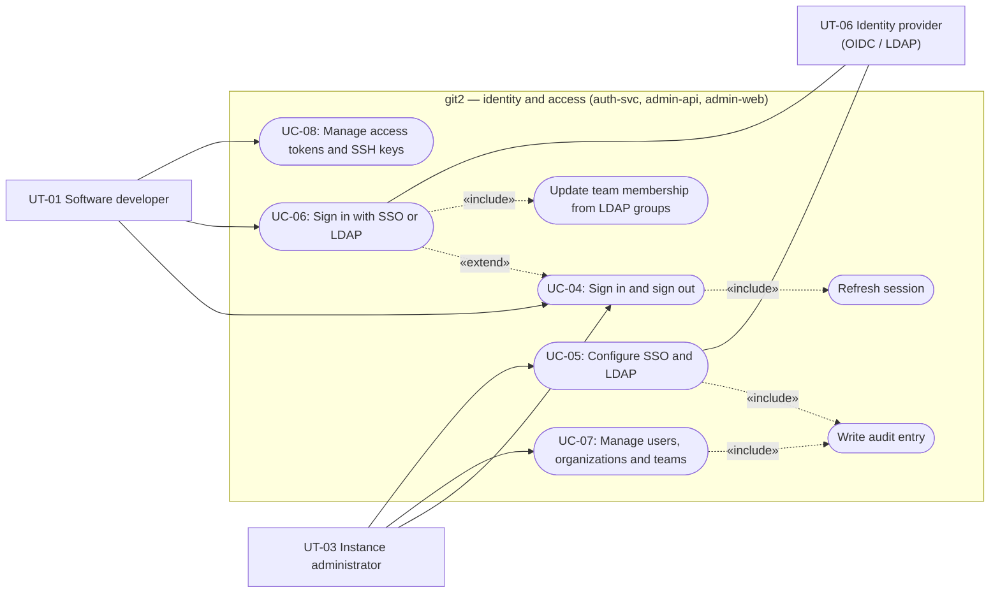

**Functionality covered:** T-02, T-03, T-04 / FR-08–FR-24 / UC-04–UC-08  
**Diagram notes:**

- UC-06 extends UC-04 because SSO or LDAP sign-in replaces the password step of the normal sign-in when a provider is configured.
- Both sign-in paths include session refresh: the client rotates its refresh token while the session lasts (FR-10).
- LDAP sign-in includes the team-membership update from LDAP groups (FR-24).
- Every administrative change made in UC-05 and UC-07 includes an audit entry (FR-68).
- UC-08 is self-service and needs no administrator.

#### 3.3.3 Functionality-Specific Use Case Diagram — Service Foundation, API Gateway and Documentation

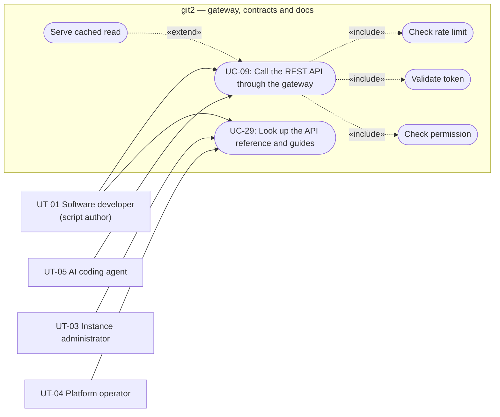

**Functionality covered:** T-01, T-16 / FR-01–FR-07, FR-99, FR-91–FR-94 / UC-09, UC-29  
**Diagram notes:**

- Every API call goes through the gateway and always includes the rate-limit check (FR-05), token validation (FR-03, FR-12) and the server-side permission check (FR-16).
- A cached read (FR-06) extends the call only for frequently read data.
- The git2 CLI and git2-mcp reach the system through UC-09 as well.
- The event outbox (FR-04) has no actor of its own. It is part of UC-11 and UC-21 (Section 3.3.7).

#### 3.3.4 Functionality-Specific Use Case Diagram — Repository Hosting, Code Browsing, Branch Protection and Git LFS

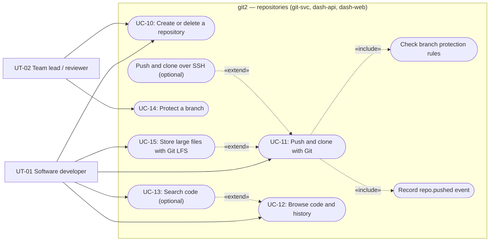

**Functionality covered:** T-05, T-06, T-07 / FR-25–FR-37 / UC-10–UC-15  
**Diagram notes:**

- Every push includes the branch-protection check (FR-35) and, when refs change, the `repo.pushed` event (FR-04).
- Git LFS transfers extend a push or clone when the repository tracks LFS files (FR-37).
- SSH transport (FR-29) and code search (FR-33) are optional extensions.
- UC-14 sets the rules that the included check enforces.

#### 3.3.5 Functionality-Specific Use Case Diagram — Merge Requests and Code Review

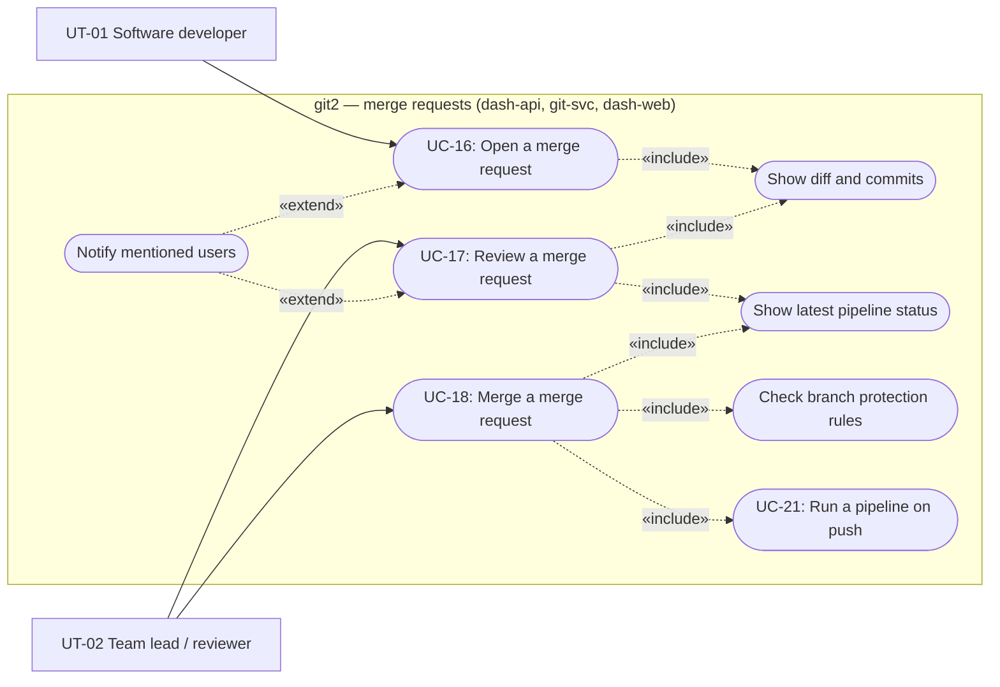

**Functionality covered:** T-08 (and FR-36 of T-07, FR-59 of T-10) / FR-36, FR-38–FR-44, FR-59 / UC-16–UC-18  
**Diagram notes:**

- Opening and reviewing a merge request include the diff view (FR-39). Reviewing and merging include the pipeline status (FR-59).
- A merge includes the branch-protection check (FR-36). Because a merge updates the target branch, it also starts a new pipeline (UC-21).
- A notification extends UC-16 or UC-17 only when the text mentions a user (FR-48).
- A developer with the Write role can also perform UC-17 and UC-18 where the branch rules allow it.

#### 3.3.6 Functionality-Specific Use Case Diagram — Issue Tracking and Notifications

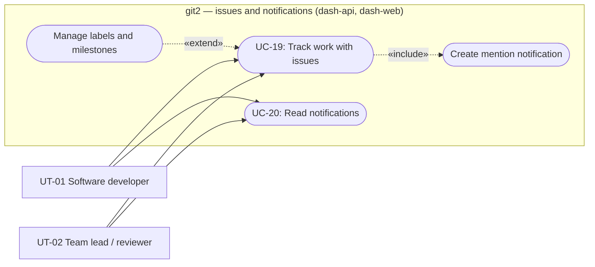

**Functionality covered:** T-09 / FR-45–FR-49 / UC-19, UC-20  
**Diagram notes:**

- Managing labels and milestones extends issue tracking and needs the Write role (FR-46).
- Every issue comment or description is scanned for @mentions, which create notifications (FR-48).
- UC-20 reads the notifications that UC-19, UC-16 and UC-17 create, and updates live (FR-49).

#### 3.3.7 Functionality-Specific Use Case Diagram — CI/CD Pipelines

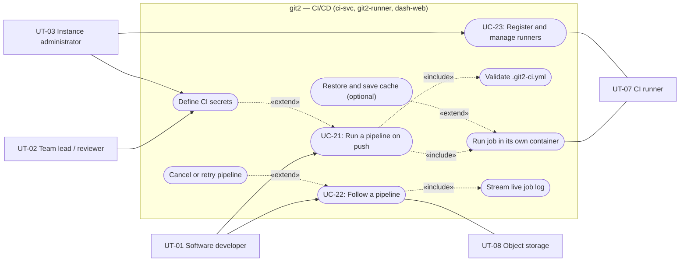

**Functionality covered:** T-10 (and FR-66, FR-67 of T-11, FR-04 of T-01) / FR-04, FR-50–FR-63, FR-66, FR-67 / UC-21–UC-23  
**Diagram notes:**

- A push by the developer starts UC-21. The runner takes part as a supporting actor that executes each job in its own container (FR-55).
- Validation of `.git2-ci.yml` is always included (FR-50, FR-52).
- CI secrets (FR-62) and caching (FR-63, optional) extend a pipeline only when they are defined. Secrets are defined by a maintainer for one repository (UT-02) or by an administrator for the whole instance (UT-03).
- Following a pipeline includes the live log (FR-56). It is extended by cancel and retry (FR-60) and uses object storage for artifacts (FR-57).
- Runner registration (UC-23) belongs to the Admin plane but is shown here because no job can run without it.

#### 3.3.8 Functionality-Specific Use Case Diagram — Admin Plane

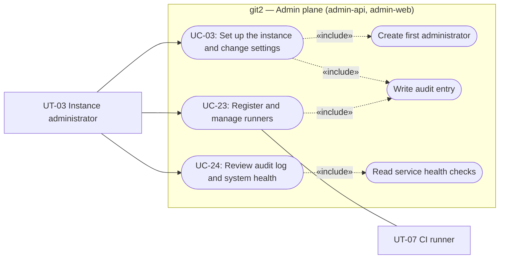

**Functionality covered:** T-11 / FR-07, FR-64–FR-69 / UC-03, UC-23, UC-24  
**Diagram notes:**

- On a fresh instance, UC-03 includes creating the first administrator (FR-64). Later visits change settings only (FR-65).
- Every change in UC-03 and UC-23 writes an audit entry (FR-68). UC-24 reads these entries back and also reads the health checks (FR-07, FR-69).
- User and team management (UC-07) and SSO configuration (UC-05) also belong to the Admin plane. They are shown in Section 3.3.2.

#### 3.3.9 Functionality-Specific Use Case Diagram — Backup and Restore

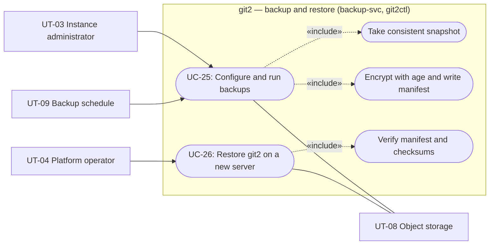

**Functionality covered:** T-12 / FR-70–FR-76, FR-100 / UC-25, UC-26  
**Diagram notes:**

- An administrator sets the schedule and retention and can start a backup on demand. The operator sets the destination and the public key in `git2.yaml`. The schedule starts the nightly runs.
- Every backup includes a consistent snapshot of the database and repositories (FR-71) and age encryption with a manifest (FR-70).
- A restore always verifies the manifest before writing anything (FR-76).
- The operator runs the restore from the host because the web UI does not exist yet on a fresh server.

#### 3.3.10 Functionality-Specific Use Case Diagram — Packaging and Deployment

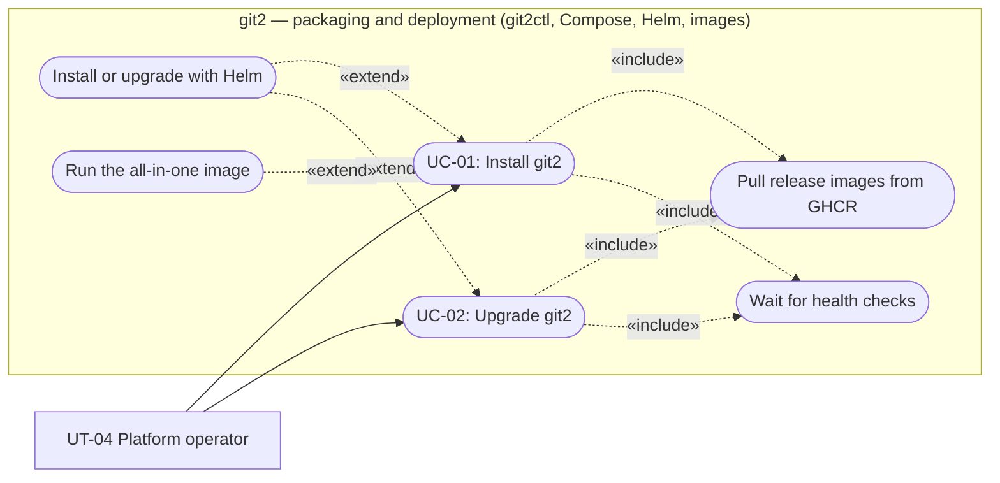

**Functionality covered:** T-13 / FR-77–FR-82 / UC-01, UC-02  
**Diagram notes:**

- Install and upgrade always pull the multi-architecture release images (FR-80) and end only when the health checks pass (FR-07).
- Kubernetes users take the Helm path (FR-79), which extends both use cases.
- Small teams can choose the all-in-one image (FR-81).
- The live reference instance (FR-82) is installed and upgraded through the same use cases.

#### 3.3.11 Functionality-Specific Use Case Diagram — git2 CLI

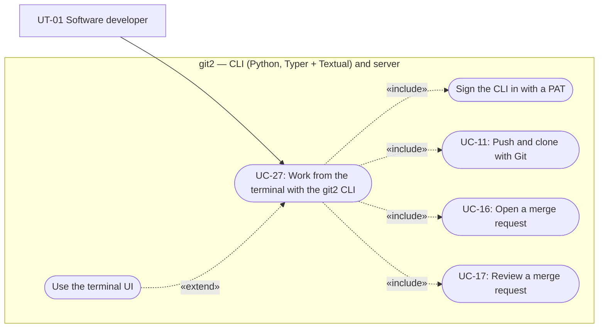

**Functionality covered:** T-14 / FR-83–FR-86 / UC-27  
**Diagram notes:**

- The CLI is another front end to the same use cases. It reaches Git transport (UC-11) through GitPython and merge requests (UC-16, UC-17) through the shared API client.
- The full-screen terminal UI (FR-86) extends the command-line usage.

#### 3.3.12 Functionality-Specific Use Case Diagram — AI Agent Integration (MCP)

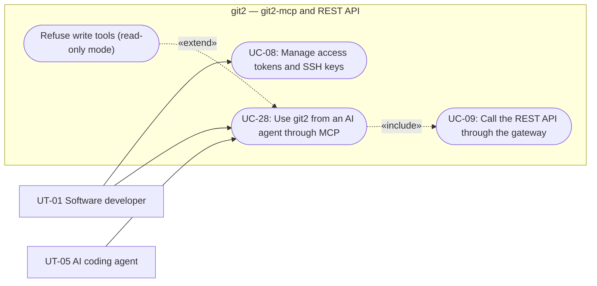

**Functionality covered:** T-15 / FR-87–FR-90 / UC-28  
**Diagram notes:**

- The developer creates a scoped PAT (UC-08) and configures the MCP client. The agent then starts every tool call.
- Each tool call includes one or more authenticated REST calls (UC-09), so git2's normal permission checks apply.
- In read-only mode, refusal of the write tools (FR-89) extends the use case and no API call is made.

#### 3.3.13 Functionality-Specific Use Case Diagram — End-to-End Integration Flows

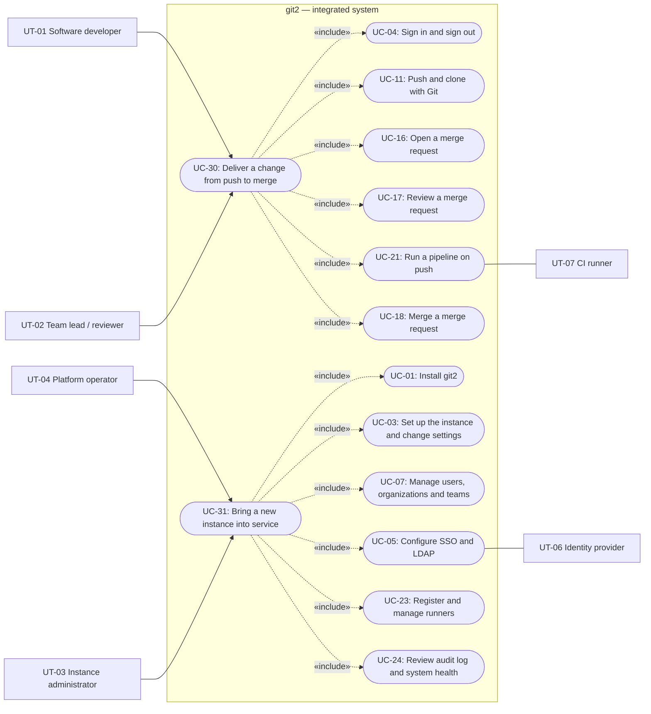

**Functionality covered:** T-17 / FR-95, FR-96 / UC-30, UC-31  
**Diagram notes:**

- These two use cases are the flows that the Playwright E2E suite (WBS-17.2) and the Friday integration check (WBS-17.1) run against the integrated system.
- UC-30 is the developer flow from the D-02 acceptance criterion. UC-31 is the administrator flow from the D-03 acceptance criterion.

### 3.4 Use Cases

#### 3.4.1 Use Case Coverage Matrix

| Project Plan task ID | Functional requirement ID(s) | Use case ID(s) | Scenario ID(s) |
|---|---|---|---|
| T-01 | FR-01–FR-07, FR-99 | UC-09, UC-11, UC-21, UC-24 | SC-13, SC-04, SC-01 |
| T-02 | FR-03, FR-08–FR-13 | UC-04 | SC-03, SC-01 |
| T-03 | FR-14–FR-20 | UC-07, UC-08 | SC-02, SC-03, SC-09 |
| T-04 | FR-21–FR-24 | UC-05, UC-06 | SC-02, SC-03 |
| T-05 | FR-25–FR-29 | UC-10, UC-11 | SC-03, SC-13 |
| T-06 | FR-30–FR-33, FR-97, FR-98 | UC-12, UC-13 | SC-03, SC-09 |
| T-07 | FR-34–FR-37 | UC-14, UC-15, UC-18 | SC-06, SC-05 |
| T-08 | FR-36, FR-38–FR-44, FR-59 | UC-16, UC-17, UC-18 | SC-05 |
| T-09 | FR-45–FR-49 | UC-19, UC-20 | SC-07 |
| T-10 | FR-50–FR-63 | UC-21, UC-22, UC-23 | SC-04, SC-05, SC-09 |
| T-11 | FR-07, FR-64–FR-69 | UC-03, UC-23, UC-24 | SC-01, SC-02, SC-11 |
| T-12 | FR-70–FR-76, FR-100 | UC-25, UC-26 | SC-10 |
| T-13 | FR-77–FR-82 | UC-01, UC-02 | SC-01, SC-11, SC-12 |
| T-14 | FR-83–FR-86 | UC-27 | SC-08 |
| T-15 | FR-87–FR-90 | UC-28 | SC-09 |
| T-16 | FR-91–FR-94 | UC-29 | SC-01, SC-12, SC-13 |
| T-17 | FR-82, FR-95, FR-96 | UC-30, UC-31 | SC-05, SC-02 |
| T-18 | — (project management and course reports; no system behavior) | — | — |

Every development task from Project Plan §1.3 is covered. The optional items (FR-29, FR-33, FR-63) are documented because they are in the agreed optional scope. They appear as alternative flows of UC-11 and UC-21, and as UC-13.

#### 3.4.2 UC-01 — Install git2

| Field | Description |
|---|---|
| **Use case ID** | UC-01 |
| **Use case name** | Install git2 |
| **Goal / Purpose** | The operator brings up a working git2 instance on the organization's own server with one command, so that no source code has to leave the organization. |
| **Actor(s)** | UT-04 — Platform operator |
| **Related Project Plan task(s)** | T-13, T-16 |
| **Related functional requirement(s)** | FR-77, FR-79, FR-80, FR-81, FR-92 |

**Pre-condition(s):**  
- The operator has a clean Linux host (amd64 or arm64) with Docker Engine and the Compose plugin, and shell access with permission to run Docker.
- A DNS name points to the host, and a TLS certificate for it is available as described in the installation guide.
- The host can reach GitHub Container Registry, and the release images are published (FR-80).

**Main success flow:**

1. **Operator:** Downloads `git2ctl` and runs `git2ctl install` with the instance's host name, following the installation guide (FR-92).
2. **System:** Checks the prerequisites: the Docker daemon is running, Compose is present, ports 80 and 443 are free and the CPU architecture is supported.
3. **System:** Writes `git2.yaml` with the host name and newly generated instance secrets.
4. **System:** Pulls the release images for the host's architecture from GitHub Container Registry.
5. **System:** Starts all git2 services, PostgreSQL and Redis with Docker Compose, with named volumes for database and repository data, and applies the database migrations.
6. **System:** Waits until every health check passes (FR-07), then prints the HTTPS address of the instance.
7. **Operator:** Opens the address. The first-run setup wizard is shown (continues in UC-03).

**Alternative flows:**

- **A1 — Kubernetes installation (branches from step 1):**
  1. The organization runs Kubernetes, so the operator installs the git2 Helm chart with a values file instead of running `git2ctl install` (FR-79).
  2. The chart creates one Deployment per service, plus the configuration and storage the values file asks for.
  3. Kubernetes pulls the images (step 4). The flow continues at step 6 when all pods report healthy.
- **A2 — All-in-one image (branches from step 5):**
  1. The operator has chosen the all-in-one image for a small team (FR-81).
  2. The system starts one git2 container that runs every service, together with PostgreSQL and Redis, and continues at step 6.
- **A3 — git2 is already installed on the host (branches from step 2):**
  1. `git2ctl` finds an existing installation.
  2. It refuses to overwrite it, suggests `git2ctl upgrade` (UC-02), and ends without changes.

**Exception / error flows (if applicable):**

- **E1 — Prerequisite missing (occurs at step 2):** `git2ctl` stops and names the missing prerequisite, for example "Docker daemon not running" or "port 443 in use". Nothing has been started or written. The operator fixes the problem and runs the command again.
- **E2 — Image pull fails (occurs at step 4):** `git2ctl` reports the registry error and stops before starting any container. The operator checks network access to the registry.
- **E3 — A service does not become healthy (occurs at step 6):** `git2ctl` reports which service failed its health check and where its logs are, and leaves the containers running so the operator can diagnose the problem.

**Post-condition(s):**  
- The instance is reachable over HTTPS and all health checks pass.
- Database and repository data live on persistent volumes (or persistent volumes in Kubernetes), and `git2.yaml` exists on the host.
- No user account exists yet; the setup wizard is waiting.
- On a clean host, the whole flow takes less than 10 minutes (NFR-15).

#### 3.4.3 UC-02 — Upgrade git2

| Field | Description |
|---|---|
| **Use case ID** | UC-02 |
| **Use case name** | Upgrade git2 |
| **Goal / Purpose** | The operator moves a running instance to a newer release without losing data, so that users get fixes and features with little downtime. |
| **Actor(s)** | UT-04 — Platform operator |
| **Related Project Plan task(s)** | T-13 |
| **Related functional requirement(s)** | FR-78, FR-80, FR-82 |

**Pre-condition(s):**  
- A git2 instance is running and was installed with `git2ctl` (or with Helm, for A2).
- A newer release is published.
- It is recommended that a snapshot was taken just before the upgrade (UC-25).

**Main success flow:**

1. **Operator:** Runs `git2ctl upgrade`, optionally naming a target version.
2. **System:** Shows the current version and the target version and asks for confirmation.
3. **Operator:** Confirms.
4. **System:** Pulls the target images, stops the services, applies the new database migrations, and starts the services with the new images. Volumes and `git2.yaml` are kept.
5. **System:** Waits until all health checks pass, then reports the upgrade as successful with the new version.

**Alternative flows:**

- **A1 — Already on the latest release (branches from step 2):**
  1. The current version equals the newest release.
  2. The system reports that no upgrade is available and ends without changes.
- **A2 — Kubernetes installation (branches from step 1):**
  1. The operator runs `helm upgrade` with the new chart version.
  2. Kubernetes replaces the Deployments with the new images and runs the migrations.
  3. The flow continues at step 5.
- **A3 — Live reference instance (applies to the whole flow):**
  1. After each release tag, the team upgrades the public reference instance with the same steps.
  2. Afterwards, the reference instance runs the latest release (FR-82).

**Exception / error flows (if applicable):**

- **E1 — A migration fails (occurs at step 4):** The system stops and reports the failing migration. It does not start the new version. The operator can restore the pre-upgrade snapshot with UC-26 and report the failure.
- **E2 — A service is unhealthy after the upgrade (occurs at step 5):** The system reports which service failed its health check and where its logs are. The data on the volumes is not changed.

**Post-condition(s):**  
- All services run the target release.
- All repositories, users, teams, settings and pipeline history are unchanged.
- All health checks pass.

#### 3.4.4 UC-03 — Set Up the Instance and Change Settings

| Field | Description |
|---|---|
| **Use case ID** | UC-03 |
| **Use case name** | Set up the instance and change settings |
| **Goal / Purpose** | The administrator creates the first administrator account on a fresh instance and adjusts instance settings later, without editing files on the server. |
| **Actor(s)** | UT-03 — Instance administrator |
| **Related Project Plan task(s)** | T-11, T-03 |
| **Related functional requirement(s)** | FR-64, FR-65, FR-20, FR-68 |

**Pre-condition(s):**  
- The instance is installed and healthy (UC-01).
- For the main flow, no administrator account exists yet.
- For A1, the administrator is signed in.

**Main success flow:**

1. **Administrator:** Opens the instance's HTTPS address.
2. **System:** Detects that no administrator exists and shows the first-run setup wizard instead of the sign-in page.
3. **Administrator:** Enters the first administrator's email address, username and password, and the basic instance settings: the instance name and the external URL.
4. **System:** Validates the input, creates the administrator account, stores the settings and records both actions in the audit log.
5. **System:** Closes the wizard permanently, signs the administrator in and opens the Admin plane.

**Alternative flows:**

- **A1 — Change settings later (branches from step 1, when an administrator exists):**
  1. The administrator opens **Instance settings** in the Admin plane, changes a value (for example the external URL or a runner or backup setting) and saves.
  2. The system validates and applies the change and writes an audit entry with the old and new value (FR-65, FR-68).
  3. The flow ends with the new setting in effect.
- **A2 — Wizard address opened after setup (branches from step 2):**
  1. An administrator already exists.
  2. The system shows the normal sign-in page; the wizard cannot be used again (FR-64).

**Exception / error flows (if applicable):**

- **E1 — Invalid input (occurs at step 4):** The email address is malformed, or the password does not meet the system's rules. The system marks the fields with errors and creates nothing. The administrator corrects the input and continues at step 3.
- **E2 — Database unavailable (occurs at step 4):** The system answers with a 5xx error, "try again", and creates nothing.

**Post-condition(s):**  
- Exactly one administrator exists after setup, and the wizard can no longer be opened.
- The settings are stored and audited.
- There is no public sign-up path (FR-20): further accounts can be created only through UC-07 or UC-06.

#### 3.4.5 UC-04 — Sign In and Sign Out

| Field | Description |
|---|---|
| **Use case ID** | UC-04 |
| **Use case name** | Sign in and sign out |
| **Goal / Purpose** | A user proves their identity once and then works in Dash and Admin with a secure session that can be ended at any time. |
| **Actor(s)** | UT-01 — Software developer; UT-02 — Team lead / reviewer; UT-03 — Instance administrator |
| **Related Project Plan task(s)** | T-02, T-01 |
| **Related functional requirement(s)** | FR-03, FR-08, FR-09, FR-10, FR-11, FR-12, FR-13 |

**Pre-condition(s):**  
- The user has an active local account (or, for A1, a configured SSO identity).
- The instance is reachable over HTTPS.

**Main success flow:**

1. **User:** Opens Dash or Admin in the browser.
2. **System:** Finds no valid session and shows the shared sign-in page (FR-08).
3. **User:** Enters an email address and password.
4. **System:** Verifies the credentials, creates a session in Redis, and returns an access token and a refresh token in the response headers (FR-09).
5. **System:** Opens the requested application. The user can open the other plane without signing in again; Admin opens only for administrators.
6. **System:** Before the access token expires, the web app exchanges the refresh token for a new pair. The old refresh token stops working (FR-10).
7. **User:** Selects **Sign out**.
8. **System:** Revokes the access token and the refresh session (FR-11) and shows the sign-in page.

**Alternative flows:**

- **A1 — Single sign-on (branches from step 3):**
  1. The user chooses the OIDC provider or enters LDAP credentials.
  2. The flow continues in UC-06, which extends this use case, and returns at step 5.
- **A2 — Non-administrator opens Admin (branches from step 5):**
  1. The user has no administrator flag.
  2. The system refuses Admin with 403 and a message; Dash stays available.
- **A3 — A used refresh token is presented again (branches from step 6):**
  1. A refresh token that was already used arrives, for example a stolen copy.
  2. The system ends the whole session, so every token of the session is refused (FR-10).
  3. The user must sign in again at step 2.

**Exception / error flows (if applicable):**

- **E1 — Wrong credentials (occurs at step 4):** The system answers "invalid credentials" with 401. The answer is the same for an unknown email and a wrong password (FR-13). No session is created.
- **E2 — Too many attempts (occurs at step 4):** The system answers 429 with `Retry-After`, and the user waits before trying again (FR-13).
- **E3 — Account disabled (occurs at step 4):** The system answers "account is disabled" with 403, and no session is created (FR-13, FR-14).
- **E4 — PostgreSQL or Redis unavailable (occurs at step 4 or 6):** The system answers 503, "try again". The client keeps its tokens and retries later (NFR-22).

**Post-condition(s):**  
- After sign-in, one session exists in Redis, and the browser holds a valid token pair that both planes accept.
- After sign-out, both tokens are refused by every service (FR-12).

#### 3.4.6 UC-05 — Configure SSO and LDAP

| Field | Description |
|---|---|
| **Use case ID** | UC-05 |
| **Use case name** | Configure SSO and LDAP |
| **Goal / Purpose** | The administrator connects git2 to the organization's OIDC provider and LDAP directory, so that staff use their existing accounts and team membership follows the directory. |
| **Actor(s)** | UT-03 — Instance administrator (primary); UT-06 — Identity provider (supporting) |
| **Related Project Plan task(s)** | T-04 |
| **Related functional requirement(s)** | FR-21, FR-23, FR-24, FR-68 |

**Pre-condition(s):**  
- The administrator is signed in to Admin.
- For OIDC, a client for git2 is registered at the provider, with git2's redirect address.
- For LDAP, the directory is reachable from the git2 server and a bind account exists.
- The teams to map exist (UC-07).

**Main success flow:**

1. **Administrator:** Opens **Authentication** in the Admin plane and adds an OIDC provider: display name, issuer URL, client ID and client secret.
2. **System:** Reads the provider's discovery document, validates the configuration, stores it with the secret kept as an instance secret, and writes an audit entry (FR-21).
3. **Administrator:** Adds an LDAP directory: server URL, bind account and password, user search base and group search base.
4. **System:** Tests the connection with a bind and a sample search and shows the result (FR-23).
5. **Administrator:** Maps one or more LDAP groups to git2 teams and saves.
6. **System:** Stores the LDAP configuration and the mapping, writes an audit entry, and from now on offers OIDC and LDAP on the sign-in page (FR-24).

**Alternative flows:**

- **A1 — Only one method is used (branches from step 1 or step 3):**
  1. The organization uses only OIDC, or only LDAP.
  2. The administrator skips the other part, and the flow continues at step 6 with the configured method only.
- **A2 — Disable a provider (branches from step 1):**
  1. The administrator disables an existing provider.
  2. The system removes it from the sign-in page and writes an audit entry. Accounts created through it still exist, but cannot sign in through that provider.

**Exception / error flows (if applicable):**

- **E1 — Wrong issuer or unreachable provider (occurs at step 2):** The system shows the error and saves nothing. The administrator corrects the URL.
- **E2 — LDAP bind or search fails (occurs at step 4):** The system shows the directory's error, such as invalid bind credentials or an unreachable host, and saves nothing.

**Post-condition(s):**  
- The configured providers appear on the sign-in page.
- The group-to-team mapping is stored.
- Every change is in the audit log.

#### 3.4.7 UC-06 — Sign In with SSO or LDAP

| Field | Description |
|---|---|
| **Use case ID** | UC-06 |
| **Use case name** | Sign in with SSO or LDAP |
| **Goal / Purpose** | A user signs in with their organization account, and git2 creates or links their account and keeps their teams in line with the directory. |
| **Actor(s)** | UT-01 — Software developer (any user) (primary); UT-06 — Identity provider (supporting) |
| **Related Project Plan task(s)** | T-04 |
| **Related functional requirement(s)** | FR-22, FR-23, FR-24, FR-20 |

**Pre-condition(s):**  
- At least one provider is configured (UC-05).
- The user exists in the OIDC provider or in the LDAP directory.

**Main success flow:**

1. **User:** On the sign-in page, selects **Sign in with** the OIDC provider.
2. **System:** Redirects the browser to the provider's sign-in page.
3. **User:** Authenticates at the provider.
4. **Identity provider:** Redirects back to git2 with an authorization code.
5. **System:** Exchanges the code, validates the ID token, and finds the git2 account linked to this identity.
6. **System:** Creates the session and tokens as in UC-04 step 4 and opens the requested application.

**Alternative flows:**

- **A1 — First OIDC sign-in (branches from step 5):**
  1. No account is linked to this identity yet.
  2. The system links the identity to an existing account with the same verified email address. If there is none, it creates a new account from the provider's claims (FR-22, FR-20).
  3. The flow continues at step 6.
- **A2 — LDAP sign-in (branches from step 1):**
  1. The user enters their LDAP username and password on the sign-in page.
  2. The system binds to the directory to verify them and reads the user's groups.
  3. On the first sign-in it creates the account. On every sign-in it adds the user to, or removes the user from, the mapped teams (FR-23, FR-24).
  4. The flow continues at step 6.

**Exception / error flows (if applicable):**

- **E1 — Authentication fails or is cancelled at the provider (occurs at step 3 or A2.2):** The user returns to the sign-in page with a message, and no session is created.
- **E2 — Provider or directory unreachable (occurs at step 5 or A2.2):** The system answers 503, "sign-in provider unavailable". Local sign-in (UC-04) still works.
- **E3 — git2 account disabled (occurs at step 5):** Even if the provider accepted the user, the system refuses with "account is disabled" (FR-14).

**Post-condition(s):**  
- The user is signed in, and their account exists and is linked to the external identity.
- After LDAP sign-in, the user's team membership matches their current LDAP groups.

#### 3.4.8 UC-07 — Manage Users, Organizations and Teams

| Field | Description |
|---|---|
| **Use case ID** | UC-07 |
| **Use case name** | Manage users, organizations and teams |
| **Goal / Purpose** | The administrator keeps accounts, organizations, teams and roles up to date, so that each person reaches exactly the repositories they need. |
| **Actor(s)** | UT-03 — Instance administrator |
| **Related Project Plan task(s)** | T-03 |
| **Related functional requirement(s)** | FR-14, FR-15, FR-16, FR-20, FR-68 |

**Pre-condition(s):**  
- The administrator is signed in to Admin.

**Main success flow:**

1. **Administrator:** Opens **Users** in the Admin plane.
2. **System:** Lists the users with their status (active or disabled), sign-in method and administrator flag.
3. **Administrator:** Selects **New user** and enters an email address, a username and an initial password.
4. **System:** Checks that the email address and username are unique (case-insensitive), creates the account and writes an audit entry.
5. **Administrator:** Creates an organization and a team inside it, and adds users to the team.
6. **Administrator:** Gives the team a role (Read, Write or Maintain) on the organization or on one repository.
7. **System:** Stores the role, writes audit entries for steps 5–6, and enforces the role on every later API call and Git operation (FR-16).

**Alternative flows:**

- **A1 — Disable or re-enable a user (branches from step 2):**
  1. The administrator disables a user.
  2. The system blocks the user's sign-in and session refresh, makes the user's PATs stop working, and writes an audit entry (FR-14).
  3. When the user is re-enabled, they can sign in again. Tokens that stopped working are not restored.
- **A2 — Edit a user (branches from step 2):**
  1. The administrator changes the user's email address, username or administrator flag.
  2. The system checks uniqueness, saves the change and writes an audit entry.
- **A3 — Change membership or roles (branches from step 5 or 6):**
  1. The administrator removes a member or changes a role.
  2. The change takes effect on the user's next request and is audited.

**Exception / error flows (if applicable):**

- **E1 — Duplicate email or username (occurs at step 4):** The system answers 409 with "email already registered" or "username already taken" and creates nothing.
- **E2 — Caller is not an administrator (occurs at any step):** admin-api refuses the call with 403 (FR-16).

**Post-condition(s):**  
- Users, organizations, teams and roles are stored, and the new permissions take effect at once.
- Every change has an audit entry.
- No account was created through public sign-up (FR-20).

#### 3.4.9 UC-08 — Manage Personal Access Tokens and SSH Keys

| Field | Description |
|---|---|
| **Use case ID** | UC-08 |
| **Use case name** | Manage personal access tokens and SSH keys |
| **Goal / Purpose** | A user gives Git clients, scripts, the git2 CLI and AI agents limited, revocable access to their account. |
| **Actor(s)** | UT-01 — Software developer (any user) |
| **Related Project Plan task(s)** | T-03 |
| **Related functional requirement(s)** | FR-17, FR-18, FR-19 |

**Pre-condition(s):**  
- The user is signed in (UC-04 or UC-06).

**Main success flow:**

1. **User:** Opens **Access tokens** in their account settings and selects **New token**.
2. **User:** Enters a token name and chooses its scopes, for example read-only.
3. **System:** Creates the token, stores only its hash, and shows the value once with a copy button (FR-17).
4. **User:** Copies the value into the Git credential helper, the git2 CLI or the git2-mcp configuration.
5. **User:** Opens **SSH keys**, pastes a public key and gives it a title.
6. **System:** Validates the key, stores it and shows its fingerprint (FR-19).

**Alternative flows:**

- **A1 — Revoke a token (branches from step 1):**
  1. The user selects **Revoke** next to a token.
  2. The system invalidates it at once. The next API call or Git operation with it gets 401 (FR-18).
- **A2 — Remove an SSH key (branches from step 5):**
  1. The user removes a key.
  2. The system deletes it. The optional SSH transport (FR-29) no longer accepts it.

**Exception / error flows (if applicable):**

- **E1 — Invalid or duplicate SSH key (occurs at step 6):** The system rejects the key and gives the reason; nothing is stored.
- **E2 — Token used beyond its scope (after step 4):** A write made with a read-only token is refused with 403 (FR-16, FR-17).

**Post-condition(s):**  
- The token is listed by name and scopes, and its value can never be shown again.
- The SSH key is listed with its fingerprint.
- Revoked tokens and removed keys no longer work.

#### 3.4.10 UC-09 — Call the REST API Through the Gateway

| Field | Description |
|---|---|
| **Use case ID** | UC-09 |
| **Use case name** | Call the REST API through the gateway |
| **Goal / Purpose** | A program acting for a user reads or changes git2 data through the documented REST API, safely and with predictable errors. |
| **Actor(s)** | UT-01 — Software developer (script author, git2 CLI); UT-05 — AI coding agent (through git2-mcp) |
| **Related Project Plan task(s)** | T-01 |
| **Related functional requirement(s)** | FR-01, FR-02, FR-03, FR-05, FR-06, FR-07, FR-16, FR-99 |

**Pre-condition(s):**  
- The client holds a PAT or access token (UC-08 or UC-04).
- The client knows the endpoint from the OpenAPI specification (FR-01, FR-91).

**Main success flow:**

1. **Client:** Sends an HTTPS request to an `/api/...` endpoint with its token.
2. **System (gateway):** Terminates TLS and checks the caller's request budget (FR-05).
3. **System (gateway):** Validates the token, removes identity headers sent by the client and routes the request, with its `Authorization` header unchanged, to the service that owns the endpoint (FR-02, FR-03, FR-99).
4. **System (service):** Verifies the token again and checks that the caller's role allows the action on the resource (FR-16).
5. **System (service):** Performs the action, or reads the data, and builds a response that matches the OpenAPI specification (FR-01).
6. **System (gateway):** Returns the response to the client.

**Alternative flows:**

- **A1 — Cached read (branches from step 5):**
  1. The data is frequently read and is present in the Redis cache.
  2. The service answers from the cache without a PostgreSQL query (FR-06), and the flow continues at step 6.
- **A2 — Health check (branches from step 1):**
  1. The client calls a health-check endpoint.
  2. The system answers with the service, PostgreSQL and Redis status without a token (FR-07).

**Exception / error flows (if applicable):**

- **E1 — No token or invalid token (occurs at step 3):** The gateway answers 401 with `{"error": "…"}`. The request never reaches a service (FR-03).
- **E2 — Rate limit exceeded (occurs at step 2):** The gateway answers 429 with `Retry-After` (FR-05).
- **E3 — Not permitted (occurs at step 4):** The service answers 403 (FR-16).
- **E4 — Invalid request body (occurs at step 5):** The service answers 400 when the body has unknown fields or trailing data or is larger than 64 KiB.
- **E5 — Database or Redis fault (occurs at step 4 or 5):** The service answers 5xx, never 401, so the client keeps its token (NFR-22).
- **E6: Service unreachable or too slow (occurs at step 3):** The gateway answers 503 when the service cannot be reached and 504 when it does not answer in time.

**Post-condition(s):**  
- Every request is either answered as the OpenAPI specification describes or refused with a documented status.
- No request reaches a service without a valid token, except the exempt endpoints of FR-03.

#### 3.4.11 UC-10 — Create or Delete a Repository

| Field | Description |
|---|---|
| **Use case ID** | UC-10 |
| **Use case name** | Create or delete a repository |
| **Goal / Purpose** | A developer gets a new repository for a project without asking IT, and a maintainer removes one that is no longer needed. |
| **Actor(s)** | UT-01 — Software developer; UT-02 — Team lead / reviewer |
| **Related Project Plan task(s)** | T-05 |
| **Related functional requirement(s)** | FR-25, FR-26, FR-16 |

**Pre-condition(s):**  
- The user is signed in.
- To create in an organization, the user has the Maintain role on it.
- To delete, the user has the Maintain role on the repository.

**Main success flow:**

1. **Developer:** Selects **New repository** in Dash.
2. **System:** Shows a form with the owner (the user or one of their organizations), name, description and default branch name.
3. **Developer:** Fills in the form and submits it.
4. **System:** Checks that the name is unique for that owner (case-insensitive), creates an empty bare repository on disk and its metadata, and records the creation event.
5. **System:** Shows the empty repository page with the HTTPS clone URL and the first-push instructions.

**Alternative flows:**

- **A1 — Delete a repository (branches from step 1):**
  1. A maintainer opens the repository's settings and selects **Delete**.
  2. The system asks the maintainer to type the repository's name to confirm.
  3. The maintainer confirms. The system marks the repository as deleted, removes it from all lists, and refuses further Git access to it. The name can be reused at once (FR-26).

**Exception / error flows (if applicable):**

- **E1 — Name already used by this owner (occurs at step 4):** The system shows "name already exists" and creates nothing.
- **E2 — Invalid name (occurs at step 4):** The name breaks the rules of FR-25, for example it contains characters that are not allowed or ends with `.git`. The system shows the rule and creates nothing.
- **E3 — No permission (occurs at step 4 or A1.3):** The system answers 403 and changes nothing (FR-16).

**Post-condition(s):**  
- A new repository is listed under its owner and can be cloned and pushed (UC-11).
- A deleted repository is no longer listed or reachable over Git.

#### 3.4.12 UC-11 — Push and Clone with Git

| Field | Description |
|---|---|
| **Use case ID** | UC-11 |
| **Use case name** | Push and clone with Git |
| **Goal / Purpose** | A developer moves code between their machine and git2 with the standard `git` client. |
| **Actor(s)** | UT-01 — Software developer |
| **Related Project Plan task(s)** | T-05, T-01, T-03, T-07 |
| **Related functional requirement(s)** | FR-27, FR-28, FR-29, FR-04, FR-35, FR-19 |

**Pre-condition(s):**  
- The repository exists (UC-10).
- The developer has a PAT (UC-08) and at least the Read role (to clone) or the Write role (to push).
- A standard `git` client is installed.

**Main success flow:**

1. **Developer:** Runs `git clone` with the repository's HTTPS clone URL.
2. **System:** Asks for credentials, and the developer's `git` client sends the username and the PAT.
3. **System:** Verifies the token and the Read role, then serves the repository over the Git Smart HTTP protocol (FR-27, FR-28).
4. **Developer:** Commits locally and runs `git push`.
5. **System:** Verifies the Write role and the branch protection rules, receives the objects and updates the refs (FR-28, FR-35).
6. **System:** Right after the refs are updated, records one `repo.pushed` event that lists every ref the push changed (FR-04). The `git` client reports success.

**Alternative flows:**

- **A1 — SSH transport, optional (branches from step 1):**
  1. The developer uses the repository's SSH URL.
  2. The system authenticates the developer with an SSH key registered on their account (FR-19, FR-29).
  3. The flow continues at step 3 with the same permission checks.
- **A2 — New branch or tag (branches from step 4):**
  1. The developer pushes a new branch or tag.
  2. The system creates the ref, and the flow continues at step 6.
- **A3 — LFS-tracked files (branches from step 4):**
  1. The repository tracks large files with Git LFS.
  2. The LFS transfer runs as in UC-15, and the flow continues at step 5.

**Exception / error flows (if applicable):**

- **E1 — Wrong or revoked token (occurs at step 2):** The system answers 401, and `git` reports that authentication failed.
- **E2 — Missing role (occurs at step 3 or 5):** The system refuses the operation, and `git` shows the error (FR-28).
- **E3 — Protected branch (occurs at step 5):** The push, force-push or branch deletion is not allowed by the branch's rules. The system rejects it with a message that `git` prints, and leaves the refs unchanged (FR-35).
- **E4 — Interrupted push (occurs at step 5):** The connection drops before the refs are updated. No ref changes and no event is recorded.
- **E5 — The system stops right after the refs are updated (occurs at step 6):** The push stays, because Git has already updated the refs, but no event is recorded and no pipeline starts for it. The system logs the lost event (FR-04).

**Post-condition(s):**  
- After a clone, the developer has a complete copy of the repository.
- After a push that changed refs, the refs are updated and exactly one `repo.pushed` event lists them, unless E5 occurred. A recorded event is delivered at least once.

#### 3.4.13 UC-12 — Browse Code and History

| Field | Description |
|---|---|
| **Use case ID** | UC-12 |
| **Use case name** | Browse code and history |
| **Goal / Purpose** | A developer reads files and history of any branch or tag in the browser, without cloning. |
| **Actor(s)** | UT-01 — Software developer (also UT-02) |
| **Related Project Plan task(s)** | T-06 |
| **Related functional requirement(s)** | FR-30, FR-31, FR-32, FR-97, FR-98 |

**Pre-condition(s):**  
- The developer is signed in and has the Read role on the repository.

**Main success flow:**

1. **Developer:** Opens Dash and selects the repository from the repository list (FR-97).
2. **System:** Shows the file tree of the default branch and its latest commit.
3. **Developer:** Selects another branch or tag from the selector.
4. **System:** Shows the file tree of that branch or tag (FR-32).
5. **Developer:** Opens a file.
6. **System:** Shows the file's content with syntax highlighting and line numbers (FR-30).
7. **Developer:** Opens the commit history and selects a commit.
8. **System:** Shows the commit's message, author and date, and the diff of each changed file (FR-31).

**Alternative flows:**

- **A1 — Empty repository (branches from step 2):**
  1. The repository has no commits yet.
  2. The system shows the clone URL and the first-push instructions instead of a file tree (FR-98).
- **A2 — Search instead of browsing (branches from step 3):**
  1. The developer searches the code (UC-13, optional).
  2. The developer opens a result, and the flow continues at step 6 at the matching line.
- **A3 — Binary or very large file (branches from step 6):**
  1. The file is binary, larger than 1 MiB or stored in Git LFS.
  2. The system shows its size and offers a download instead of a highlighted view (FR-30).
- **A4 — Link to a line (branches from step 6):**
  1. The developer selects a line number.
  2. The URL now points to that line and can be shared; opening it scrolls to and highlights the line (FR-30).
- **A5 — History of a file or directory (branches from step 7):**
  1. The developer opens the history from a file or directory instead of the branch.
  2. The system lists only the commits that changed it (FR-31).

**Exception / error flows (if applicable):**

- **E1 — Branch, tag or path does not exist (occurs at step 4 or 6):** The system shows a "not found" page with a link back to the default branch.
- **E2 — No Read role (occurs at step 1):** The repository is not in the list, and its URL shows "not found" (FR-16, FR-97).
- **E3 — Very large commit (occurs at step 8):** The commit changes more than 300 files. The system shows the first 300 and says that the list is truncated (FR-31).

**Post-condition(s):**  
- Nothing has changed in the repository; browsing is read-only.

#### 3.4.14 UC-13 — Search Code (Optional)

| Field | Description |
|---|---|
| **Use case ID** | UC-13 |
| **Use case name** | Search code |
| **Goal / Purpose** | A developer, or an AI agent working for one, finds where text occurs in a repository's default branch. |
| **Actor(s)** | UT-01 — Software developer; UT-05 — AI coding agent (through `search_code`) |
| **Related Project Plan task(s)** | T-06 (optional activity WBS-6.2) |
| **Related functional requirement(s)** | FR-33, FR-88 |

**Pre-condition(s):**  
- WBS-6.2 was delivered.
- The caller has the Read role on the repository, and the repository has a default branch with commits.

**Main success flow:**

1. **Developer:** Types a query into the repository's search box.
2. **System:** Searches the default branch.
3. **System:** Lists the matching files with the matching lines, each linked to the file view.
4. **Developer:** Opens a result. The file view of UC-12 opens at the matching line.

**Alternative flows:**

- **A1 — No matches (branches from step 3):**
  1. Nothing matches the query.
  2. The system shows "no results", and the developer can change the query (step 1).
- **A2 — Search by an AI agent (branches from step 1):**
  1. The agent calls `search_code` through git2-mcp.
  2. git2-mcp calls the same search endpoint and returns the matches to the agent (FR-88).

**Exception / error flows (if applicable):**

- **E1 — Feature not delivered (occurs at step 1):** If WBS-6.2 was dropped, Dash shows no search box, and `search_code` returns a "not available" tool error.

**Post-condition(s):**  
- Nothing is changed.

#### 3.4.15 UC-14 — Protect a Branch

| Field | Description |
|---|---|
| **Use case ID** | UC-14 |
| **Use case name** | Protect a branch |
| **Goal / Purpose** | A maintainer makes sure an important branch such as `main` changes only through allowed, reviewed merges. |
| **Actor(s)** | UT-02 — Team lead / reviewer |
| **Related Project Plan task(s)** | T-07 |
| **Related functional requirement(s)** | FR-34, FR-35, FR-36 |

**Pre-condition(s):**  
- The team lead has the Maintain role on the repository, and the branch exists.

**Main success flow:**

1. **Team lead:** Opens the repository's settings and the **Protected branches** section.
2. **Team lead:** Selects the branch and sets the rules: who may push directly (for example nobody), who may merge (for example maintainers), and the required number of approvals.
3. **System:** Saves the rules and shows the branch as protected (FR-34).
4. **System:** From now on, checks every push to the branch (UC-11) and every merge into it (UC-18) against the rules. It always refuses force-pushes to the branch and deletion of it (FR-35, FR-36).

**Alternative flows:**

- **A1 — Change or remove protection (branches from step 1):**
  1. The team lead edits the rules of a protected branch, or removes the protection.
  2. The system saves the change, which applies to the next push or merge.

**Exception / error flows (if applicable):**

- **E1 — Caller is not a maintainer (occurs at step 3):** The system answers 403 and saves nothing.
- **E2 — Branch does not exist (occurs at step 2):** The system shows the error and saves nothing.

**Post-condition(s):**  
- The branch is protected, and its rules are enforced on every push and merge.

#### 3.4.16 UC-15 — Store Large Files with Git LFS

| Field | Description |
|---|---|
| **Use case ID** | UC-15 |
| **Use case name** | Store large files with Git LFS |
| **Goal / Purpose** | A developer keeps large binary files with the repository without making its Git history large. |
| **Actor(s)** | UT-01 — Software developer |
| **Related Project Plan task(s)** | T-07 |
| **Related functional requirement(s)** | FR-37, FR-28, FR-70 |

**Pre-condition(s):**  
- `git-lfs` is installed on the developer's machine.
- The developer has the Write role (to upload) or the Read role (to download), and a PAT.

**Main success flow:**

1. **Developer:** Runs `git lfs track` for the large file types and commits the files.
2. **Developer:** Runs `git push`.
3. **System:** Receives the LFS batch request with the same credentials as Git, checks the Write role, and returns upload instructions for the objects it does not have yet.
4. **System:** Receives each object, checks its size and hash, and stores it.
5. **System:** Accepts the Git push (UC-11 step 5).
6. **Developer:** A colleague clones the repository, and `git-lfs` downloads the objects after a Read role check.

**Alternative flows:**

- **A1 — Object already stored (branches from step 3):**
  1. The server already has an object with the same hash.
  2. It tells the client to skip the upload, and the flow continues at step 5.

**Exception / error flows (if applicable):**

- **E1 — No Write role (occurs at step 3):** The system refuses the upload with 403, and the push fails.
- **E2 — Hash or size mismatch (occurs at step 4):** The system rejects the object, and the client reports the error.

**Post-condition(s):**  
- The LFS objects are stored and can be downloaded by users with the Read role.
- The objects are included in the next snapshot (FR-70).
- LFS file locking is not offered.

#### 3.4.17 UC-16 — Open a Merge Request

| Field | Description |
|---|---|
| **Use case ID** | UC-16 |
| **Use case name** | Open a merge request |
| **Goal / Purpose** | A developer asks for a review of a branch before it is merged into the target branch. |
| **Actor(s)** | UT-01 — Software developer |
| **Related Project Plan task(s)** | T-08 |
| **Related functional requirement(s)** | FR-38, FR-39, FR-44, FR-48, FR-59 |

**Pre-condition(s):**  
- The source branch is pushed (UC-11).
- The developer has the Write role on the repository.

**Main success flow:**

1. **Developer:** Selects **New merge request** in the repository.
2. **Developer:** Chooses the source branch and the target branch.
3. **System:** Shows the commits and the diff between the two branches as a preview (FR-39).
4. **Developer:** Enters a title and a description, optionally mentioning reviewers as `@username`, and submits.
5. **System:** Creates the merge request in the open state with the next number (`!n`), creates notifications for the mentioned users (FR-48), and shows the merge request page with the latest pipeline status of the source branch (FR-59).

**Alternative flows:**

- **A1 — New commits after opening (branches from step 5):**
  1. The developer pushes more commits to the source branch.
  2. The system updates the commits, the diff and the pipeline status of the merge request (FR-39). Inline comments on lines that changed are marked as outdated (FR-40).
- **A2 — Close and reopen (branches from step 5):**
  1. The author closes the merge request without merging.
  2. It moves to the closed list (FR-44). The author can reopen it later (FR-38).

**Exception / error flows (if applicable):**

- **E1 — Nothing to merge (occurs at step 3):** The branches have no differences. The system says so and does not create the merge request.
- **E2 — Same branch selected twice (occurs at step 2):** The system refuses the selection.
- **E3 — No Write role (occurs at step 5):** The system answers 403 (FR-16).

**Post-condition(s):**  
- An open merge request exists, is listed under **Open** (FR-44), and shows its diff and pipeline status.

#### 3.4.18 UC-17 — Review a Merge Request

| Field | Description |
|---|---|
| **Use case ID** | UC-17 |
| **Use case name** | Review a merge request |
| **Goal / Purpose** | A reviewer checks a change line by line, discusses it with the author and approves it when it is ready. |
| **Actor(s)** | UT-02 — Team lead / reviewer (also UT-01 with the Write role) |
| **Related Project Plan task(s)** | T-08, T-10 |
| **Related functional requirement(s)** | FR-39, FR-40, FR-41, FR-48, FR-59 |

**Pre-condition(s):**  
- The merge request is open (UC-16).
- The reviewer has the Read role (to comment) and the Write role (to approve).

**Main success flow:**

1. **Reviewer:** Opens the merge request from the list or from a notification.
2. **System:** Shows the description, commits, diff, current approvals and latest pipeline status (FR-39, FR-59).
3. **Reviewer:** Adds a comment on a specific line of the diff.
4. **System:** Saves the comment and shows it on that line. Mentioned users get a notification (FR-40, FR-48).
5. **Author (UT-01):** Pushes a fix to the source branch.
6. **System:** Updates the diff and the pipeline status.
7. **Reviewer:** Selects **Approve**.
8. **System:** Records the approval and shows the reviewer among the approvers (FR-41).

**Alternative flows:**

- **A1 — General comment or reply (branches from step 3):**
  1. The reviewer comments on the whole merge request, or replies to an existing comment.
  2. The system saves the comment, and the flow continues at step 4.
- **A2 — Withdraw approval (branches from step 8):**
  1. The reviewer withdraws the approval.
  2. The system removes the reviewer from the approvers.

**Exception / error flows (if applicable):**

- **E1 — No permission to approve (occurs at step 8):** The reviewer has only the Read role. The system answers 403, and comments remain possible.

**Post-condition(s):**  
- The comments and approvals are stored and visible to everyone with the Read role.

#### 3.4.19 UC-18 — Merge a Merge Request

| Field | Description |
|---|---|
| **Use case ID** | UC-18 |
| **Use case name** | Merge a merge request |
| **Goal / Purpose** | An authorized user brings a reviewed change into the target branch with the strategy the team agreed. |
| **Actor(s)** | UT-02 — Team lead / reviewer (or UT-01 where the branch rules allow) |
| **Related Project Plan task(s)** | T-08, T-07, T-10 |
| **Related functional requirement(s)** | FR-42, FR-43, FR-36, FR-59, FR-51 |

**Pre-condition(s):**  
- The merge request is open.
- The user may merge into the target branch: the Write role for an unprotected branch, or the branch rules for a protected one.

**Main success flow:**

1. **Team lead:** Opens the merge request.
2. **System:** Shows the merge box: whether the merge request can be merged, the latest pipeline status, the approvals against the required number, and the merge strategies. If the merge is not allowed, the merge button is disabled and the reason is shown (FR-43); if the latest pipeline failed, a warning is shown (FR-59).
3. **Team lead:** Chooses merge commit, squash or fast-forward and selects **Merge** (FR-42).
4. **System:** Checks the branch rules again (FR-36), performs the merge, updates the target branch and marks the merge request as merged.
5. **System:** Records the update of the target branch as a push, which starts a pipeline on the target branch (UC-21, FR-51).

**Alternative flows:**

- **A1 — Fast-forward not possible (branches from step 3):**
  1. The target branch has commits that the source branch does not have.
  2. The system shows that fast-forward is not possible, and the team lead chooses another strategy (step 3).

**Exception / error flows (if applicable):**

- **E1 — Conflicts (occurs at step 2 or 4):** The system shows that the merge request cannot be merged, lists the conflicting files, and leaves the target branch unchanged (FR-43). The author resolves the conflict and pushes (UC-16 A1).
- **E2 — Rules not met (occurs at step 4):** For example, approvals are missing or the user may not merge into this protected branch. The system refuses the merge with the reason and changes nothing (FR-36).
- **E3 — Target changed meanwhile (occurs at step 4):** The target branch moved after step 2. The system checks again: if the merge is still clean, it continues; otherwise it reports a conflict (E1).

**Post-condition(s):**  
- The target branch contains the change in the chosen form, and the merge request is in the merged state.
- A pipeline runs for the new target commit.

#### 3.4.20 UC-19 — Track Work with Issues

| Field | Description |
|---|---|
| **Use case ID** | UC-19 |
| **Use case name** | Track work with issues |
| **Goal / Purpose** | The team records, plans and discusses work next to the code, using labels, milestones, assignees and mentions. |
| **Actor(s)** | UT-02 — Team lead / reviewer; UT-01 — Software developer |
| **Related Project Plan task(s)** | T-09 |
| **Related functional requirement(s)** | FR-45, FR-46, FR-47, FR-48 |

**Pre-condition(s):**  
- The users are signed in.
- They have the Read role (to create issues and comment) and the Write role (for labels, milestones and assignees) on the repository.

**Main success flow:**

1. **Team lead:** Opens the repository's **Issues**.
2. **Team lead:** Creates the labels `bug` and `feature` and the milestone `Release 2.3` (FR-46).
3. **Team lead:** Creates an issue with a title and a description, and sets its labels, milestone and assignee.
4. **System:** Saves the issue and lists it as open (FR-45).
5. **Team lead:** Writes a comment that mentions `@deniz`.
6. **System:** Saves the comment and creates a notification for Deniz (FR-48, continues in UC-20).
7. **Developer:** Filters the issue list by milestone and by **assignee: me** (FR-47).
8. **Developer:** Closes the issue when the work is done.

**Alternative flows:**

- **A1 — Reopen an issue (branches from step 8):**
  1. The work turns out to be incomplete.
  2. The author or a user with the Write role reopens the issue.
- **A2 — Mention of an unknown name (branches from step 6):**
  1. The mentioned name is not a user.
  2. The system keeps the text as written and creates no notification.

**Exception / error flows (if applicable):**

- **E1 — No Write role for labels, milestones or assignees (occurs at step 2 or 3):** The system answers 403. The user can still create the issue without them.

**Post-condition(s):**  
- The issues are stored with their state, labels, milestone, assignees and comments.
- The mentioned users have notifications.

#### 3.4.21 UC-20 — Read Notifications

| Field | Description |
|---|---|
| **Use case ID** | UC-20 |
| **Use case name** | Read notifications |
| **Goal / Purpose** | A user learns at once that someone needs their attention and goes straight to the place where they were mentioned. |
| **Actor(s)** | UT-01 — Software developer (any user) |
| **Related Project Plan task(s)** | T-09 |
| **Related functional requirement(s)** | FR-48, FR-49 |

**Pre-condition(s):**  
- The user is signed in.
- Someone has mentioned the user in an issue, a merge request or a comment (UC-16, UC-17 or UC-19).

**Main success flow:**

1. **System:** Creates the notification and pushes it to the user's open browser sessions. The unread counter goes up without a reload (FR-49).
2. **User:** Opens the notification list.
3. **System:** Lists the notifications, newest first, each showing who mentioned the user, where, and when.
4. **User:** Selects a notification.
5. **System:** Marks it as read and opens the issue or merge request at the mention.

**Alternative flows:**

- **A1 — Mark all as read (branches from step 3):**
  1. The user selects **Mark all as read**.
  2. The system marks every listed notification as read and sets the counter to zero.
- **A2 — User was offline (branches from step 1):**
  1. No browser session is open.
  2. The notification is stored and appears with the counter at the user's next visit.

**Exception / error flows (if applicable):**

- **E1 — Live channel unavailable (occurs at step 1):** Redis pub/sub is down. The notification is still stored durably and appears on the next page load (NFR-21).

**Post-condition(s):**  
- The opened notifications are marked as read, and the counter shows the remaining unread ones.

#### 3.4.22 UC-21 — Run a Pipeline on Push

| Field | Description |
|---|---|
| **Use case ID** | UC-21 |
| **Use case name** | Run a pipeline on push |
| **Goal / Purpose** | Every pushed commit is built and tested automatically in clean containers, stage by stage. |
| **Actor(s)** | UT-01 — Software developer (primary, by pushing); UT-07 — CI runner (supporting) |
| **Related Project Plan task(s)** | T-10, T-01 |
| **Related functional requirement(s)** | FR-04, FR-50, FR-51, FR-52, FR-53, FR-54, FR-55, FR-61, FR-62, FR-63 |

**Pre-condition(s):**  
- The pushed commit contains a `.git2-ci.yml` at the repository root.
- At least one registered, unpaused runner exists whose labels match the jobs' tags (UC-23).
- Any CI secrets the jobs need are defined (A6).

**Main success flow:**

1. **Developer:** Pushes a commit (UC-11).
2. **System:** Delivers the `repo.pushed` event to ci-svc (FR-04).
3. **System:** Reads `.git2-ci.yml` at that commit and validates it against the schema (FR-50).
4. **System:** Creates one pipeline for the commit with all its jobs, and queues the jobs of the first stage (FR-51, FR-53).
5. **Runner:** Asks for work. The system hands it a matching queued job with the job's image, script, variables and secrets (FR-54, FR-62).
6. **Runner:** Starts a new container from the job's image, unprivileged and with CPU and memory limits, runs the script, streams the log and uploads the declared artifacts (FR-55).
7. **Runner:** Reports the exit status. The system marks the job as succeeded, and the runner removes the container.
8. **System:** When every job of a stage has succeeded, queues the next stage. Steps 5–7 repeat; jobs of one stage may run in parallel on several runners.
9. **System:** When the last stage succeeds, marks the pipeline as succeeded and records a pipeline-finished event.

**Alternative flows:**

- **A1 — Event delivered twice (branches from step 2):**
  1. The same `repo.pushed` event arrives again.
  2. A pipeline already exists for this commit, so no second pipeline is created (FR-51).
- **A2 — No `.git2-ci.yml` (branches from step 3):**
  1. The commit has no pipeline file.
  2. No pipeline is created, and the flow ends.
- **A3 — A job fails (branches from step 7):**
  1. The script exits with a non-zero status.
  2. The job is marked failed (`script_failure`), the jobs of later stages are skipped and the pipeline is marked failed (FR-53, FR-61).
- **A4 — No matching runner is free (branches from step 5):**
  1. Every matching runner is busy, paused or offline.
  2. The job stays queued, and the pipeline stays pending until a matching runner asks for work.
- **A5 — Cache, optional (branches from step 6):**
  1. The job declares cache paths.
  2. The runner restores them from an earlier job of the same branch before the script runs, and saves them after the job succeeds (FR-63).
- **A6 — Define CI secrets (before step 1):**
  1. A maintainer opens the repository's CI settings, or an administrator opens the instance CI settings, and adds a secret's name and value.
  2. The system stores the value encrypted and never shows it again (FR-62, NFR-06).

**Exception / error flows (if applicable):**

- **E1 — Invalid `.git2-ci.yml` (occurs at step 3):** The system creates the pipeline with status failed and shows the validation error. No job runs (FR-52).
- **E2 — Time limit exceeded (occurs at step 6):** The job is stopped and marked failed with reason `timeout`, and later stages are skipped.
- **E3 — Image cannot be pulled (occurs at step 6):** The job is marked failed with reason `image_pull_failure`.
- **E4 — Runner lost (occurs at step 6):** The runner stops reporting during the job. When the job's lease expires, the system marks the job failed with reason `runner_lost` (FR-61).
- **E5 — Redis or ci-svc restarts (occurs at any step):** The queued jobs and the pipeline state are kept and the pipeline continues (FR-54, NFR-21).

**Post-condition(s):**  
- The pipeline's final status (succeeded, failed or canceled) and the status of each job are stored.
- The logs and artifacts are kept.
- The status is visible in Dash and on related merge requests (UC-22, FR-59).

#### 3.4.23 UC-22 — Follow a Pipeline

| Field | Description |
|---|---|
| **Use case ID** | UC-22 |
| **Use case name** | Follow a pipeline (live logs, artifacts, cancel and retry) |
| **Goal / Purpose** | A developer watches a pipeline as it runs, finds the cause of a failure, gets the build output, and stops or re-runs a pipeline when needed. |
| **Actor(s)** | UT-01 — Software developer (primary); UT-08 — Object storage (supporting, artifacts) |
| **Related Project Plan task(s)** | T-10 |
| **Related functional requirement(s)** | FR-56, FR-57, FR-58, FR-59, FR-60 |

**Pre-condition(s):**  
- A pipeline exists (UC-21).
- The developer has the Read role, or the Write role for cancel and retry.

**Main success flow:**

1. **Developer:** Opens **Pipelines** in the repository.
2. **System:** Lists the pipelines with status, branch, commit and trigger (FR-58).
3. **Developer:** Opens a pipeline.
4. **System:** Shows the pipeline graph with the stages, the jobs and their status.
5. **Developer:** Opens a running job.
6. **System:** Shows the log printed so far and adds new lines as the job prints them (FR-56, NFR-14).
7. **System:** When the job ends, keeps the complete log and lists the job's artifacts.
8. **Developer:** Downloads an artifact. The system serves it from object storage (FR-57).

**Alternative flows:**

- **A1 — Cancel a pipeline (branches from step 4):**
  1. A developer with the Write role selects **Cancel** on a pending or running pipeline.
  2. The system stops the running jobs, cancels the pending ones and marks the pipeline canceled (FR-60).
- **A2 — Retry a pipeline (branches from step 4):**
  1. A developer with the Write role selects **Retry** on a finished pipeline.
  2. The system creates a new pipeline for the same commit with trigger `manual` (FR-60).
- **A3 — Open from a merge request (branches from step 1):**
  1. The developer selects the pipeline status shown on a merge request (FR-59).
  2. The flow continues at step 4.
- **A4 — Live stream interrupted (branches from step 6):**
  1. The browser loses the live connection.
  2. When it reconnects, the page reloads the stored log and continues streaming, so no line is lost.

**Exception / error flows (if applicable):**

- **E1 — No Write role (occurs at A1 or A2):** The system answers 403, and the pipeline is not changed.
- **E2 — Object storage unavailable (occurs at step 8):** The system answers 503 and the download fails. The artifact is still listed and can be downloaded later.

**Post-condition(s):**  
- Viewing changes nothing.
- After A1, the pipeline is canceled. After A2, a new pipeline exists for the same commit.

#### 3.4.24 UC-23 — Register and Manage Runners

| Field | Description |
|---|---|
| **Use case ID** | UC-23 |
| **Use case name** | Register and manage runners |
| **Goal / Purpose** | The administrator connects build machines to git2 safely and controls which of them take jobs. |
| **Actor(s)** | UT-03 — Instance administrator (primary); UT-07 — CI runner (supporting) |
| **Related Project Plan task(s)** | T-11, T-10 |
| **Related functional requirement(s)** | FR-66, FR-67, FR-54, FR-68 |

**Pre-condition(s):**  
- The administrator is signed in to Admin.
- A Linux host with Docker is ready for the runner. For the reference instance, this is a separate VM (NFR-07).

**Main success flow:**

1. **Administrator:** Opens **Runners** in the Admin plane and selects **New registration token**, with a description.
2. **System:** Generates a one-time token with an expiry time, stores only its hash, and shows the value once (FR-66).
3. **Administrator:** Installs git2-runner on the runner host and registers it with the instance URL, the token, a name and its labels.
4. **System:** Checks that the token is unused and unexpired, marks it used, creates the runner record with its own runner token (stored as a hash), and writes an audit entry.
5. **Runner:** Starts asking for jobs with its runner token.
6. **System:** Lists the runner with its name, labels, version and status **online** (FR-67).

**Alternative flows:**

- **A1 — Pause and resume (branches from step 6):**
  1. The administrator pauses a runner.
  2. The system gives it no new jobs. Its running jobs finish, and its queued jobs go to other matching runners (FR-67).
  3. When the runner is resumed, it takes jobs again. Both actions are audited.
- **A2 — Remove a runner (branches from step 6):**
  1. The administrator removes a runner.
  2. The system refuses the runner's next request and writes an audit entry.

**Exception / error flows (if applicable):**

- **E1 — Token used or expired (occurs at step 4):** The system refuses the registration. The administrator creates a new token.
- **E2 — Runner stops reporting (after step 6):** The runner list shows it as **offline**. Jobs it was running are handled as in UC-21 E4.

**Post-condition(s):**  
- The runner is registered and listed with its status.
- The registration token cannot be used again.
- All actions are in the audit log.

#### 3.4.25 UC-24 — Review Audit Log and System Health

| Field | Description |
|---|---|
| **Use case ID** | UC-24 |
| **Use case name** | Review audit log and system health |
| **Goal / Purpose** | The administrator sees whether every component is up and who changed what, to explain incidents and pass audits. |
| **Actor(s)** | UT-03 — Instance administrator |
| **Related Project Plan task(s)** | T-11, T-01 |
| **Related functional requirement(s)** | FR-07, FR-68, FR-69 |

**Pre-condition(s):**  
- The administrator is signed in to Admin.

**Main success flow:**

1. **Administrator:** Opens the **Health** dashboard.
2. **System:** Shows the current status of each git2 service, PostgreSQL and Redis, taken from the health checks (FR-07, FR-69).
3. **Administrator:** Opens the **Audit log**.
4. **System:** Lists the entries newest first, each with time, actor, action and target object (FR-68).
5. **Administrator:** Filters by actor, action type and time range.
6. **System:** Shows the matching entries.

**Alternative flows:**

- **A1 — A component is down (branches from step 2):**
  1. A health check fails.
  2. The dashboard shows that component as unhealthy, with the time of the last check and the error.

**Exception / error flows (if applicable):**

- **E1 — The audit log cannot be read (occurs at step 4):** The database is unavailable. The system answers 503 with "try again", and the dashboard still shows PostgreSQL as unhealthy.

**Post-condition(s):**  
- Nothing is changed. Audit entries cannot be edited or deleted from here or through the API.

#### 3.4.26 UC-25 — Configure and Run Backups

| Field | Description |
|---|---|
| **Use case ID** | UC-25 |
| **Use case name** | Configure and run backups |
| **Goal / Purpose** | The instance is backed up automatically and completely into storage the organization controls, encrypted so that only the key holder can read it. |
| **Actor(s)** | UT-03 — Instance administrator (configures, starts on demand); UT-09 — Backup schedule (starts scheduled runs); UT-08 — Object storage (supporting) |
| **Related Project Plan task(s)** | T-12 |
| **Related functional requirement(s)** | FR-70, FR-71, FR-72, FR-73, FR-74, FR-100, FR-65, FR-68 |

**Pre-condition(s):**  
- The administrator is signed in to Admin.
- The operator has set the backup destination (an S3-compatible bucket with its credentials, or a local directory) and the `age` public key in `git2.yaml`, and keeps the private key outside the instance and the bucket (NFR-05).

**Main success flow:**

1. **Administrator:** Opens **Backups** in the Admin plane.
2. **Administrator:** Sees the destination and the public key from `git2.yaml` (read-only, without credentials), sets the schedule (nightly by default) and the retention, and saves (FR-65, FR-100).
3. **System:** Saves the settings and writes an audit entry (FR-68).
4. **Backup schedule:** At the scheduled time, starts a backup (FR-73).
5. **System:** Takes a consistent snapshot of every service schema and every repository, including LFS objects. It adds `git2.yaml` and the instance secrets, writes the manifest with checksums, and encrypts the archive with the public key (FR-70, FR-71).
6. **System:** Uploads the archive to the destination (FR-72).
7. **System:** Records the run with its start and end time, size and result, and shows it in the backup list (FR-74).

**Alternative flows:**

- **A1 — Back up now (branches from step 4):**
  1. The administrator selects **Back up now**, for example before an upgrade.
  2. The flow continues at step 5, and the run is audited as started by the administrator.
- **A2 — Local disk destination (branches from step 2):**
  1. The operator chose a local directory in `git2.yaml` instead of a bucket.
  2. Step 6 uses that directory.
- **A3: Delete a snapshot (branches from step 1):**
  1. The administrator deletes a snapshot from the backup list.
  2. The system removes it from the destination and writes an audit entry (FR-100, FR-68).

**Exception / error flows (if applicable):**

- **E1 — Destination unreachable or credentials wrong (occurs at step 6):** The run is recorded as failed with the error (FR-74). The operator fixes `git2.yaml`. Earlier snapshots are not touched.
- **E2 — Snapshot fails midway (occurs at step 5):** No partial archive is marked as complete, and the run is recorded as failed.

**Post-condition(s):**  
- A new encrypted snapshot with a manifest is in the destination, and the run is recorded.
- Without the private key, the snapshot cannot be read.

#### 3.4.27 UC-26 — Restore git2 on a New Server

| Field | Description |
|---|---|
| **Use case ID** | UC-26 |
| **Use case name** | Restore git2 on a new server |
| **Goal / Purpose** | After losing a server, the operator brings the whole instance back on a new server with one command. |
| **Actor(s)** | UT-04 — Platform operator (primary); UT-08 — Object storage (supporting) |
| **Related Project Plan task(s)** | T-12 |
| **Related functional requirement(s)** | FR-75, FR-76 |

**Pre-condition(s):**  
- A fresh server with Docker exists and has `git2ctl`.
- The operator has access to the backup destination and holds the `age` private key.
- At least one complete snapshot exists.

**Main success flow:**

1. **Operator:** Runs `git2ctl restore` with the snapshot location (the latest snapshot by default) and the private key.
2. **System:** Downloads the snapshot from the destination.
3. **System:** Decrypts it and checks every file against the manifest checksums before writing anything (FR-76).
4. **System:** Sets up git2 on the host as in UC-01 steps 4–5, using the `git2.yaml` and secrets from the snapshot.
5. **System:** Restores the database, the repositories and the LFS objects.
6. **System:** Starts the services, re-queues CI jobs that were unfinished at snapshot time from PostgreSQL, and waits for the health checks.
7. **System:** Reports success with the number of repositories, users and teams restored.
8. **Operator:** Points the instance's DNS name to the new server. Users sign in again, because sessions are not part of the backup.

**Alternative flows:**

- **A1 — Older snapshot (branches from step 1):**
  1. The operator names a specific older snapshot, for example one from before a bad change.
  2. The flow continues at step 2 with that snapshot.

**Exception / error flows (if applicable):**

- **E1 — Wrong key (occurs at step 3):** Decryption fails. `git2ctl` stops with a clear error, and nothing is written on the server.
- **E2 — Missing file or checksum mismatch (occurs at step 3):** `git2ctl` names the file and stops, and nothing is written. The operator tries an older snapshot (A1).
- **E3 — Target is not fresh (occurs at step 4):** git2 data already exists on the host. `git2ctl` refuses to restore over it and ends without changes.

**Post-condition(s):**  
- All repositories, users, teams, settings and secrets are back as they were at the snapshot (NFR-23).
- All health checks pass.

#### 3.4.28 UC-27 — Work from the Terminal with the git2 CLI

| Field | Description |
|---|---|
| **Use case ID** | UC-27 |
| **Use case name** | Work from the terminal with the git2 CLI |
| **Goal / Purpose** | A developer does everyday Git work and merge requests without leaving the terminal. |
| **Actor(s)** | UT-01 — Software developer |
| **Related Project Plan task(s)** | T-14 |
| **Related functional requirement(s)** | FR-83, FR-84, FR-85, FR-86 |

**Pre-condition(s):**  
- Python and pipx are installed.
- The developer has a PAT (UC-08) and the needed roles on the repositories.

**Main success flow:**

1. **Developer:** Installs the git2 CLI with pipx.
2. **Developer:** Signs the CLI in with the instance URL and the PAT.
3. **System:** The CLI checks the token against the API and stores the URL and token in the local configuration (FR-83).
4. **Developer:** Clones a repository with the CLI (FR-84).
5. **Developer:** After editing, runs `git2` without arguments.
6. **System:** Opens the full-screen terminal UI with the changed files and their diff (FR-86).
7. **Developer:** Stages files, writes a commit message, creates a branch and pushes, all with the keyboard (FR-84).
8. **Developer:** Opens a merge request from the current branch with one command (FR-85).
9. **System:** Creates the merge request (UC-16) and the CLI prints its link.

**Alternative flows:**

- **A1 — Review in the terminal (branches from step 8):**
  1. The developer lists the open merge requests and opens one.
  2. The CLI shows its diff and pipeline status.
  3. The developer comments and approves (UC-17, FR-85).
- **A2 — Pull and switch branches (branches from step 5):**
  1. The developer pulls new commits or switches branches from the terminal UI.
  2. The flow continues at step 6.

**Exception / error flows (if applicable):**

- **E1 — Invalid or revoked token (occurs at step 3 or later):** The CLI shows "not signed in or token revoked" and asks the developer to sign in again.
- **E2 — Push rejected (occurs at step 7):** For example, the branch is protected. The CLI shows the server's message (FR-35).
- **E3 — Instance unreachable (occurs at any step):** The CLI reports the network error. The local repository is not changed.

**Post-condition(s):**  
- The results are the same as doing the work in the browser and with `git`: commits are pushed and merge requests are created or reviewed.

#### 3.4.29 UC-28 — Use git2 from an AI Agent Through MCP

| Field | Description |
|---|---|
| **Use case ID** | UC-28 |
| **Use case name** | Use git2 from an AI agent through MCP |
| **Goal / Purpose** | A developer lets an AI coding agent read and, if allowed, change git2 data through the API, with no more access than the developer gives it. |
| **Actor(s)** | UT-05 — AI coding agent (primary); UT-01 — Software developer (configures) |
| **Related Project Plan task(s)** | T-15 |
| **Related functional requirement(s)** | FR-87, FR-88, FR-89, FR-90 |

**Pre-condition(s):**  
- The developer has created a PAT with the scopes the agent should have (UC-08).
- An MCP-compatible client such as Claude Code is installed, and `uvx` can start git2-mcp.

**Main success flow:**

1. **Developer:** Adds git2-mcp to the MCP client configuration with `GIT2_URL`, `GIT2_TOKEN` and `GIT2_READ_ONLY` (FR-87).
2. **System:** The MCP client starts git2-mcp over stdio, and git2-mcp lists its tools to the agent (FR-88).
3. **Agent:** Calls `list_repositories`.
4. **System:** git2-mcp sends an authenticated REST request (UC-09) and returns the result to the agent.
5. **Agent:** Calls `read_file`, `list_issues` and `get_pipeline_status` to gather what it needs.
6. **Agent:** Calls `open_merge_request` with its branch, title and description (read-only mode off).
7. **System:** git2-mcp calls the API, which creates the merge request as the token's owner, and returns its link.

**Alternative flows:**

- **A1 — Read-only mode (branches from step 2):**
  1. `GIT2_READ_ONLY` is `true`.
  2. git2-mcp does not list the write tools. If the agent calls one anyway, git2-mcp refuses it without calling the API (FR-89).
- **A2 — Other write tools (branches from step 6):**
  1. The agent calls `create_issue`, `comment_on_issue`, `review_merge_request` or `retry_pipeline`.
  2. git2-mcp performs them in the same way and returns the result.
- **A3 — Code search (branches from step 5):**
  1. The agent calls `search_code`.
  2. If code search is delivered, the results are returned (UC-13). Otherwise the call returns "not available".

**Exception / error flows (if applicable):**

- **E1 — The API refuses the call (occurs at step 4 or 7):** For example 401 for a revoked token, 403 for a missing role, 404 or 429. git2-mcp returns the API's error message as a tool error and keeps running (FR-90).
- **E2 — Instance unreachable (occurs at step 4 or 7):** git2-mcp returns a tool error that names the connection problem.

**Post-condition(s):**  
- Every change the agent made is recorded in git2 as made by the token's owner, within the token's scopes.
- In read-only mode, nothing has changed.

#### 3.4.30 UC-29 — Look Up the API Reference and Guides

| Field | Description |
|---|---|
| **Use case ID** | UC-29 |
| **Use case name** | Look up the API reference and guides |
| **Goal / Purpose** | Users, operators and contributors find accurate documentation for the version they run, without asking the git2 team. |
| **Actor(s)** | UT-01 — Software developer; UT-03 — Instance administrator; UT-04 — Platform operator |
| **Related Project Plan task(s)** | T-16 |
| **Related functional requirement(s)** | FR-91, FR-92, FR-93, FR-94 |

**Pre-condition(s):**  
- A git2 release is installed (for the API reference), or the release documentation is available.

**Main success flow:**

1. **Developer:** Opens `/api/docs` on the instance.
2. **System:** Serves the HTML API reference generated from the OpenAPI specification of the running version (FR-91).
3. **Developer:** Finds the endpoint with its parameters, request and response schemas, and error responses, and uses it (UC-09).
4. **Operator:** Opens the installation and administration guide of the release and follows the section needed: install, upgrade, SSO and LDAP, runners, or backup and restore (FR-92).

**Alternative flows:**

- **A1 — User guide (branches from step 1):**
  1. A new developer opens the Dash user guide.
  2. The developer learns repositories, merge requests, issues and pipelines from its screenshots (FR-93).
- **A2 — Contributor documentation (branches from step 1):**
  1. A contributor, or an AI assistant working in a git2 repository, opens that repository's README and CLAUDE.md.
  2. The contributor finds the build and test commands, architecture notes and AI-agent rules (FR-94).

**Exception / error flows (if applicable):**

- **E1 — Reference does not match the API (occurs before a release):** The contract tests in CI (FR-01) detect the mismatch, and the release is blocked until the spec and the implementation agree. A released reference therefore always matches its version.

**Post-condition(s):**  
- Nothing is changed. The reader has the documentation for the version they run.

#### 3.4.31 UC-30 — Deliver a Change from Push to Merge

| Field | Description |
|---|---|
| **Use case ID** | UC-30 |
| **Use case name** | Deliver a change from push to merge |
| **Goal / Purpose** | Show that all parts of git2 work together: a change goes from a developer's machine through review and CI into the target branch on one instance. |
| **Actor(s)** | UT-01 — Software developer; UT-02 — Team lead / reviewer; UT-07 — CI runner (supporting) |
| **Related Project Plan task(s)** | T-17 |
| **Related functional requirement(s)** | FR-95 (through FR-08, FR-27, FR-38–FR-42, FR-51–FR-59) |

**Pre-condition(s):**  
- An installed, set-up instance with a repository that contains `.git2-ci.yml`.
- A protected target branch, an online runner, and two users: a developer with the Write role and a reviewer with the Maintain role.

**Main success flow:**

1. **Developer:** Signs in (UC-04).
2. **Developer:** Pushes a new branch with a change (UC-11).
3. **System:** Runs a pipeline for the pushed commit (UC-21).
4. **Developer:** Opens a merge request into the protected branch (UC-16).
5. **Reviewer:** Reviews the merge request, comments inline and approves it (UC-17).
6. **System:** Shows the passed pipeline on the merge request (FR-59).
7. **Reviewer:** Merges the merge request (UC-18).
8. **System:** Runs a pipeline on the updated target branch (UC-21).

**Alternative flows:**

- **A1 — The pipeline fails (branches from step 3):**
  1. A test fails, and the merge request shows the failed status.
  2. The developer pushes a fix, and the flow returns to step 3.

**Exception / error flows (if applicable):**

- **E1 — An included use case fails (occurs at any step):** That use case's own exception flow applies. In the E2E suite, the test is marked failed and the Friday integration check is recorded red (WBS-17.1).

**Post-condition(s):**  
- The change is on the target branch, with an approval and a passed pipeline.
- The Playwright E2E suite for this flow passes (D-02 acceptance).

#### 3.4.32 UC-31 — Bring a New Instance into Service

| Field | Description |
|---|---|
| **Use case ID** | UC-31 |
| **Use case name** | Bring a new instance into service |
| **Goal / Purpose** | Show that the administrator side of git2 works end to end on a fresh install, from an empty server to an instance ready for a team. |
| **Actor(s)** | UT-04 — Platform operator; UT-03 — Instance administrator; UT-06 — Identity provider (supporting); UT-07 — CI runner (supporting) |
| **Related Project Plan task(s)** | T-17 |
| **Related functional requirement(s)** | FR-96 (through FR-64, FR-15, FR-21–FR-24, FR-66, FR-68, FR-77) |

**Pre-condition(s):**  
- A clean host as in UC-01.
- A Keycloak (OIDC) and an OpenLDAP test directory with seeded users.
- A runner host with Docker.

**Main success flow:**

1. **Operator:** Installs git2 (UC-01).
2. **Administrator:** Completes the setup wizard and creates the first administrator (UC-03).
3. **Administrator:** Creates an organization and a team (UC-07).
4. **Administrator:** Connects the OIDC provider and the LDAP directory and maps an LDAP group to the team (UC-05).
5. **Administrator:** Registers a runner (UC-23).
6. **Administrator:** Opens the audit log and finds entries for steps 2–5 (UC-24).

**Alternative flows:**

- **A1 — Backups configured as part of bring-up (branches from step 6):**
  1. The administrator also configures backups (UC-25).
  2. The first on-demand snapshot succeeds.

**Exception / error flows (if applicable):**

- **E1 — An included use case fails (occurs at any step):** That use case's own exception flow applies. In the admin E2E suite, the test is marked failed.

**Post-condition(s):**  
- The instance has an administrator, a team, working OIDC and LDAP sign-in, and an online runner, and every step is audited.
- The admin E2E suite passes (D-03 acceptance).
