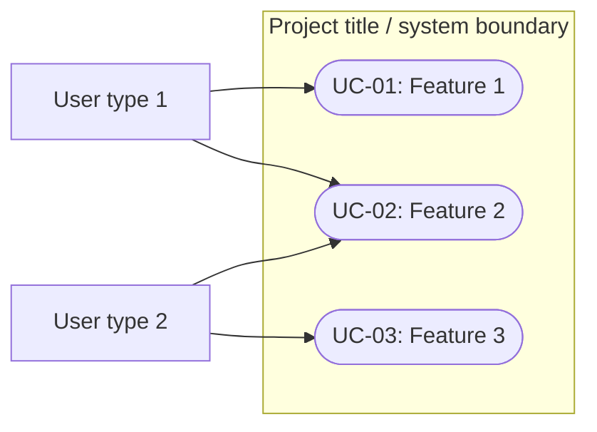
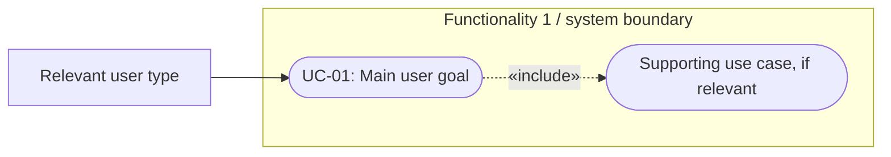

# Software Engineering — Requirements Specification

> **Template instructions:** Replace all text in `[square brackets]` with your project's information. Add or remove rows and repeatable subsections as needed. Keep task (`T-##`), deliverable (`D-##`), and work-breakdown (`WBS-#.#`) IDs consistent with your **Project Plan**; assign unique functional requirement (`FR-##`), non-functional requirement (`NFR-##`), user type (`UT-##`), persona (`P-##`), scenario (`SC-##`), user story (`US-##`), and use case (`UC-##`) IDs in this document. **Cover every planned feature/task with at least one corresponding requirement and use case.** The diagram and table entries below are placeholders, not completed project content.
>
> **Course guideline note:** The supplied outline refers to requirements-writing rules in lecture notes, but those notes were not provided. Check the final wording and level of detail against your instructor's lecture guidelines before submission.

## Cover Page

| Field | Details |
|---|---|
| **Course** | BLG 411E Software Engineering |
| **Report name** | Requirements Specification |
| **Project title** | [Project title] |
| **Group name / number** | [Group name] |
| **Group members** | [Name — Student ID], [Name — Student ID], ... |
| **Instructor** | [Instructor's name] |
| **Submission date** | [YYYY-MM-DD] |
| **Document version** | [e.g., 1.0] |

---

## 1. Introduction

Introduce the project briefly, explain the purpose of this document, provide information about the following sections.

---

## 2. System Requirements

### 2.1 Functional Requirements

Link each requirement to the matching task(s); use multiple requirements for one task when necessary. Connect it to a deliverable.

| Requirement ID | Related task ID(s) | Related deliverable ID(s) | Functional requirement (natural language) | Priority | Verification / acceptance condition |
|---|---|---|---|---|---|
| FR-01 | T-01 | D-01 | The system shall [perform an observable action] when [actor/condition]. | [Must/Should/Could] | [How successful behavior will be checked] |
| FR-02 | T-02 | [D-##] | The system shall [perform another action] when [actor/condition]. | [Must/Should/Could] | [Expected result or test] |
| FR-03 | T-03 | [D-##] | The system shall [perform another action] when [actor/condition]. | [Must/Should/Could] | [Expected result or test] |

**Functional requirement notes:**  
[State relevant business rules, input/output expectations, or dependencies that clarify the requirements. Give each additional behavior its own requirement ID if it needs independent verification.]

### 2.2 Non-functional Requirements

Describe the **quality attributes** and system-wide constraints relevant to the project. Where possible, state measurable conditions and how they will be evaluated; do not invent thresholds that the team has not agreed upon.

| Requirement ID | Quality attribute | Non-functional requirement (natural language) | Applies to | Verification / measurement |
|---|---|---|---|---|
| NFR-01 | Security | The system shall [enforce a specific access or data-protection rule]. | [Whole system / FR-##] | [Security check or test] |
| NFR-02 | Performance | The system shall [complete an operation within a defined limit under stated conditions]. | [Whole system / FR-##] | [Measured test and target] |
| NFR-03 | Usability | The system shall [satisfy a specific usability or accessibility criterion]. | [Target user type(s)] | [Usability/accessibility evaluation] |
| NFR-04 | Reliability | The system shall [handle a defined failure or availability condition]. | [Whole system / FR-##] | [Failure-recovery or reliability test] |
| NFR-05 | [Other, if relevant] | The system shall [meet an additional verifiable quality requirement]. | [Scope] | [Verification method] |

**Non-functional requirement notes / assumptions:**  
[Define ambiguous terms, supported environments, external constraints, and any conditions under which requirements must hold.]

---

## 3. Use Cases

### 3.1 User Types

List every relevant **user profile or external actor** of the software.

| User type ID | User type / actor | Description and responsibilities | Goals / typical actions | Related requirement ID(s) |
|---|---|---|---|---|
| UT-01 | [User type 1] | [Who this user is and their role] | [Actions/goals] | FR-01, [FR-##] |
| UT-02 | [User type 2] | [Who this user is and their role] | [Actions/goals] | FR-02, [FR-##] |
| UT-03 | [External system or additional role, if applicable] | [How it interacts with the software] | [Actions/goals] | [FR-##] |

**Access or role distinctions:**  
[Explain differences in permissions, knowledge, frequency of use, or other role-specific needs, if relevant.]

### 3.2 User Scenarios

Write a **short narrative for each scenario** above. Describe the persona's situation, intention, actions, the system's response, and the resulting outcome. These are readable stories; the formal, step-by-step specifications belong in Section 3.4.

**SC-01 — [Scenario title]**  
**Persona:** P-01 — [Persona name]  
**Related requirements:** FR-01, [FR-##]

[At the start of the situation, the persona is ... They want to ... They interact with the system by ... The system responds by ... The scenario ends when ...]

**SC-02 — [Scenario title]**  
**Persona:** P-02 — [Persona name]  
**Related requirements:** FR-02, [FR-##]

[Describe the scenario in natural, chronological prose, including context, actions, system response, and outcome.]

**SC-03 — [Scenario title]**  
**Persona:** [P-##] — [Persona name]  
**Related requirements:** FR-03, [FR-##]

[Add a narrative for each remaining entry in the scenario table.]

#### User Stories Linked to the Project Plan

The **Project Plan Section 2** notes that user stories for WBS subtasks belong in the separate requirements document. Write a user story for each relevant user-facing WBS activity (or explain if an activity is purely internal/technical), and keep the original `WBS-#.#` IDs.

| Scenario ID | Project Plan WBS activity ID | User story | Related requirement ID(s) |
|---|---|---|---|
| SC-01 | WBS-1.1 | As a [user type], [I want to ... so that ...]. | FR-01 |
| SC-02 | WBS-1.2 | As a [user type], [I want to ... so that ...]. | [FR-##] |
| SC-03 | WBS-2.1 | As a [user type], [I want to ... so that ...]. | FR-02 |
| SC-04 | WBS-3.1 | [User story, or an explanation of why this technical activity does not require a user story] | FR-03 |

### 3.3 Use Case Diagrams

Include **one diagram for the entire system** and **additional diagrams for each major software functionality**. Show actors, system boundaries, and use cases; ensure naming agrees with Sections 2 and 3.4.

The samples below use **PlantUML** for UML use case notation. Replace all sample names and connections. Markdown viewers without PlantUML support may display these as code; if necessary, export the final diagrams as images and embed them with standard Markdown image syntax.

#### 3.3.1 Whole-System Use Case Diagram

**Whole-system diagram notes:**  
[Explain the actors, major use cases, and any include/extend relationships, if they exist. Verify that every planned feature is represented.]

#### 3.3.2 Functionality-Specific Use Case Diagram — [Feature / Functionality 1]

**Functionality covered:** [T-01 / FR-01 / UC-01]  
**Diagram notes:** [Explain what is shown. Remove the illustrative `<<include>>` relationship unless it is accurate for your project.]

#### 3.3.3 Functionality-Specific Use Case Diagram — [Feature / Functionality 2]

[Add the corresponding PlantUML diagram or embed your exported UML diagram here. Reference T-02, FR-02, UC-02, etc. Repeat this subsection for **every additional functionality**.]

### 3.4 Use Cases

Write **at least one detailed use case for each feature/functional requirement from the Project Plan**, including **alternative flows**. One use case may reference multiple requirements if they form a single user goal, but no planned feature should be left undocumented. Use matching IDs across tables, diagrams, and use case descriptions.

#### 3.4.1 Use Case Coverage Matrix

| Project Plan task ID | Functional requirement ID(s) | Use case ID(s) | Scenario ID(s) |
|---|---|---|---|
| T-01 | FR-01, [FR-##] | UC-01 | SC-01 |
| T-02 | FR-02, [FR-##] | UC-02 | SC-02 |
| T-03 | FR-03, [FR-##] | UC-03 | SC-03 |

[Add rows until every feature/task from Project Plan Section 1.3 is covered. Document optional features only if they are included in the agreed project scope.]

#### 3.4.2 UC-01 — [Use Case Name]

| Field | Description |
|---|---|
| **Use case ID** | UC-01 |
| **Use case name** | [Verb + object describing the user goal] |
| **Goal / Purpose** | [What the actor wants to achieve and the value provided] |
| **Actor(s)** | UT-01 — [User type] |
| **Related Project Plan task(s)** | T-01 |
| **Related functional requirement(s)** | FR-01, [FR-##] |

**Pre-condition(s):**  
[Describe the observable conditions under which this use case is considered successfully implemented.]

**Main success flow:**

1. **Actor:** [Starts the task by performing an action.]
2. **System:** [Responds with the relevant information or functionality.]
3. **Actor:** [Provides input or selects an option.]
4. **System:** [Validates/processes the input and performs the expected behavior.]
5. **System:** [Confirms the result or presents the completed outcome.]

**Alternative flows:**

- **A1 — [Alternative path title] (branches from step [N]):**
  1. [Explain the condition that causes this alternative.]
  2. [Describe actor/system interactions on this path.]
  3. [State whether the flow returns to main step [N] or ends with a different outcome.]
- **A2 — [Second alternative path title] (branches from step [N]):**
  1. [Explain the alternative condition and the resulting behavior.]
  2. [Specify the next step or termination condition.]

**Exception / error flows (if applicable):**

- **E1 — [Error condition] (occurs at step [N]):** [Describe the system response, user feedback, recovery action, and final state.]

**Post-condition(s):**  
[Describe the observable conditions under which this use case is considered successfully implemented.]
